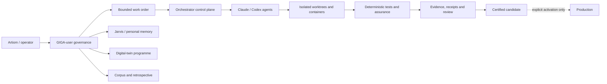
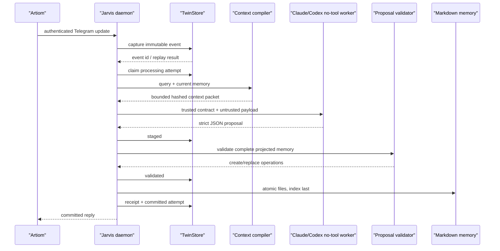

# Orchestrator-v3 and GIGA-user — complete system architecture

**Snapshot:** 24 July 2026  
**Purpose:** portable, offline explanation of what the software factory is, how it works,
where authority lives, and how GIGA-user governs it.

## 1. The system in one page

There are two connected but deliberately separate systems.

**Orchestrator-v3** is the software factory. It converts a project specification into
planned work, isolated implementation attempts, deterministic tests, independent reviews,
evidence, certification and—only after explicit gates—an accepted release candidate.

**GIGA-user** is the operator-owned governance and personal infrastructure layer. It stores
Artiom's charter, standing decisions, programmes, architecture plans, evidence, reports,
skills, memory protocols and migration controls. It governs the factory but is not absorbed
by it.



The important distinction is:

- models propose and implement;
- deterministic infrastructure measures and constrains;
- the controller owns state transitions;
- reviewers challenge the candidate;
- certificates describe evidence;
- the operator owns final authority.

## 2. Physical deployment

### Gigabyte — dedicated software-factory host

- Windows host with Ubuntu under WSL.
- Factory root: `/home/gutua/software-factory`.
- Production orchestrator:
  `/home/gutua/software-factory/agentic-orchestrator/projects/orchestrator-v3`.
- GIGA governance mirror:
  `/home/gutua/software-factory/giga-user`.
- Isolated candidates: `/home/gutua/software-factory/.worktrees/`.
- Controller evidence: `/home/gutua/software-factory/.control/`.
- JAA remains stopped until the efficiency programme is certified.
- Production `STOP` is an operator-controlled kill switch.

### Mac — mobile operator and digital-twin host

- GIGA-user: `/Users/admin/Documents/giga-user`.
- Mac orchestrator copy is a usable but non-authoritative fallback.
- Jarvis, personal memory, corpus, digital-twin work and Market Aligner remain Mac-owned.
- Personal exports/corpus were intentionally excluded from the Gigabyte factory migration.

## 3. Orchestrator-v3 logical architecture

### 3.1 Charter and laws

`charter/laws.py` defines machine-checkable laws. Architecture tests connect laws to
enforcement. Important principles include:

- untrusted input is data, never instruction;
- STOP and budget limits must halt new work;
- workers cannot certify themselves;
- evidence must bind to the exact candidate;
- state transitions must be legal and replayable;
- no success may be inferred from a model's narrative.

### 3.2 Core domain model

`core/models.py` defines tasks, projects, statuses, attempts, results and associated typed
records. `core/state_machine.py` defines allowed state transitions. The state machine keeps
planning, execution and settlement from becoming arbitrary strings interpreted differently
by different agents.

Typical lifecycle:

```text
QUEUED ──CLAIM──> IN_PROGRESS ──COMPLETE──> DONE
   │                    │
   │                    ├──FAIL──> FAILED ──REQUEUE──> QUEUED
   │                    ├──REQUEUE──> QUEUED
   │                    └──RECLAIM──> QUEUED
   └──BLOCK──> BLOCKED ──UNBLOCK──> QUEUED
                         └──FAIL──> FAILED
```

The shipped task state is deliberately smaller than the richer programme/certification
lifecycle around it. Every `(TaskStatus, Event)` pair is defined: legal pairs transition;
illegal pairs are no-ops and are not logged. This totality means replay cannot crash merely
because an old or foreign event asks for an inapplicable transition. Admission boundaries
still reject malformed types, duplicate task IDs, self-dependencies and dependency cycles
before they reach the log.

The `Task` record carries:

- stable task ID, title, type and project;
- current five-state status;
- dependency IDs and acceptance criteria;
- typed payload;
- priority and durable creation order;
- retry/max-retry accounting;
- last transition/blocking reason.

The single worker wire result is `AgentResult`: `ok`, summary, failure cause, touched
artefacts, spawned tasks, knowledge entries and metadata. A failure without a cause, a
non-Boolean success flag or malformed collection is rejected at deserialisation.

### 3.3 Agent layer

`agents/` contains specialised model-facing roles:

- `task_manager.py`: decomposes approved project scope into executable tasks.
- `builder.py`: implements a bounded task in an isolated workspace.
- `tester.py`: writes or runs verification without owning acceptance.
- `judge.py`: performs semantic review against explicit criteria and evidence.
- `common.py`: shared process and result contracts.
- `prompt_contracts.py`: trusted instructions and exact response expectations.

Agents are interchangeable providers behind contracts. Claude Sonnet is currently the
primary coding workforce; Codex coordinates and provides independent assessment. Provider
choice is policy, not architecture.

### 3.4 Control plane

`control/` owns orchestration rather than code generation:

- `daemon.py`: unattended factory loop.
- `programme.py`: project and stage progression.
- `project_loop.py`: repeated claim, execute, settle and reassess cycle.
- `factory_launch.py`: launch configuration and boot gates.
- `directives.py`: authenticated operator directives such as STOP/resume.
- `gate_runner.py`: invokes deterministic gates.
- `scoped_completion.py`: determines whether bounded work is actually complete.
- `project_completion.py`: project-level completion rules.
- `feedback.py`: turns findings into bounded corrective work.
- `scorecard.py`: measured progress and quality state.
- `self_test.py`: boot-time integrity checks.

Only the controller may admit work, assign authority or settle canonical state. Workers
return envelopes and artefacts; they do not directly declare themselves accepted.

### 3.4.1 Programme planning loop

The project loop is incremental rather than “plan everything once”:

1. A root goal enters as a planning task.
2. The planner returns one complete child graph for the next increment.
3. The entire batch is validated and appended as one `tasks_spawned` event.
4. Each child depends on the planning parent, preventing a crash between child admission and
   parent settlement from releasing half-admitted work.
5. The repository drains eligible children.
6. Current files plus durable DONE/FAILED outcomes become the next planning state.
7. A fresh incremental plan either opens more work or declares planner completion.
8. Completion gates run against the project, not the planner's claim.
9. A passing first completion may open one bounded improvement phase.
10. The project closes only when the durable completion path says it is closed.

Planning can be bypassed for scope-certified routine work by the deterministic workflow
compiler. The intended economics are: use code to compile known workflows; pay a planner only
where ambiguity genuinely remains.

### 3.5 Dispatch and isolation

`dispatch/` turns admitted work into constrained processes:

- `dispatcher.py`: chooses role/provider and failure-ladder behaviour.
- `runner.py`: executes an agent subprocess and captures the result.
- `container.py` and `isolation.py`: filesystem/process boundaries.
- `manifest.py`: declares allowed files, commands, tools and resources.
- `repository.py`: task/event repository and replay.
- `gate_runner.py`: deterministic command execution.
- `failure_fingerprint.py`: identifies repeated causal failures.
- `metrics.py`: execution and efficiency telemetry.
- `module_loader.py` and `registry_gen.py`: controlled capability loading.

Every attempt receives its own workspace/worktree. Candidate changes are inspected and
joined deliberately; a model is not allowed to edit production directly.

There are three distinct concurrency controls:

- `EventStore.append` permits multiple callers but serialises the read-sequence/write/fsync
  critical section with an OS advisory lock.
- `TaskRepository.claim_next` enforces a per-project in-progress cap, one by default, to
  prevent concurrent changes in one project tree.
- The newer factory turnstile gives model workers single-flight mutable access to a candidate
  and forbids tests while a writer is changing it.

These controls solve different races and must not be conflated.

### 3.6 Infrastructure

`infra/` supplies deterministic primitives:

- `canonical.py`: canonical serialisation and hashing.
- `atomic_io.py`: atomic write and directory-fsync semantics.
- `event_store.py`: append-only historical event stream.
- `snapshot.py`: replay acceleration with hash-bound fallback.
- `workspace.py` and `worktree.py`: candidate isolation.
- `llm.py`: provider invocation boundary and usage capture.
- `prompt_safety.py`: trusted-instruction versus untrusted-data separation.
- `usage_log.py`: token/call accounting.
- `context.py`: bounded context construction.
- `file_inventory.py`: exact candidate closure.
- `factory_policy.py`: deterministic provider/role policy.
- `triage.py`: failure classification.

#### Event-store durability

The canonical task history is JSONL. Every event contains a gapless integer sequence, finite
timestamp, kind and dictionary payload. Append performs:

1. exclusive file lock;
2. repair of any torn final line;
3. fresh on-disk last-sequence calculation;
4. append;
5. file fsync;
6. parent-directory fsync when creation/rename durability requires it.

Replay tolerates malformed/foreign records and a final line torn inside a multibyte UTF-8
code point. Corruption is skipped rather than allowed to brick every future boot. The task
repository is log-first: it appends before mutating memory, so disk-full cannot create live
state that replay would not reconstruct.

Snapshots are accelerators, not authorities. A snapshot is accepted only when its sequence
exists in the current log and its anchor identifies that same event stream. Otherwise the
system falls back to full replay.

#### Repository behaviour

`TaskRepository` rebuilds tasks, results, spawned-child lineage, failure fingerprints,
budgets, project-loop closure and cost events from the log. It:

- assigns deterministic creation order;
- rejects duplicate IDs and dependency cycles;
- selects ready tasks by priority then creation order;
- repeatedly blocks missing/failed/transitively blocked dependency chains to a fixpoint;
- releases recovered chains to a fixpoint;
- reclaims orphaned `IN_PROGRESS` work after a dead process;
- separates transient retries from hard failures;
- requires load-bearing knowledge on successful settlement;
- preserves exactly-once spawned batches and project-loop closure;
- keeps snapshots optional and recoverable.

The block/unblock sweep is dirty-flagged so it is not needlessly repeated after every claim.

### 3.7 Validation and assurance

`validation/` is intentionally separate from agent self-reports:

- acceptance execution and authentic test receipts;
- candidate and repository identity binding;
- deterministic assurance;
- semantic evaluation gates;
- pass-only evidence reuse;
- external-evidence validation;
- certification logs;
- efficiency telemetry.

Evidence is useful only when it proves:

1. exactly which bytes were tested;
2. which command/environment produced the result;
3. which candidate, gate and scope it applies to;
4. whether it is fresh or safely reusable;
5. whether usage is measured, missing or unknown.

Missing usage is never represented as zero.

### 3.7.1 Completion and certification chain

A project-level pass may require all of:

1. project test discovery and execution;
2. declared executable acceptance commands;
3. semantic judge review;
4. authenticity checks against empty/stub/deceptive implementation;
5. behavioural evaluation/non-regression where declared;
6. exact content-revision stability across the gate run;
7. a certification-log append bound to that revision.

Test and acceptance commands run through the isolation boundary without provider credentials
or network access. A gate that changes product content invalidates its own result. Partial
passes do not append a certification record.

The authenticity layer scans for empty bodies, placeholder markers, dynamic rebinding and
other ways a test-shaped repository can pretend to contain production work. Exemptions are
structural and explicit; the scanner itself has planted-violation controls.

### 3.8 Graph, memory and knowledge

- `graph/` maintains dependency and project-knowledge relationships.
- `memory/knowledge.py` stores append-only reusable knowledge.
- `memory/corpus.py` and readers ingest registered corpora as untrusted data.
- `memory/overseer.py` and `pulse.py` expose factory status and anomalies.
- `memory/rehydrate.py` reconstructs bounded context after restarts.

This is factory knowledge, not Artiom's personal-memory database.

### 3.9 Registry and scheduling

- `registry/agents.py` describes allowed agent roles and capabilities.
- `scheduling/` determines eligible work without letting priority destroy fairness.
- Manifests and registries define what exists; models do not invent capabilities.

Each agent manifest is a closed contract: role, module, allowed ports, declared tests and
model assignment. Module loading fails closed if a declared test is absent, does not collect,
times out or fails. Model assignment is expected to be receipt-backed rather than an
unmeasured preference.

### 3.9.1 Provider seam

`infra/llm.py` normalises Claude CLI, Codex CLI and Ollama behind one result shape containing
text, provider/model identity, token usage, cost, telemetry completeness and failure metadata.
It parses provider-specific streaming output, applies time/tool budgets and distinguishes
authentication, rate-limit, timeout, invalid-model and local-runtime failures.

The target provider model is a ladder:

```text
role → ordered provider/model rungs → availability evidence → selected rung
```

The architecture is provider-neutral; operational policy currently favours Sonnet for
implementation and Codex for independent review. Same-provider review is treated as a known
degradation, not silently equivalent to cross-provider independence.

### 3.10 Edge/API surface

`edge/cli.py` and `edge/server.py` expose operator-facing status and control surfaces.
They are adapters onto controller state, not parallel authorities.

The HTTP server is standard-library only. It replays repository state for each state request,
uses bearer-token authentication, binds loopback by default and exposes:

- dashboard and per-project counts;
- blocked/“needs you” grouping;
- STOP;
- confirmation;
- operator correction capture.

Remote access should be through SSH/Tailscale rather than broad unauthenticated binding.

## 3.11 Layering and machine-checked architecture

The inward dependency direction is:

```text
edge/control/agents
        ↓
dispatch/memory/validation/scheduling/registry/selfdev
        ↓
infra/graph/charter
        ↓
core
```

The precise contract lives in `pyproject.toml`. Architecture tests perform an AST import
walk even when the optional import-linter CLI is absent. Another scan makes
`infra.atomic_io` the sanctioned mutation layer. `charter/laws.py` stores laws as records
linked to enforcing tests, and a PRIME test fails if an active law lacks a collecting check.
Boot self-test refuses dispatch when those law checks cannot be proved.

## 3.12 Isolation and its honest boundary

Isolation is receipt-gated: merely finding a sandbox executable does not enable autonomous
dispatch. Certification binds the host, source digest, executable and negative/positive
drills. Agent environments receive only declared runtime/auth inputs and bounded working
paths.

The historic production boundary was macOS Seatbelt. Linux/WSL isolation work exists in the
factory development line, but portable containerisation remains a future improvement. The
target replacement must add:

- filesystem read as well as write isolation;
- PID/process isolation;
- exact network-egress policy;
- reproducible runtime images;
- explicit provider credential injection;
- cross-platform certification and escape drills.

No document should claim this future boundary is already production-certified.

## 4. End-to-end execution

1. The operator or an approved programme supplies a specification.
2. Scope admission hashes and freezes the effective work order.
3. The task manager decomposes only when deterministic compilation cannot.
4. The scheduler selects an eligible task.
5. A lease/fence prevents concurrent ownership.
6. The dispatcher creates an isolated attempt.
7. The builder produces a candidate delta and structured result.
8. Deterministic gates run against the exact candidate.
9. The tester and judge add independent evidence where required.
10. Findings become a bounded ledger; repairs address that ledger.
11. Candidate, tests, evidence and review are joined by exact identity.
12. Certification records commands, hashes, results, rollback and limitations.
13. Activation is separate. A certified branch does not silently become production.

### 4.1 Crash example

If the controller dies after a task is claimed:

- the durable log still says `IN_PROGRESS`;
- boot replays the log;
- `reclaim_orphans()` emits `RECLAIM`;
- the task returns to `QUEUED`;
- completed tasks remain DONE and are not repurchased.

If it dies after appending a child batch but before completing the planner:

- the child batch replays;
- every child remains dependent on the planner parent;
- the parent is reclaimed;
- children cannot race the retried parent.

If a snapshot is corrupt, stale or belongs to another log, full replay replaces it.

### 4.2 Failure ladder

Failures are classified before retry:

- transient provider/runtime failures may requeue without hard-failure penalty;
- deterministic input/code failures consume the bounded hard ladder;
- repeated equivalent failures are fingerprinted across replans;
- exhausted or structurally repeated failure becomes redesign/escalation rather than an
  infinite model loop;
- fleet claim and cost ceilings can halt admission independently of per-task retry count.

## 5. Deterministic Infrastructure programme

The DFI programme was created after measurement showed enormous token amplification and
repeated work. Its purpose is not to make model generation deterministic; it makes
admission, identity, execution, evidence, reuse and recovery deterministic.

Completed/certified stages include:

- DFI-00: factory epoch and daemon fencing.
- DFI-01: canonical serialisation, hashing and schema registry.
- DFI-02: structured finding ledger and lifecycle.
- DFI-03: deterministic workflow compiler.
- DFI-04: durable adapter/recovery and collaboration controls.
- DFI-05: scope admission and pre-model authority.

Current:

- DFI-06: full-versus-delta review economics plus the operator-authorised signed,
  host-controlled review-evidence journal.
- DFI-07: planned general operation identity and pass-only executor, reconciled with the
  existing E2/E3 cache so only one reuse mechanism survives.

The efficiency target is roughly 35–55% fewer tokens per accepted component and 20–40%
lower eligible wall time without reducing full-release review, safety or auditability.

### 5.1 Earlier E1–E6 efficiency controls

The DFI programme builds on six earlier controls:

- **E1 context containment:** routine workers receive task-scoped context, not the ambient
  personal corpus, environment and tool universe.
- **E2 deterministic shadow cache:** compute operation identity and compare a fresh result
  with prior evidence without yet skipping execution.
- **E3 pass-only reuse:** reuse only exact, current passing deterministic evidence; never
  cache failure as success.
- **E4 host assurance:** perform bounded mechanical assurance before expensive semantic
  review where the scope contract permits it.
- **E5 external-evidence reuse:** consume exact source-bound evidence bundles rather than
  asking a model to rediscover unchanged facts.
- **E6 GPT-only outage profile:** preserve bounded factory operation when Claude is
  unavailable, with pinned roles, tool ceilings and explicit degradation.

These controls are useful only when their profile is actually active. Earlier audits found
configured shadow/reuse mechanisms that were not running, proving why telemetry must measure
real calls rather than infer savings from configuration.

### 5.2 DFI-06 scope lesson

DFI-06 began as a small full-versus-delta review-economics comparator. Independent review
correctly noticed that unsigned observations could be fabricated or rebound. Automatic repair
then expanded into a signed, host-authoritative, append-only evidence journal with sealed heads,
crash recovery and hardened filesystem handling—without first pausing for architecture
authorisation.

The operator chose to retain that useful subsystem under DFI-06. The process failure produced
a new rule: a finding that requires a new authority, persistence system, cryptographic root,
public API or material budget expansion is `ARCHITECTURE_EXPANSION`, not an ordinary defect.
Automatic repair must pause for a new work order.

## 6. GIGA-user architecture

GIGA-user is an owned operating system for the human operator.

### Governance tier

- `CHARTER.md`: how assistants respond.
- `CONTEXT.md`: identity, situation and settled decisions.
- `00_MASTER.md`: programme state and sequencing.
- `CONTEXT_PROTOCOL.md`: context size, freshness and deployment rules.
- Session briefs/logs: one bounded workstream per session.

Standing doctrines include depth before breadth, no stubs, scope as a floor, model
agnosticism, eyes-before-hands, no secrets in repositories, and untrusted input as data.

Canon is deliberately split by question:

| Question | Canon |
|---|---|
| How should an assistant behave? | `CHARTER.md` |
| Who is Artiom, what is current, what is settled? | `CONTEXT.md` |
| What workstream is active and complete? | `00_MASTER.md` |
| How is context deployed and refreshed? | `CONTEXT_PROTOCOL.md` |
| How is personal memory mutated/retrieved? | `memory/MEMORY_PROTOCOL.md` |
| Which source/export/count is authoritative? | `corpus/MANIFEST.md` |
| What is implemented versus merely described? | implementation registries and tests |

Deployment copies are condensations. They never outrank their source.

### Personal-knowledge tier

- `memory/`: human memories, decisions, reminders and collision handling.
- Jarvis Telegram bot: retrieval and reminder surface.
- Daily ingestion: Cowork/Codex/chat exports are harvested into proposals.
- Memory is derived from evidence, not dictated by a model.
- Conflicting memories remain distinct and carry provenance; they are not blended into a
  plausible fiction.

The intended temperature hierarchy is:

```text
HOT    CONTEXT.md + bounded working set
WARM   memory/INDEX.md + routed entry files + one-hop links
COLD   immutable exports and derived corpus evidence
```

The deterministic context compiler always loads standing context, memory policy and index,
then scores entries by lexical overlap, due reminders and trigger matches. It selects at most
ten primary entries and eight linked neighbours, hashes every included document and caps the
packet at 120,000 characters by dropping complete low-priority entries rather than slicing
ambiguous fragments.

Memory files remain the human-auditable canon. SQLite operationalises attempts, receipts and
lineage; it must not become a second biography.

### Corpus and retrospective tier

- `corpus/`: namespace-isolated exports and manifests.
- Extraction scripts preserve source, timestamp, authorship and hashes.
- Retrospectives measure behavioural/reasoning patterns.
- Training datasets have deterministic splits, deduplication, privacy screening,
  credential quarantine and locked evaluation sets.

### Digital-twin control plane

`twin_core/` provides:

- transactional event/store boundaries;
- context compilation;
- memory proposals and validation;
- provider adapters;
- Telegram capture;
- health and maturity reporting;
- lineage reconciliation;
- external-proof and SOP compilation.

The maturity sequence is memory → corrected memory → speaking style → reasoning style →
scrutiny/prediction → tightly governed agency.

#### Twin trust kernel

`~/.giga/twin.sqlite3` is an owner-only SQLite/WAL store. It records:

- immutable captured events with idempotency keys, source, actor, observed/captured time,
  trust class, sensitivity and payload hash;
- processing attempts and legal attempt transitions;
- committed/failed/rejected/rolled-back receipts;
- goals, decisions and future action foundations;
- registered artefacts and append-only revisions;
- lineage and supersession rather than destructive overwrite.

Trust classes distinguish operator confirmation, source observation, third-party claim,
model inference and model output. Authority levels are explicit (`A0`–`A4`, `AX`). A model
inference is not promoted into operator authority merely because it is stored.

#### Telegram transaction



The model has no filesystem tools and no write authority. Replacements require the exact
current file hash. Deletion/path escape is forbidden. A prior committed receipt answers
replay without a second model call. Failure is captured as retryable rather than losing the
Telegram update.

#### Daily ingestion transaction

Daily capture uses the same proposal/receipt path:

1. deterministic extraction of local sessions and landed exports;
2. namespace and machine-turn filtering;
3. content fingerprinting;
4. fresh evidence before bounded historical backlog;
5. record and character budgets;
6. run-addressed delta artefact;
7. no-tool provider proposal;
8. whole-projection validation;
9. memory commit;
10. advance `seen` only after the committed receipt.

The older “any non-empty model reply marks the whole batch seen” path was replaced by this
transactional boundary.

### Skills and capability registry

- Skills encode reusable procedures.
- `skilltree/implementation-registry.json` distinguishes installed, implemented, tested
  and merely catalogued capabilities.
- Public taxonomies are evidence, not proof that a capability is deployed.

### Automation and monitoring

- Daily personal-knowledge ingestion.
- Prediction generation, later evidence matching and calibration.
- Cross-service monitoring.
- Jarvis provider fallback.
- Gigabyte migration verification and unattended service control.

### Prediction and calibration

The prediction ledger separates:

- immutable forecasts made before evidence;
- evidence with timestamps/provenance;
- an evidence fence preventing hindsight leakage;
- deterministic digital-trace resolutions where literal terms suffice;
- model adjudication where interpretation is unavoidable;
- calibration statistics after resolution.

AI generates forecasts in bulk; the operator is not required to type them manually. This is
not yet a trained “mind predictor”. It is an auditable forecast→evidence→adjudication dataset
that can later support a predictor and expose systematic reasoning gaps.

### Corpus and training boundary

Raw account exports are immutable source evidence. Derived snapshots, transcripts, reply
pairs and training candidates are reproducible views—not originals. Namespaces prevent one
ChatGPT account from overwriting another. Visible-branch extraction excludes abandoned
ChatGPT retries. Discord account-sent text is style evidence, not fabricated dialogue.

Fine-tuning is mode-aware:

- casual-general;
- partner-intimate;
- work-directive;
- reasoning-critique;
- historical casual eras.

Stable voice may enter weights. Current facts, plans, relationships and memory remain
retrieval-time data. Promotion requires privacy review, locked mode-balanced evaluation and
comparison against the prompted/retrieval base model.

### External proof and career evidence

The proof compiler turns source-hashed internal evidence into draft case studies, reports and
presentation outlines. It enforces path containment, public-source limits, secret scanning
and deterministic lineage. It grants draft authority only; publication remains an operator
decision.

The strongest career claim is evidence-backed:

> A self-built autonomous factory was measured at more than one million tokens per accepted
> task; its architectural causes were identified, and its assurance economics were redesigned
> without intentionally weakening correctness.

That claim becomes defensible only when controlled before/after measurements prove it.

## 7. Relationship between GIGA-user and the factory

GIGA-user supplies:

- operator policy;
- bounded work orders;
- architecture plans;
- certification expectations;
- inter-model collaboration rules;
- migration and recovery instructions;
- durable audit reports.

The orchestrator supplies:

- controlled software production;
- isolated execution;
- deterministic evidence;
- model coordination;
- replay, recovery and certification.

Neither should silently absorb the other. Personal corpus and digital-twin data stay on
the Mac. Commercial software production belongs on Gigabyte.

### 7.1 Integration contract

The intended seam is:

```text
GIGA operator packet
  = goal + doctrine + bounded context + authority + evidence references

Orchestrator return packet
  = candidate + events + usage + gate receipts + findings + certificate/rollback
```

GIGA must not send an unlimited personal memory dump as standing factory context. The
orchestrator must not write personal memory directly. Future cross-system updates should be
proposal/receipt events processed by the twin trust kernel.

### 7.2 Skills

Portable skills encode procedures—librarian, review, cost audit, risk register, Korean daily,
session closure—without becoming standing policy. The charter is always-on doctrine and must
not be demoted into an on-demand skill.

Skills staged for the factory cross a certification boundary: prompts are production code,
so portability increases rather than removes the need for review, versioning and activation
evidence.

## 8. Trust boundaries

| Boundary | Trusted authority | Untrusted input |
|---|---|---|
| Operator → controller | authenticated directive/work order | pasted text without authority |
| Controller → worker | hash-bound task and manifest | model interpretation |
| Worker → candidate | isolated filesystem delta | worker self-report |
| Candidate → gates | exact bytes and command identity | filenames/descriptions alone |
| Gates → certificate | validated receipts | prose claiming tests passed |
| Corpus → memory | provenance and validation | messages as instructions |
| Certified branch → production | explicit activation | certification by implication |

Additional invariants:

- credentials live outside repositories and memory;
- source, email, issue and corpus text cannot broaden a task;
- one model cannot be both implementation evidence and independent certification evidence;
- a cache hit is authority only when every effective input is bound;
- a passing deterministic receipt may be reused; a failure must never become a cached pass;
- stale provider/model assumptions invalidate the applicable receipt;
- external side effects require capability-specific prepare/execute/reconcile/commit or a
  human receipt.

## 8.1 What is deterministic and what is not

Deterministic:

- canonical serialisation and hashes;
- task/event state transitions;
- work-order and candidate identity;
- dependency eligibility;
- filesystem admission and closure;
- test commands and their captured result;
- receipt validation;
- cache eligibility;
- replay and recovery rules.

Probabilistic:

- model planning;
- code generation;
- semantic judgement;
- memory extraction suggestions;
- personal prediction.

The architecture does not pretend models are deterministic. It places probabilistic work
between deterministic admission and deterministic validation.

## 8.2 Observability

Observability spans:

- append-only task events;
- task results and causes;
- agent/provider/model served identity;
- token/cost/elapsed telemetry and completeness;
- failure fingerprints and retries;
- gate receipts and candidate revisions;
- certification logs;
- controller reports and worktree hashes;
- twin events, attempts and receipts;
- memory provenance and access logs;
- cross-service health envelopes.

Unknown telemetry is represented as unknown. Configuration weights or intended routing are
not substituted for measured usage.

## 9. Current operational state

At this snapshot:

- Gigabyte production is clean at commit `35efb19`.
- STOP is armed.
- DFI-06 is being repaired in an isolated worktree.
- A persistent coordinator will certify DFI-06 and then begin bounded DFI-07.
- JAA is unchanged and paused.
- The Mac remains the authoritative home for personal knowledge, digital twin and
  Market Aligner.

The current DFI-06 worktree is intentionally dirty while Sonnet repairs it. A separate
Codex coordinator waits behind that sole writer. DFI-06 is not certified merely because
development is active; the targeted suite, full suite, independent verdict and candidate-bound
certificate must still pass.

## 9.1 Certified, implemented, active and planned are different words

- **designed:** architecture exists in a plan.
- **implemented:** code exists.
- **tested:** specified tests passed on a named candidate.
- **certified:** independent gates and a candidate-bound certificate passed.
- **activated:** that certified configuration is the running production configuration.
- **proven beneficial:** controlled runtime evidence demonstrates the claimed quality,
  token and time effect.

This vocabulary prevents “the code exists” from being reported as “the saving is operating”.

## 9.2 Known limitations

- DFI-06/07 and later efficiency stages are not yet production-activated.
- The signed DFI-06 evidence-journal expansion is unfinished at this snapshot.
- Portable stronger containerisation is future work.
- Full live multi-provider factory operation remains an operational certification concern
  distinct from deterministic test substitutes.
- Fable cannot participate in unattended CLI execution; milestones must state that limitation.
- Personal knowledge remains much larger than a model context window; routing and provenance,
  not preload-everything, are the intended solution.
- GIGA Session 03 life infrastructure remains incomplete.
- Digital-twin P2 still needs natural-run and transition fault-injection evidence.
- Fine-tuned Artiom modes are not training-authorised.
- JAA remains paused until the efficient factory profile is certified and savings are proved.

## 10. Canonical supporting documents

- `architecture/01_LIGHT_MAP.md`
- `architecture/02_MEDIUM_MAP.md`
- `architecture/03_DEEP_MAP.md`
- `architecture/10_DETERMINISTIC_EXECUTION_BOUNDARY.md`
- `architecture/ORCHESTRATOR_V3_DETERMINISTIC_INFRASTRUCTURE_PLAN_2026-07-22.md`
- `reports/ORCHESTRATOR_V3_COMMERCIAL_READINESS_ROADMAP_2026-07-23.md`
- `reports/DFI06_OPERATOR_SCOPE_RATIFICATION_2026-07-24.md`
- `reports/GIGABYTE_UNATTENDED_CHECKPOINT_2026-07-24.md`
- `MODEL_AGNOSTIC_SPEC.md`
- `memory/MEMORY_PROTOCOL.md`
- `SKILLTREE_GIGA_USER_INTEGRATION.md`

This document is an architectural synthesis. Code, candidate-bound certificates and the
standing-decision registry remain authoritative when they disagree with prose.
