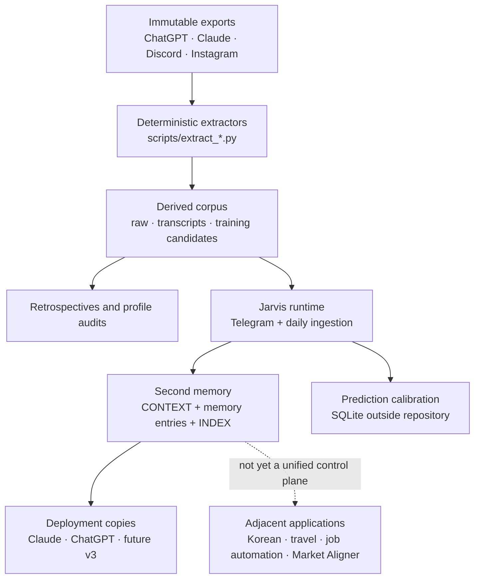

# GIGA light architecture map

*Discovery cycle 1 · surface pass · 2026-07-20*

## One-sentence model

GIGA is an operator-owned personal-intelligence workspace: immutable communication exports
feed deterministic extractors and derived corpora; those feed a plain-file memory, behavioural
retrospectives, style-training candidates and a Telegram librarian; a separate SQLite loop
attempts to calibrate forecasts; several adjacent applications are present but are not yet
unified behind one runtime or decision engine.

## Physical shape

Measured at discovery time (excluding common virtual-environment/cache directories):

- 9,327 files, approximately 3.3 GB after the separate ChatGPT archive landed.
- `corpus/`: ~1.1 GB, including both namespace-isolated ChatGPT derived views.
- Root archives: ~1.9 GB, chiefly the 1.17 GB second ChatGPT export plus Instagram and Discord ZIPs.
- `market-aligner/`: ~290 MB and 5,790 files; active product work, read-only here.
- `audit-work/`: ~51 MB and 1,913 files; orchestrator audit artefacts and a local audit venv.
- GIGA's direct runtime is small: `scripts/` ~416 KB, `memory/` ~196 KB, `deploy/` ~420 KB.

The high file count is therefore misleading: most code files belong to vendored environments,
audit snapshots or Market Aligner. The personal-twin core is a compact Python-and-Markdown
system surrounded by a large evidence lake.

## Major zones

## Canon hierarchy

| Question | Canonical source |
|---|---|
| Programme progress | `00_MASTER.md` |
| How assistants should behave | `CHARTER.md` |
| Identity, active situation, settled doctrine | `CONTEXT.md` |
| How memory is filed/retrieved | `memory/MEMORY_PROTOCOL.md` |
| Corpus provenance/counting | `corpus/MANIFEST.md` |
| Fine-tuning readiness | `FINE_TUNING_READINESS.md` plus prepared manifests |
| Prediction loop design | `PREDICTION_AUTOMATION.md` plus SQLite evidence |

## What is actually live

- `scripts/jarvis_telegram.py` is running under `scripts/run_jarvis.sh` and uses Telegram as
  the conversational memory surface.
- A scheduled daily knowledge pipeline harvests local AI-session prompts, selects a bounded
  delta, invokes Claude with a GPT/Codex fallback, updates memory and invokes prediction work.
- The latest observed ingestion succeeded through GPT, but the historical backlog was 17,657
  prompts while the bounded daily delta was 120.
- The read-only prediction worker is currently failing; the SQLite store has 20 forecasts,
  1,089 evidence records and zero adjudications.
- Separate UK job collection and processing loops are live outside this folder. They must not
  be stopped or folded into this implementation while Market Aligner productisation proceeds.

## Existing Graphify coverage

The graph contains 26 nodes, 33 links and 3 hyperedges. Every node originates in
`retrospectives/2026-07-deep-characterisation.md`. Its largest nodes are `Sovereign
Architect`, `First Sovereignty Prototype` and `Totalising Systemisation`.

It is useful as a map of the current characterisation narrative. It is **not** an architecture,
memory, corpus, runtime or code graph. Any model using it as the sole overview will miss nearly
the whole operational system.

The complete March 2023–July 2026 second-account review is not yet represented in this graph.
An incremental rebuild was attempted after the review, but Graphify has no configured LLM
backend in this workspace. Until a backend is deliberately supplied, use
`retrospectives/gpt2_2026-2023-03_to_2026-07-forward-ledger.md` as the authoritative account map.

## Surface verdict

GIGA already possesses four valuable primitives:

1. A large, owned longitudinal evidence corpus.
2. Explicit behavioural doctrine and a portable memory protocol.
3. Working ingestion/extraction code and a live conversational surface.
4. Early evaluation assets: retrospective evidence, style datasets and a forecast ledger.

What it does not yet possess is a single event model, a verified temporal truth layer, a goal
and preference model, a decision ledger, an authority policy, or a closed outcome-learning
loop. Consequently it currently remembers and describes Artiom better than it can safely act
for him.

## Cycle-1 cautions for other models

- Never write into an export or treat derived JSONL as an original.
- Never infer live truth directly from an old transcript; apply the recency law.
- Never equate style imitation with preference or decision accuracy.
- Never describe the prediction loop as healthy merely because the database exists.
- Never edit Market Aligner from the GIGA twin workstream while its independent product build
  is active.
- Do not add another memory store. The plain-file memory remains canonical; databases should
  index or operationalise it, not silently replace it.
