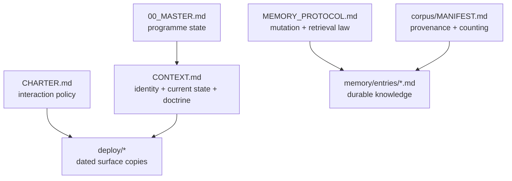
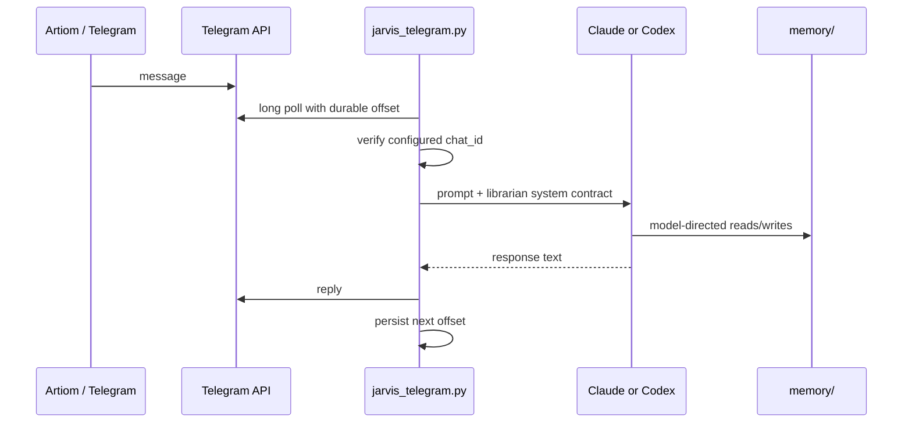
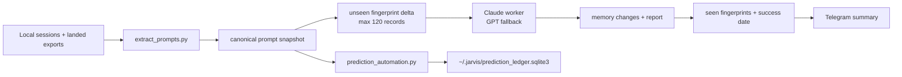

# GIGA medium architecture map

*Discovery cycle 2 · module and data-flow pass · 2026-07-20*

## System identity

GIGA is not one application. It is a personal operating-system workspace composed of:

1. **Governance canon** — objectives, response policy, current context and standing laws.
2. **Evidence lake** — immutable account exports plus reproducible derived views.
3. **Second memory** — portable Markdown knowledge with links, supersession and retrieval law.
4. **Jarvis runtime** — Telegram capture and a daily model-assisted ingestion/sweep.
5. **Evaluation substrate** — retrospectives, style datasets and behavioural forecasts.
6. **Domain systems** — career, Korean, travel, relationship/personal analysis, appearance and
   social-account operations.
7. **Future execution seam** — the separate orchestrator is intended to consume an operator
   packet and return action receipts, but that contract is not implemented here.

The system is best understood as a small control plane over a large private evidence lake,
not as a conventional monolithic codebase.

## Canon and authority

The separation is conceptually clean:

- `CHARTER.md` answers *how should an assistant behave?*
- `CONTEXT.md` answers *what is currently known and settled?*
- `memory/` answers *what durable facts, decisions and reminders exist?*
- `corpus/` answers *what evidence can substantiate or revise those claims?*
- `00_MASTER.md` answers *which programme deliverables exist and what is still open?*

Enforcement is primarily social. No validator currently proves that deployment copies are
fresh, master status matches real artefacts, links resolve, or canon files do not contradict
one another.

## Corpus pipeline

### Source classes

| Source | Canonical evidence | Derived use | Key limitation |
|---|---|---|---|
| Claude export | immutable ZIP/unpacked export | two-sided transcript, prompts, reasoning candidates | provider export boundary and mixed project material |
| First ChatGPT export | immutable 613 MB ZIP | canonical visible branches, prompts, two-sided transcript | no retained 2026 history and none before Sep 2023 |
| Second ChatGPT export | immutable 1.17 GB root ZIP, namespace `gpt2_2026` | canonical visible branches, prompts, two-sided transcript, reviewed chronology and reasoning candidates | Mar 2023–Jul 2026 with explicit Aug 2024 and Jan–Oct 2025 source gaps; mixed pasted/model/third-party material requires provenance triage |
| Discord export | immutable `package.zip` | one-sided account-sent JSONL, style analysis | sent does not prove independently composed; no reply context |
| Instagram export | immutable root ZIP | casual messages, context→reply pairs | third-party context and relationship dominance |
| Local Cowork/Codex | local session stores | daily operator-prompt snapshot | machine/imported/injected turns must be excluded |

The five source archive hashes are recorded in `EXPORT_IMMUTABILITY_BASELINE.sha256`. Discovery
performed only reads and hashes against them.

### Extractor responsibilities

- `extract_chatgpt.py`: walks the export's `current_node` ancestry, keeping the visible branch
  rather than abandoned retries; emits user prompts and two-sided transcripts; supports a
  stable namespace for a second account.
- `extract_discord.py`: reads only the Messages section, strips signed attachment URLs,
  preserves provenance and labels composition as unverified/style-only.
- `extract_instagram.py` and `build_instagram_pairs.py`: convert Instagram material into casual
  records and direct-reply pairs.
- `extract_prompts.py`: creates the canonical multi-surface operator-prompt snapshot, chooses
  the newest ChatGPT snapshot per namespace, excludes known machine sessions and deduplicates
  imported Codex overlap.
- `prepare_finetune_data.py`: produces versioned, hashed, leakage-aware training candidates;
  separates direct replies, operator-next-turn examples and style-only text.

### Integrity boundary

The manifest correctly says that snapshots are not additive and that training views are not
raw evidence. Two operational deviations remain:

1. Same-day extract runs overwrite `prompts_<date>.jsonl` and its Markdown rendering, so the
   so-called raw snapshot is mutable within a date.
2. `corpus/inbox/daily_delta_<date>.jsonl` is likewise reused within a date.

This does not alter the export archives, but it prevents complete reconstruction of what a
specific ingestion run saw. Content-addressed or run-addressed derived snapshots are needed.

## Memory architecture

The store currently contains 42 entry files:

- 25 facts
- 10 reminders
- 6 decisions
- 1 idea

Forty are active and two are explicitly superseded. Every entry has YAML frontmatter. The
index contains five duplicated working-set links plus the complete entry list, as intended.

### Retrieval and mutation laws

- One thought per file.
- Never delete; archive or supersede.
- FILE → COLLIDE → REMIND → INGEST.
- Apply the recency law: historical statements are dated evidence, not live state.
- Load linked entries one hop beyond a routed memory.
- Log accesses and compute a five-item recent working set.
- Treat `CONTEXT.md` as the hot identity/state tier, memory entries as the warm tier and the
  corpus as cold evidence.

### Current distribution problem

The memory was seeded during travel and is correspondingly travel-heavy: 13 entries carry the
travel tag, while several strategic domains have only one or two entries. This is not proof
that travel dominates Artiom's enduring preferences; it is a capture-period distribution.
Retrieval and model evaluation must distinguish *frequency in the store* from *importance to
the operator*.

### Missing technical layer

No deterministic router currently builds a bounded memory packet. The model is instructed to
read the index, choose entries, follow links and cite slugs. There is no executable check for:

- unresolved links;
- missing/asymmetric supersession;
- provenance presence;
- temporal validity;
- confidence or verification state;
- contradictions between active facts;
- retrieval precision/recall on a locked question set;
- exact files a response actually consulted.

## Jarvis conversational path

Positive properties:

- one authorised chat ID;
- durable offset and first-contact backlog drain;
- Claude-first/Codex-fallback availability;
- one canonical memory store;
- explicit gap naming and source-slug instruction.

Failure properties:

- A failed librarian returns “try again” but the offset is still committed. There is no local
  durable inbox, retry state or dead-letter queue.
- A model can access the full GIGA root. Claude is launched with permissions bypassed; the
  “write only inside memory” boundary is not a filesystem capability.
- Successful reply text is not a commit receipt. Jarvis does not validate which files changed
  or whether the index remains correct.
- The configuration holding the bot token is mode `0644`, not owner-only.

## Daily knowledge path

The Telegram daemon, rather than launchd, is the effective clock because the launchd path hit
macOS Documents/TCC restrictions. It starts the daily process after 06:00 in a hard-coded
Asia/Ho_Chi_Minh timezone.

The state records 2,824 seen fingerprints and the latest run processed 120 through GPT. At
the last measured run, 17,657 records were pending, almost all historical ChatGPT material.
The queue therefore mixes two different jobs:

- current daily change capture, where latency matters;
- historical backfill, where conversation cohesion and throughput matter.

Any non-empty model reply marks the whole 120-record batch seen. There is no per-record
receipt, diff validation or proof that every accepted memory write contains provenance. A
partial model pass can therefore acknowledge evidence it never incorporated.

## Prediction/calibration path

`prediction_automation.py` is a hybrid deterministic/probabilistic design:

- Deterministic code fingerprints recent evidence, validates forecast fields and dates,
  prevents unknown provenance, rejects duplicate open event keys, stores immutable forecasts,
  fences pre-forecast evidence and computes calibration statistics.
- A read-only model proposes forecasts and adjudicates explicit real-world evidence.
- Digital-trace forecasts precommit literal match terms and are resolved by exhaustive code,
  not model judgement.

The database has useful provenance tables for evidence, metadata, adjudications and runs.
However, its current operational state is not healthy:

- 20 forecasts exist, all unresolved.
- 1,089 evidence rows exist.
- zero adjudications exist.
- the read-only Claude command is malformed for the installed CLI;
- the read-only GPT path has also failed in the live environment.

This ledger measures whether future topics/events were forecast, not whether GIGA's advice was
good. Decision-quality calibration requires a separate decision/outcome schema.

## Style and thinking-model path

The fine-tuning design correctly separates weights from memory:

- weights may learn stable register, compression, critique and mode-conditioned behaviour;
- current facts and plans remain retrieval-time data;
- direct reply, operator next turn and style-only data are never conflated;
- evaluation compares base, prompted/retrieval base and fine-tuned model;
- promotion requires blind preference plus privacy, mode-isolation and factual-restraint gates.

Current prepared assets are sufficient for experiments but not promotion. The blockers are an
operator-reviewed mode map, Discord authorship/function triage, curated reasoning examples,
locked multi-mode evaluations and a successful baseline training run. Speaking like Artiom is
therefore behind memory accuracy and should remain there.

## Retrospective and self-model path

The retrospectives contain the deepest current reasoning about operator patterns. They provide
monthly/relationship evidence ledgers and a characterisation narrative. Their value is
epistemic rather than operational: there is no automated hypothesis lifecycle linking a claim
to corroborating/contradicting evidence, operator verdict, expiry and downstream artefacts.

The existing graph is exclusively a graph of one characterisation report. A source correction
does not automatically invalidate graph nodes, deployed context, training candidates or
recommendations derived from the old claim.

## Domain systems inside or adjacent to GIGA

| Domain | Current artefact | Integration state |
|---|---|---|
| Career/job search | Market Aligner plus job-application automation plan | active independent commercial build; not controlled by Jarvis |
| Korean | fixed v2 operating system, drills, milestones and logs | self-contained but not observed by Jarvis as structured state |
| Travel | flight-price product goal and travel memories | goal staged; no live flight intelligence product in GIGA |
| Life infrastructure | Session 03 brief for Gmail/Calendar/morning brief | not started; external state absent |
| Social cleanup | Instagram unfollow plan/progress | standalone state files; no generic action receipt contract |
| Orchestrator | v3 design/audit/contract documents | intended execution engine, deliberately read-only from GIGA |
| Client work | memory entries and future external-product goal | not a structured project/outcome feed |

The phrase “combine all GIGA functionality” therefore means normalising these systems behind
shared event, goal, decision, authority and receipt interfaces—not merging every codebase into
one directory.

## Medium-depth architectural verdict

The system already has a credible **epistemic substrate**:

`source evidence → derived views → portable memory → context-aware model`

It lacks a trustworthy **operational substrate**:

`durable event → verified state transition → decision → bounded action → receipt → outcome → calibration`

The next implementation should not replace Markdown memory or interrupt active products. It
should add a small trust kernel beneath Jarvis: immutable event/receipt records, deterministic
memory validation and retrieval, a goal/decision model, technical authority gates and locked
evaluations. All domain tools can then become adapters around that kernel.
