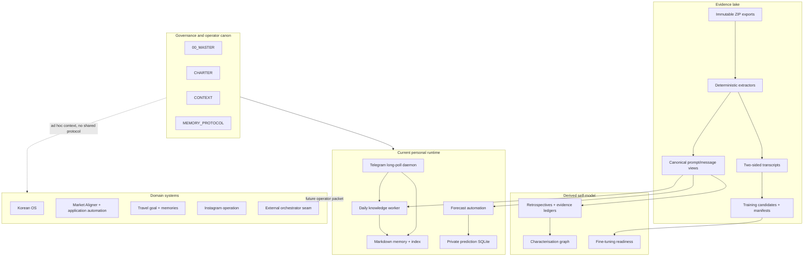

# GIGA deep architecture map

*Discovery cycle 3 · code, schema and runtime validation pass · 2026-07-20*

## Confidence statement

This map is based on:

- complete top-level and three-level file inventories;
- direct reads of every GIGA control document, brief, session log, memory entry, runtime
  script, test and training contract;
- deterministic scans of every JSONL derived corpus/training file (counts, schemas, date
  ranges, hashes and parse validity without reproducing private text);
- production SQLite schema/content inspection;
- live process, state and log inspection;
- the complete 12-test GIGA suite, Python compilation and shell syntax checks;
- SHA-256 verification of all four source export archives before and after discovery.

Market Aligner was inspected only at its public architecture/readme boundary. Its code and
state were not modified because an independent commercial build is running. Large exports
were treated as immutable binary evidence; derived scanners read them or their canonical
views and wrote no changes into them.

## Definitive subsystem map

## File-level control plane

| Artefact | Actual responsibility | Mutability | Current truth status |
|---|---|---|---|
| `00_MASTER.md` | session/workstream status and sequencing | manually updated | partially stale/internally says “five” while listing six |
| `CHARTER.md` | assistant response behaviour | versioned document | deployed, natural-use review still open |
| `CONTEXT.md` | hot identity/situation/doctrine | canonical manual state | stale: says Discord awaited and 35 entries |
| `CONTEXT_PROTOCOL.md` | tier cadence and deployment staleness | stable protocol | not mechanically enforced |
| `memory/MEMORY_PROTOCOL.md` | FILE/COLLIDE/REMIND/INGEST and retrieval laws | stable protocol | good design, model-enforced |
| `memory/INDEX.md` | always-loaded routes + working set | rewritten by librarians | structurally coherent, contains sensitive travel routing |
| `corpus/MANIFEST.md` | source inventory/counting/limitations | updated on landings | counts match deterministic scan |
| `FINE_TUNING_READINESS.md` | training gates and runbook | planning/control | accurately says training unauthorised |
| `PREDICTION_AUTOMATION.md` | forecast-loop contract | planning/control | architecture accurate; operational-health implication stale |

Canon drift is currently detectable only by a careful reader. There is no `giga validate`
command, schema or build receipt binding statements to measured state.

## Immutable evidence and complete derived-corpus scan

All five source hashes passed verification. The canonical derived files all parsed with zero
JSON errors and zero blank records:

| View | Records | Verified span/shape |
|---|---:|---|
| canonical prompts | 20,358 | Sep 2023–19 Jul 2026; 787 Cowork, 2,120 Claude, 17,109 ChatGPT, 342 Codex |
| ChatGPT human prompts | 17,109 | Sep 2023–Dec 2025 |
| ChatGPT transcript | 35,678 | 17,109 human + 18,569 assistant |
| second-account ChatGPT prompts | 7,556 | Mar 2023–19 Jul 2026; namespace-isolated pending the next canonical multi-source harvest |
| second-account ChatGPT transcript | 15,214 | 7,556 human + 7,658 assistant; 1,199 text-bearing conversations |
| Claude transcript | 4,301 | 2,115 human + 2,186 assistant |
| Discord account-sent | 83,779 | Aug 2022–7 Jul 2026 |
| Instagram canonical | 13,295 | Oct 2023–17 Jul 2026 |
| Instagram reply pairs | 7,062 | all schema-valid |
| ChatGPT reasoning candidates | 14,361 | operator-next-turn, unapproved |
| second-account ChatGPT reasoning candidates | 6,168 | operator-next-turn, unapproved; provenance/function triage pending |
| Claude reasoning candidates | 1,861 | operator-next-turn, unapproved |
| prepared casual train/valid/test | 6,490 / 100 / 468 | all modes unassigned; test hash matches lock |
| prepared provenance | 7,058 | source/split records |
| quarantine | 1 | possible credential, retained outside training splits |

The manifest's record counts agree with disk. The locked test SHA-256 also agrees with
`test.lock.json`. This is the most mechanically trustworthy layer of GIGA.

### Export boundary

The source archives themselves are immutable by convention plus the new checksum baseline.
No operating code checks those hashes before extraction. The baseline also has no automated
encrypted backup/restore test. Integrity is now observable, not yet continuously enforced.

### Derived-view identity

`extract_prompts.py` names the canonical snapshot by calendar day. Multiple executions on one
day rewrite the same pathname. Consumers use the lexicographically latest filename, not a
manifest pointer or content ID. The snapshot hash is stored by prediction runs, but memory
ingestion receipts do not exist. Reproduction of “what exactly did the librarian see?” is
therefore incomplete.

## Exact daily-ingestion state machine

### Fingerprint contract

Each record is hashed from sorted JSON containing exactly:

`ts`, `text`, `source`, `session`, `channel`.

The state is a JSON document outside the repository containing a list of seen hashes, the last
successful Vietnam date, provider and delta filename. It is mode `0644`.

### Initialisation

If no state exists, `load_state()` hashes the **oldest** prompt snapshot and treats it as
already ingested. This intentionally avoids replaying original material, but it makes the
state dependent on whatever happens to be the oldest matching file rather than an explicit
bootstrap receipt.

### Selection

The latest snapshot is scanned entirely. Unseen records are sorted by string timestamp; the
first 120 become the batch. Current measured production state:

- state hashes: 2,824;
- hashes matching the current snapshot: 2,821;
- current unseen: 17,537;
- unseen by channel: 16,989 ChatGPT, 342 Codex, 205 Cowork, 1 Claude.

The difference between state size and current overlap proves that “seen” is not synonymous
with membership in the current canonical snapshot.

### Model authority

The Claude worker runs with `--dangerously-skip-permissions`. The Codex fallback runs with
`--dangerously-bypass-approvals-and-sandbox`. Both receive the whole GIGA root as cwd. The
prompt limits writes to memory and the manifest, but the operating system does not.

### Commit rule

Any successful provider process returning non-empty text causes all 120 fingerprints to be
added to state. No code checks:

- how many input records were considered;
- which memories were created/amended;
- whether claimed files exist;
- whether the index and links remain valid;
- whether provenance/as-of fields were attached;
- whether a model stopped halfway through the delta.

Thus “processed” currently means “a model returned text,” not “a validated state transition
was committed.”

### Scheduling

The deployed launchd plist exists, but `launchctl` has no loaded service by that label. The
Telegram daemon's `_maybe_start_daily()` is the real scheduler. It uses
`Asia/Ho_Chi_Minh`, starts after 06:00, and attempts only once per local date. Timezone is
compiled into both daily and prediction code rather than read from operator state.

## Exact Telegram state machine

1. Load token/chat ID and durable offset from `~/.jarvis`.
2. On first contact, advance beyond existing Telegram backlog without processing it.
3. Long-poll; advance an in-memory offset for each update.
4. Discard messages from any chat except the configured ID.
5. For text, call Claude then Codex; either model can mutate the workspace.
6. Send the reply.
7. Persist the offset after the attempt.

The comment claims failed work will not be swallowed, but `_librarian()` converts total model
failure into ordinary reply text. The loop then persists the offset. The user is told the
message is “safe,” while no local queue contains it and no automatic retry exists. Telegram
history remains the only recovery source.

There is also no idempotency key around model writes. A crash after mutation but before offset
commit can redeliver and rerun the mutation. The file protocol encourages collision handling,
but it is not a transaction mechanism.

## Memory truth model in detail

### Current strengths

- All 42 entries have frontmatter.
- Superseded items are preserved.
- Corrections are often appended with dates and explicit sources.
- Recent automated amendments mark themselves unreviewed and cite exact delta lines/sessions.
- The five-stage twin roadmap is operator-ratified and model-neutral.

### Current schema deficiency

Frontmatter supports only type, tags, created, trigger and status. Important semantics are
embedded in prose rather than machine fields:

- `source` and source fingerprint;
- `observed_at` versus `valid_from`/`valid_until`;
- operator-confirmed versus corpus-derived versus inferred;
- confidence and review state;
- sensitivity/access class;
- supersedes/superseded-by as resolvable identifiers;
- subject and scope;
- contradiction group;
- action/reminder lifecycle.

Consequently deterministic validation cannot distinguish a verified fact from an unreviewed
historical extraction without natural-language interpretation.

### Retrieval deficiency

The working set is access-frequency based and the full index is always loaded. There is no
query-to-entry scorer, temporal filter or sensitivity gate. A PNR, ticket number and date of
birth are stored in an ordinary fact and summarised in the hot index route. “No secrets” is
therefore narrower than the actual privacy problem: not-secret but operationally sensitive
data is still overexposed to every provider packet.

### Link state

Most wiki links point to entry slugs, but the syntax is also used for conceptual references
such as `career clock` and `MEMORY_PROTOCOL`. There is no namespace or validator defining which
links must resolve to entry files and which are conceptual. A future validator needs an
explicit exemption/reference scheme rather than treating every bracket as a broken file.

## Forecast ledger internals

### Data boundary

The production database is `~/.jarvis/prediction_ledger.sqlite3`. Core prediction CRUD and
calibration statistics are dynamically imported from a hard-coded external certified project,
overridable through `JARVIS_PREDICTION_LEDGER_ROOT`. GIGA then adds four tables:

- `auto_prediction_metadata` — event/domain/scope/rule/provider/basis;
- `auto_prediction_evidence` — timestamped source text and processing flags;
- `auto_prediction_adjudications` — outcome/evidence/provider/coverage;
- `auto_prediction_runs` — snapshot hash, counts and errors.

### Validity rules

- Confidence is an integer 5–95.
- Target date must be 1–30 operator-local days ahead.
- Scope is limited to captured prompts or explicit real-world evidence.
- Candidate basis hashes must belong to the supplied generation batch.
- Duplicate open semantic event keys are rejected.
- Later evidence must be strictly after forecast creation.
- Model real-world resolutions require ≥90 confidence and evidence.
- Literal prompt forecasts resolve through deterministic exhaustive substring scans.

These are strong controls and the four focused tests pass.

### Production divergence

Two run records exist. The first ingested 1,089 evidence rows but could not invoke a model. The
second generated 20 forecasts with GPT. All are captured-prompt forecasts, concentrated on the
current job/application work. None is resolved and no adjudication exists.

The current read-only worker failures are command-integration defects, not ledger defects.
Claude parsed prompt words as deny-tool arguments; GPT also failed its runtime invocation.
Session 05's statement that the loop is “live” is therefore historically true for generation
but false as a current health assertion.

The complete test run passes but emits many `ResourceWarning` messages for unclosed SQLite
connections inside the external certified repository/statistics implementation. This does not
currently fail correctness tests but is a lifecycle defect worth fixing in that external
project, not by patching the imported dependency from GIGA.

## Training architecture in detail

`prepare_finetune_data.py` enforces three semantic classes:

1. direct reply (other-person context → Artiom reply);
2. operator next turn (AI answer → Artiom correction/acceptance/question);
3. style only (Artiom/account text without prior context).

Pair preparation performs exact deduplication, possible-credential quarantine, privacy flags,
optional cloud redaction, deterministic group/month splitting and identical-context
coalescence. The output manifest remains `training_authorised: false`; the 468-item test hash
is locked and matches disk.

What the current data can support:

- a mixed Instagram reply-style baseline;
- historical register analysis;
- curation of critique/steering behaviour.

What it cannot yet support:

- a general “Artiom” adapter;
- independent problem-solving/thinking-style claims from operator-next-turn data;
- safe cloud training without third-party review;
- mode routing, because every prepared example is currently `unassigned`;
- promotion, because locked multi-mode and reasoning evaluations do not exist.

## Domain integration reality

### Korean

The Korean OS is a complete standalone programme with phase gates, daily/weekly measurements,
anti-burnout rules and disaster recovery. GIGA does not ingest its log into a structured goal
state or automatically detect slippage. It is a high-quality document, not a live adapter.

### Career

Market Aligner already embodies a useful decision pattern: probabilistic extraction/judgement
behind schemas and caches, followed by deterministic scoring and reports. It is the natural
first consumer of a GIGA decision/receipt interface. It remains an independent product and
must not be physically absorbed or modified from this workstream.

The separate `job-application-automation/` directory contains build plans, not the active
implementation. Production work is occurring through the external Korea Job Scraper and
orchestrator instances.

### Travel, social operations and client work

These exist as goals, memories or standalone JSON state. They do not implement a common
project/event/action interface. Their inclusion in the future twin should be through adapters,
not ad hoc reads of unrelated files.

## Verification matrix

| Check | Result |
|---|---|
| GIGA unit tests | 12/12 PASS |
| Python compile | PASS for all scripts |
| Shell syntax | PASS for all shell scripts |
| JSONL parse scan | zero invalid records across all canonical/training JSONL views |
| Export SHA-256 | four of four PASS after discovery |
| Training test lock | hash matches |
| Jarvis process | live |
| launchd service | not loaded |
| Daily latest provider | GPT |
| Forecast worker | unhealthy in latest logs |
| Forecast resolution | 0/20 |
| Root version control | absent |
| Market Aligner isolation | respected; no changes made |

## Root causes, not symptoms

1. **No trust kernel.** LLM text is mistaken for a commit receipt.
2. **No shared event schema.** Memory, goals, reminders, predictions, applications and social
   operations each model lifecycle differently or not at all.
3. **No temporal truth schema.** Recency exists as prose law but not queryable state.
4. **No authority engine.** “Read-only” and “write only here” are usually prompts/CLI flags,
   not a centrally validated capability decision.
5. **No outcome ledger.** Forecast calibration exists; advice/action utility does not.
6. **No derived-artefact registry.** Corrections do not invalidate all downstream products.
7. **No machine health contract.** Master/session prose can say “live” while production is
   degraded.
8. **No bounded operator packet.** Each model decides what context to load.

## Deep-pass conclusion

GIGA has enough evidence and enough design doctrine to begin the virtual-twin build. More raw
collection is not the bottleneck. The bottleneck is converting model-mediated file mutation
into validated state transitions and converting advice into measured decisions/outcomes.

The correct first implementation is a provider-neutral trust kernel alongside—not instead of—
the existing Markdown memory:

- append-only event and receipt storage;
- deterministic memory schema/validation and retrieval packets;
- goal, preference, decision and outcome schemas;
- authority classifications and technical write scopes;
- health/status derived from machine evidence;
- locked retrieval/decision evaluations;
- adapters for Telegram, daily ingestion and later domain systems.

Only after this kernel proves accuracy should style training or autonomous execution receive
promotion authority.
