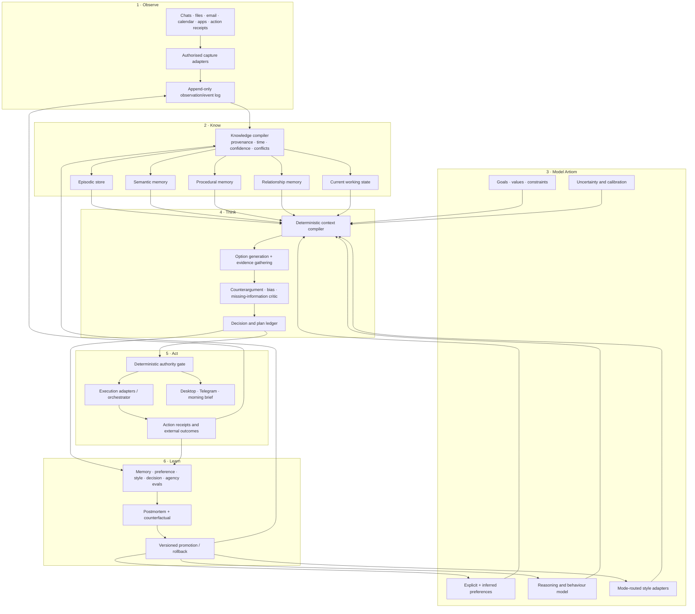

# Virtual Artiom target architecture

*P2 · end-state specification · 2026-07-20*

## Mission

Build a local-first, provider-independent virtual twin that can faithfully remember Artiom's
life, model his stable preferences and ways of reasoning, communicate in the appropriate
version of his voice, improve his judgement, and complete authorised work in his favour—while
remaining corrigible, auditable and unable to silently turn inference into biography.

The external forcing function remains material AI/IT results by 31 December 2026. The twin is
not successful because it resembles Artiom in conversation; it is successful when it improves
his memory, decisions, execution and outcomes without corrupting truth or authority.

## What “contains all my memories” means

It must not mean placing every conversation into a context window or baking mutable life facts
into model weights. It means the twin can address the entire authorised evidence corpus and
compile the right bounded packet for the present situation.

The target separates:

- **Episodic memory:** what happened, when, where, with whom and from which source.
- **Semantic memory:** durable facts and concepts believed to be true.
- **Procedural memory:** how Artiom performs recurring work and prefers systems to operate.
- **Decision memory:** options considered, rationale, choice, prediction and outcome.
- **Relational memory:** people, roles, interaction history and privacy boundaries.
- **Prospective memory:** commitments, reminders, deadlines and trigger conditions.
- **Working memory:** current goals, plans, active constraints and recent context.
- **Behavioural model:** preferences, reasoning tendencies, habits and uncertainty—not facts.
- **Voice model:** mode-conditioned language behaviour—not biography.

Every important memory must be retrievable with provenance and temporal validity. The model
may summarise memory; it may not become the only copy of memory.

## Target system

## Architectural layers

### 1. Immutable observation layer

Every authorised input becomes an append-only event with:

- stable event ID and source fingerprint;
- event time, capture time and source timezone;
- source/account/channel and actor provenance;
- content reference or bounded payload;
- sensitivity and retention class;
- trust class: operator statement, external observation, third-party claim, model output;
- parent/reply/causal links where known.

Original exports remain outside the event store as immutable evidence. Events refer to them;
they do not rewrite them.

### 2. Knowledge compiler

The compiler converts observations into proposed knowledge. It performs deterministic checks
before model-assisted interpretation:

- schema and provenance validation;
- exact/near duplicate detection;
- temporal normalisation;
- source priority and recency comparison;
- contradiction/supersession detection;
- sensitivity routing;
- derived-artefact dependency registration.

The output lifecycle is:

`proposed → corroborated | operator-confirmed → active → superseded | expired | disputed`.

LLMs may propose facts and links. Only validated transitions may change canonical memory.

### 3. Layered memory

Markdown remains the human-auditable source of truth for durable personal knowledge. SQLite or
another local index supplies transactions, search, dependency tracking and telemetry; it does
not silently become a competing biography.

A response packet contains only:

1. a bounded canonical core;
2. current working state;
3. retrieved memories passing time/sensitivity filters;
4. one-hop neighbours and contradictions;
5. citations to supporting events;
6. explicit gaps and unresolved conflicts.

### 4. Operator model

The twin needs four distinct models that must never be collapsed into one confidence-free
profile:

| Model | Learns | Evidence |
|---|---|---|
| Values/goals | desired outcomes and trade-offs | explicit decisions, goal files, corrections |
| Preferences | recurring choices and mode/domain tastes | explicit statements + repeated choices |
| Cognitive model | problem decomposition, challenge response, biases, habits | decision histories, retrospectives, held-out predictions |
| Voice model | register, rhythm, compression, multilingual switching | authorised mode-labelled language data |

Every inferred preference carries evidence, confidence, scope and counterexamples. An explicit
current correction outranks a historical behavioural pattern. “Artiom often did X” must never
become “Artiom wants X” without a preference inference and uncertainty.

### 5. Decision intelligence

When a decision trigger appears, the system creates a record rather than responding ephemerally:

- affected goals and stakeholders;
- deadline and cost of delay;
- hard constraints;
- options, including do nothing;
- supporting/contradicting evidence;
- predicted outcomes, probability and confidence;
- reversibility, downside, regret and information value;
- recommendation and dissenting critique;
- operator choice or autonomous policy decision;
- later outcome, repair cost and lesson.

The twin should model both *what Artiom would choose* and *what best advances his ratified
goals*. These can differ. When they do, it must say so rather than optimising for imitation.

### 6. Planning and counsel

Plans are live state machines, not prose checklists:

`proposed → accepted → ready → running → blocked → completed | abandoned`.

Tasks carry dependencies, due dates, resource budgets, evidence of completion and a link to the
decision that created them. The twin continuously asks:

- What changed?
- Which assumption is now false?
- What is the highest-leverage next action?
- What can run unattended?
- What requires Artiom's judgement?
- Which commitment is being crowded out?

Counsel must include a calibrated recommendation, evidence, decisive uncertainty and the
strongest counterargument. Emotional support can match the relevant mode without pretending
that empathy supplies missing facts.

### 7. Authority and action

Authority is deterministic data evaluated before tool access:

| Level | Meaning |
|---|---|
| A0 | observe and remember only |
| A1 | recommend and remind |
| A2 | prepare a complete action; require approval |
| A3 | execute reversible, low-cost actions inside explicit scope/budget |
| A4 | execute broader delegated workflows with monitoring and rollback |
| AX | never autonomously execute under current policy |

Every action declares capability, target, maximum cost, reversibility and expected receipt.
Credentials remain outside prompts and repositories. Untrusted content never modifies policy.
Irreversible, high-cost, medical, legal, major financial and sensitive relationship decisions
default to AX/A2 regardless of model confidence.

### 8. Provider and model layer

The twin is a system around models, not one model:

- provider gateway with measured ladders and health state;
- identical provider-neutral context packet;
- role-specific model selection (retrieval, drafting, critic, judge, local/private);
- mode-specific voice adapters selected explicitly;
- local inference where privacy or availability justifies it;
- prompt/model/dataset version on every significant output;
- no model-generated “success” without an external receipt.

Fine-tuning changes stable behavioural priors. Retrieval supplies mutable truth. A base model
plus excellent retrieval remains the rollback baseline for every adapter.

### 9. Self-observation and improvement

The twin observes both Artiom and itself:

- what Artiom accepts, rejects, edits or ignores;
- repeated procrastination and task-switch patterns;
- forecast calibration by domain/horizon;
- reminder usefulness versus annoyance;
- retrieval misses and false memories;
- recommendation outcome and counterfactual regret;
- autonomous completion/repair rate;
- model/provider cost, latency and availability;
- style preference and cross-mode leakage.

Self-improvement produces proposals, tests and promotion receipts. It cannot rewrite its own
constitution, authority policy, evaluation set or source history without explicit governance.

## User experience at maturity

### Continuous, mostly invisible

- Captures authorised state changes.
- Maintains goals, commitments and memory freshness.
- Watches for contradictions, deadlines and degrading plans.
- Runs bounded background research/processing.
- Evaluates its own retrieval and recommendations.

### Daily

A concise briefing answers:

1. What changed?
2. What matters today and why?
3. What is likely to go wrong?
4. What should Artiom decide?
5. What can the twin execute?
6. What did yesterday's actions produce?

### On demand

Artiom can ask factual, reflective, planning, counselling or execution questions through any
surface and receive the same memory-grounded answer. Mode affects voice, not truth.

## Promotion scorecard

Thresholds should be calibrated, but promotion requires all categories—not a single aggregate
score.

| Capability | Minimum evidence before promotion |
|---|---|
| Memory coverage | locked questions across life domains; source recall and important omissions measured |
| Accuracy | false-memory, stale-answer and contradiction rates below ratified limits |
| Reminder quality | useful-action rate and annoyance/false-trigger rate measured over time |
| Preference model | predicts held-out choices and names uncertainty/counterexamples |
| Voice | blind mode-specific comparison beats strongest prompted baseline without privacy leakage |
| Thinking | reproduces decisive constraints on held-out decisions and improves outcome forecasts |
| Counsel | recommendations produce measured benefit or reduced regret versus baseline |
| Planning | dependency/deadline adherence and plan-repair quality measured |
| Agency | bounded tasks complete with valid receipts, low repair rate and zero authority violations |
| Portability | provider extinction and local restore drills pass |

## Non-goals and failure definitions

The target is not:

- a model that parrots old messages;
- a chatbot with a larger system prompt;
- an omniscient autobiographical narrative;
- an agent that performs irreversible actions because it sounds confident;
- a second memory database that silently disagrees with Markdown;
- a folder that physically absorbs every product;
- an endless introspective project without external career/user outcomes.

The twin fails if it is eloquent but wrong, faithful to old habits but harmful to current
goals, autonomous but unauditable, personalised but privacy-leaking, or architecturally rich
without improving Artiom's real outcomes.

## End-state acceptance statement

Virtual Artiom is mature when an authorised fresh installation on Artiom's computer can ingest
the canonical corpus and memory, reconstruct its operator model, pass locked memory/style/
reasoning/authority evaluations, survive a primary-provider outage, produce the same bounded
daily priorities across providers, complete delegated reversible work with receipts, explain
why it acted, and learn from measured outcomes without rewriting history or exceeding its
authority.

