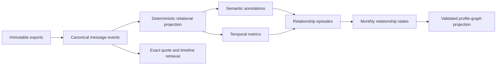

# Relationship event graph: four-friend pilot

*P3 relational-memory design · 2026-07-22*

## Decision

Build an **event-sourced temporal knowledge graph**, not a neural network as the source of
truth. A future embedding model or temporal graph neural network may consume the graph, but
neither may become the authority for who said what or when.

The system has three strictly separated layers:

1. **Evidence:** immutable messages, actors, timestamps, threads and source pointers.
2. **Deterministic structure:** replies, sessions, initiation, response times, direct/group
   context, meetings and topic segments where explicitly recoverable.
3. **Interpretation:** speech acts, disclosure, support, humour, hierarchy, conflict, repair,
   warmth and relationship-state estimates, each probabilistic and linked to evidence.

The pilot covers Artiom's four principal current friends:

- Andrei Kavaliou / Bottle;
- Serge Sotskyi;
- Allen;
- Joel.

Definition/Anton remains a high-value historical extension but is not allowed to widen the
first implementation slice. Rinat is excluded by operator calibration.

## Why the current graph is insufficient

`graphify-out/graph.json` contains 26 high-level characterisation nodes and 33 edges. It is a
useful semantic map, but it cannot answer:

- who authored a specific sentence;
- the original platform, thread, message ID and timestamp;
- what a message replied to;
- who reopened a conversation;
- what happened immediately before and after a disclosure or conflict;
- whether a relationship changed month by month;
- whether a claim is direct evidence or later interpretation.

The friendship graph must therefore be a new evidence subsystem. It will later project only
validated people, relationship states and episodes into the full profile graph.

## Architectural fit

The design extends the existing virtual-twin architecture rather than creating a competing
biography.

The existing `TwinStore.events` table remains the append-only trust kernel. Relationship
tables are rebuildable projections over those events. Markdown remains the human-auditable
canon for durable conclusions; the graph supplies evidence retrieval and temporal structure.

## Source coverage for the pilot

| Friend | Direct evidence | Group evidence | Principal limitation before Telegram |
|---|---|---|---|
| Andrei | Discord outgoing; selected two-sided Telegram excerpts pasted into AI | historical guild contexts | no complete two-sided recent thread |
| Serge | complete two-sided Instagram direct thread | Brotein Shake | some offline events exist only as chat references |
| Allen | Discord outgoing and two-sided Instagram | occasional shared/group context | platform transitions and offline context are incomplete |
| Joel | two-sided Instagram direct thread | Brotein Shake | newer relationship; much interaction is group/offline |

The Telegram export is expected to repair Andrei most strongly and may add direct or group
coverage for the others. The entire Telegram export must be preserved, but the first semantic
pass remains restricted to the four-person pilot and the complete group threads necessary to
interpret their messages.

## Canonical identifiers and identity resolution

Identity is resolved before semantic analysis.

### Stable IDs

- Person: `person:andrei_kavaliou`
- Account: `account:discord:bottle0_0`
- Thread: `thread:telegram:<native_chat_id>`
- Message: `message:<platform>:<account_namespace>:<chat_id>:<native_message_id>`
- Session: `session:<thread_id>:<first_message_id>`
- Episode: `episode:<relationship_id>:<content_hash>`
- Relationship: `relationship:artiom:andrei_kavaliou`
- State window: `state:<relationship_id>:<yyyy-mm>`

If a platform has no stable native message ID, derive one from a versioned canonical tuple:

`sha256(platform | source archive hash | archive member | record position | actor | original timestamp | content hash)`

### Identity registry

Each person can own multiple accounts and aliases. Mappings have provenance and a lifecycle:

`candidate → corroborated → operator_confirmed → superseded | disputed`

Current pilot mappings include:

- Andrei Kavaliou = Bottle = Ботол = `bottle0_0`;
- Serge Sotskyi = Serge = Serjo;
- Allen = Discord/Instagram account identities to be pinned from exports;
- Joel = Instagram/Telegram identities to be pinned from exports.

Names alone never merge identities. Native account IDs, cross-platform self-reference,
conversation evidence and operator confirmation do.

## Evidence schema

Every message event retains enough information to reconstruct the exact source:

| Field | Purpose |
|---|---|
| `event_id` | trust-kernel event ID |
| `message_id` | stable cross-build message ID |
| `platform` / `account_namespace` | source separation |
| `source_archive_sha256` | immutable export identity |
| `source_member` / `source_position` | exact location inside export |
| `native_chat_id` / `native_message_id` | platform identity where supplied |
| `author_account_id` / `author_person_id` | actor provenance |
| `recipient_person_ids` | explicit direct recipients or group membership |
| `original_timestamp` | exact source value |
| `timestamp_utc` | normalised query value |
| `source_timezone` / `timezone_basis` | known, platform-derived, or assumed |
| `timestamp_precision` | second, minute, day, or unknown |
| `edited_at` / `version` | edit history where present |
| `reply_to_message_id` | native reply link where present |
| `forwarded_from` | third-party authorship boundary |
| `content_text` or restricted `content_ref` | message body without losing provenance |
| `media_refs` | attachments, voice notes, images and call records |
| `content_sha256` | integrity and deduplication |
| `authorship_class` | authored, forwarded, pasted, bot/system, unknown |
| `sensitivity` | internal, sensitive, restricted |
| `coverage_class` | complete two-sided, one-sided export, selected paste, inferred gap |

The source text is never replaced by a cleaned version. Normalised text, translation,
transcription and redaction are separate derived fields or nodes.

## Core node and edge model

### Evidence nodes

- `Person`
- `Account`
- `Platform`
- `Thread`
- `Message`
- `MessageVersion`
- `Media`
- `Place`
- `Project`
- `Event`

### Deterministic nodes

- `ConversationSession`
- `TopicSegment`
- `OfflinePlan`
- `Meeting`
- `InteractionEpisode`
- `Relationship`
- `TimeWindow`

### Interpretive nodes

- `SpeechAct`
- `Disclosure`
- `SupportBid`
- `SupportResponse`
- `ConflictMove`
- `RepairMove`
- `AffectionSignal`
- `StatusMove`
- `RelationshipState`
- `RelationshipHypothesis`

### Representative edges

Evidence edges:

- `Person OWNS Account`
- `Account AUTHORED Message`
- `Message IN_THREAD Thread`
- `Message SENT_TO Person`
- `Message REPLIES_TO Message`
- `Message QUOTES Message`
- `Message FORWARDS_FROM Account|UnknownActor`
- `Message MENTIONS Person|Place|Project`
- `Message DUPLICATE_OF Message`
- `Message HAS_VERSION MessageVersion`

Derived edges:

- `Message STARTS_SESSION ConversationSession`
- `Message PART_OF ConversationSession|TopicSegment|InteractionEpisode`
- `Episode EVIDENCES RelationshipState`
- `Annotation SUPPORTED_BY Message|MessageSpan`
- `Relationship HAS_STATE RelationshipState`
- `RelationshipState VALID_DURING TimeWindow`
- `ProfileClaim SUPPORTED_BY Episode|Message`
- `ProfileClaim CONTRADICTED_BY Episode|Message`

Every derived edge records `method`, `processor_version`, `created_at`, `confidence_class`,
`confidence_score`, and source message IDs. Extracted edges have confidence 1.0; inferred
edges cannot masquerade as extracted.

## Three analytical layers

### Layer 1 — exact interaction structure

Derived without an LLM:

- message totals by author, platform, thread and month;
- direct versus group exposure;
- conversation/session initiator;
- reply depth and response latency where reply or ordering data allows it;
- gaps, bursts, return after gap and platform migration;
- question/answer direction;
- message length, media use, language and register;
- plans, calls and meetings only where explicit patterns or native event types identify them;
- completeness warnings for one-sided Discord and selected pasted chats.

Session boundaries begin with a 12-hour inactivity heuristic because it is already used in the
friendship analysis. The pipeline must also run 4-hour and 24-hour sensitivity checks. Any
conclusion that changes materially under the boundary is labelled threshold-sensitive.

### Layer 2 — message and span annotation

Model-assisted, multi-label annotations are attached to the smallest supporting span:

- question, answer, request, invitation, refusal, advice, correction;
- humour, teasing, affection, gratitude, praise, contempt, reassurance;
- self-disclosure, vulnerability, crisis disclosure, relationship disclosure;
- practical support, emotional support, instrumental help, teaching;
- disagreement, challenge, escalation, withdrawal, boundary, apology, repair;
- future planning, shared project, travel, money, work, dating, identity and other topics;
- status comparison, audience performance, management/optimisation attempt;
- uncertainty, irony and context dependence.

An annotation is a proposal, not a fact. High-impact categories such as contempt,
manipulation, crisis, hierarchy and repair require either human calibration or agreement from
an independent critic pass before entering relationship summaries.

### Layer 3 — temporal relationship model

The unit is a monthly state plus event-driven change points, not one timeless friendship
label. Each relationship window estimates:

- initiation and maintenance symmetry;
- reciprocity and response availability;
- direct/group ratio;
- topic breadth and role specialisation;
- disclosure depth and reciprocity;
- affection and humour density;
- practical and emotional support exchange;
- shared planning and offline integration;
- conflict frequency, escalation and repair latency;
- advice-versus-listening balance;
- equality-versus-management dynamics;
- gap/return behaviour;
- evidence coverage and uncertainty.

The output is a vector with evidence, not a score of friendship quality. For example,
`high cognitive intimacy + low direct initiation + high group continuity` is more useful than
“closeness = 7.4.”

## Relationship episodes

Messages alone are too granular for interpretation, while monthly summaries are too coarse.
The bridge object is an `InteractionEpisode`, such as:

- an ordinary check-in;
- a planning session;
- advice around a real problem;
- an affectionate exchange;
- a conflict and its aftermath;
- a disclosure and response;
- an invitation and completed meeting;
- a return after a long silence;
- a group performance followed by a private conversation.

Each episode has explicit start/end message IDs, participants, thread context, topic segments,
deterministic metrics, proposed interpretation and coverage warnings. It must be possible to
open the original sequence from every episode summary.

## Group-context rule

Do not extract only direct messages. Brotein Shake is necessary to understand Serge and Joel;
guild/group contexts may be necessary for Andrei and Allen. A private dyad behaves differently
when an audience is present.

The pilot therefore ingests:

1. all direct threads with the four friends;
2. complete group threads in which those relationships materially operate;
3. all participants in those group threads as contextual actors;
4. semantic relationship analysis only for the four target dyads.

This preserves audience, coalition, teasing and status effects without expanding the pilot
into a full social-network analysis.

## Deduplication and authorship

The same exchange may appear in Telegram, a ChatGPT paste and a Claude paste. Never delete
the latter silently. Preserve all observations and link them:

- native Telegram message = primary interaction evidence;
- pasted excerpt = `REPRESENTS` or `DUPLICATE_OF` native messages;
- surrounding AI prompt = evidence that Artiom selected the exchange for later analysis;
- AI answer = model output, never evidence of what the friend thought.

Discord remains one-sided. Missing replies are explicit gap nodes or coverage flags; they are
never reconstructed from Artiom's next message.

Forwarded messages, copied text and screenshots retain the original speaker where known. The
sender who forwarded something is not automatically its author.

## Storage and projections

### Authoritative layer

- immutable provider exports under `corpus/*-export/`;
- SHA-256 manifests;
- append-only message observations in `~/.giga/twin.sqlite3`.

### Rebuildable local projection

Add a relationship projection database or schema under `~/.giga/`, generated only from
receipted source events. Recommended tables:

- `people`, `accounts`, `aliases`, `identity_assertions`;
- `threads`, `thread_participants`;
- `messages`, `message_versions`, `message_links`, `media`;
- `sessions`, `session_membership`, `topic_segments`;
- `annotations`, `annotation_evidence`, `annotation_reviews`;
- `episodes`, `episode_messages`;
- `relationships`, `relationship_states`, `state_evidence`;
- `projection_builds`, `source_coverage`, `quality_findings`.

SQLite is sufficient for the pilot and keeps privacy local. Export graph views to GraphRAG
JSON, GraphML or Neo4j only as derived artefacts. Do not make Neo4j or Graphify the sole copy
of evidence.

### Neural/embedding layer

After exact retrieval passes its gate:

- message and episode embeddings can provide semantic retrieval;
- clustering can surface recurring interaction modes;
- temporal embeddings may support change-point detection;
- a graph neural network is justified only after a labelled prediction task exists, such as
  predicting whether a support bid receives engagement or whether a relationship goes quiet.

Extreme factual accuracy comes from source provenance and deterministic retrieval, not from
neural weights.

## Queries the pilot must answer

Exact retrieval:

- What exactly did Andrei say about his mother's visa, and what preceded it?
- Who initiated the conversation and after what gap?
- Show every message in which Artiom or Serge explicitly used brother/love language.
- What did Joel say before and after the Christmas 2025 friendship exchange?
- Which Allen disclosures were direct, forwarded or selected later for AI analysis?

Dynamic retrieval:

- When did each friendship move from game/university context into adult planning?
- Which friend most often reopens a quiet private channel?
- Does Artiom respond differently to practical problems and emotional disclosures?
- How often does disagreement lead to withdrawal, continuation, or repair?
- When does advice become management, and how does the other person respond?
- Are group interaction and private intimacy moving together or diverging?

Every answer must return message/episode IDs, timestamps, source pointers, coverage caveats and
the inference path.

## Telegram export landing protocol

When the export arrives:

1. **Freeze it.** Copy or move nothing destructively. Record absolute path, byte size,
   SHA-256, capture time and provider export settings in a manifest.
2. **Inspect structure read-only.** Determine JSON schema, chat types, account identity,
   timestamp representation, native IDs, replies, edits, forwards, calls and media references.
3. **Reconcile counts.** Count chats, messages, authors, direct/group threads, span and
   malformed/unsupported records before extraction.
4. **Create a canonical derived view.** Suggested path:
   `corpus/raw/telegram_messages_primary_YYYYMMDD.jsonl`; one record per native message with
   source-member and source-position provenance.
5. **Resolve identities.** Pin Telegram accounts for Andrei, Serge, Allen and Joel using native
   IDs plus operator-confirmed aliases.
6. **Select the pilot without truncating context.** Include all four direct threads and whole
   relevant group threads. Preserve the complete export for later expansion.
7. **Deduplicate across representations.** Link Telegram messages to Discord migrations,
   Instagram overlap and pasted ChatGPT/Claude excerpts. Do not delete provenance-distinct
   copies.
8. **Run integrity gates.** Reconcile raw-to-canonical counts, verify timestamps and authors,
   check duplicate IDs, verify hashes and sample message sequences manually.
9. **Build evidence graph first.** No semantic relationship labels until exact sequence
   retrieval passes.
10. **Register derived artefacts.** Record source hashes and build commands in the existing
    trust kernel.

Telegram credentials, session files and unrelated private data must never enter Git, prompts,
Graphify output or training datasets.

## Validation and promotion gates

### Gate R0 — source fidelity

- 100% raw-export hash preservation;
- 100% canonical records trace to archive member and position;
- native message/chat IDs preserved where available;
- author and timestamp reconciliation passes on a stratified manual sample;
- no model processing is required to reconstruct an exact conversation slice.

### Gate R1 — identity and chronology

- all four principal identities operator-confirmed;
- no unresolved alias silently merged;
- duplicate and pasted representations linked without record loss;
- reply and edit chains verified on a sample;
- timezone assumptions exposed.

### Gate R2 — deterministic relationship metrics

- session counts stable or explicitly threshold-sensitive across 4/12/24-hour boundaries;
- initiation, direct/group and response metrics reproduce from a clean build;
- one-sided and selected-source coverage cannot be mistaken for complete dialogue;
- monthly metrics reconcile with raw counts.

### Gate R3 — semantic annotation

- locked human-reviewed sample across all four friends and all main annotation classes;
- precision/recall reported by label, not only as one aggregate;
- high-impact interpretations require critic agreement or operator review;
- every annotation opens its supporting message span;
- irony/ambiguity and missing context support abstention.

### Gate R4 — relationship claims

- every material claim cites episodes/messages and names coverage;
- historical state cannot surface as current state without temporal validation;
- operator corrections are recorded as calibration, not retroactive deletion of evidence;
- profile-graph projection contains validated summaries only;
- exact-message and timeline questions beat manual `rg` lookup on a locked test set.

## Implementation sequence

### Phase A — schema and deterministic extractor

- freeze canonical schemas and identity registry;
- implement Telegram extractor with source manifests;
- adapt Instagram and Discord into the same message-event contract;
- add relationship projection migrations and clean-rebuild command;
- test counts, identity mapping, timestamps, edits, replies and idempotency.

### Phase B — exact graph and retrieval

- build people/account/thread/message/session nodes;
- implement quote, timeline, before/after and initiator queries;
- create a locked exact-retrieval suite;
- stop if evidence retrieval is not perfect enough to audit manually.

### Phase C — episodes and semantic annotation

- topic segmentation and episode formation;
- versioned multi-label annotator plus independent critic;
- human calibration sample and active-learning queue;
- monthly state vectors and detected change points.

### Phase D — full-profile integration

- project validated relationship nodes into the greater profile graph;
- connect relationships to places, life stages, projects, travel, crises and goals;
- expose GraphRAG/MCP queries with evidence citations;
- keep exact evidence local and sensitivity-filtered.

## Initial delivery target

The first useful release is not a beautiful graph visualisation. It is a local query that can
answer, reproducibly:

> “Show the complete source-grounded sequence around this relationship event, identify each
> author and timestamp, state who initiated it, and separate observed behaviour from inferred
> dynamics.”

Once that works for ten locked episodes per friend, relationship-state modelling can begin.

