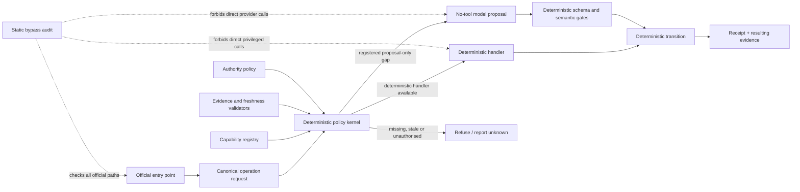

# Deterministic execution boundary — architecture decision

*Design only · 2026-07-22 · not deployed · grants no new authority*

## Decision

GIGA should enforce deterministic-first execution through a **small in-process policy kernel**, a
single **canonical capability registry**, and a **static bypass audit** over every declared official
entry point.

It should not begin with a daemon, MCP server, prompt rule, database migration or operating-system
sandbox. Those mechanisms either add operational surface or fail to express the decisive rule:

> For an official GIGA operation, deterministic code decides eligibility, evidence, authority and
> completion. A model may generate a typed proposal only when the registry explicitly permits it.
> The model cannot grant authority, claim completion or choose to bypass the deterministic path.

This is the smallest architecture that can turn the current convention into a testable guarantee.
The guarantee is intentionally bounded to **registered official execution surfaces**. It cannot
prevent the repository owner from running arbitrary Python or replacing the local database.

## Why this is now the right slice

The portable ECC extraction is complete and its freeze permits design review. Current source
inspection shows that GIGA already has most of the required primitives:

- deterministic context compilation in `twin_core/context_compiler.py`;
- no-tool Claude/Codex proposal generation in `twin_core/provider_adapters.py`;
- deterministic proposal validation and commit in `twin_core/memory_proposals.py`;
- append-only events, attempts and receipts in `twin_core/store.py`;
- replay-before-provider behaviour in `twin_core/telegram_pipeline.py`;
- read-only adapter evidence and operator-status compilers;
- a tested schema-v3 candidate whose database concerns are separate from execution routing.

What is missing is a single mandatory decision point. Today:

- Telegram and daily memory use the safe proposal lifecycle, but call it by convention;
- the daily prediction worker invokes providers through a second direct implementation;
- Jarvis starts the daily process directly;
- standalone scripts can perform writes, subprocesses or network calls without consulting one
  canonical capability policy;
- the evidence registry describes adapters but deliberately grants no execution authority;
- no check proves that all official entry points pass through the same decision boundary.

## Options considered

| Option | What it guarantees | Cost / weakness | Decision |
|---|---|---|---|
| Documentation or prompt rule | Intent only | Any caller or model can ignore it | Reject |
| Persistent gateway daemon / MCP | Central runtime choke point | New process, credentials, recovery, schema-token and availability tax | Defer; unjustified now |
| OS sandbox as primary control | Filesystem/process/network containment | Too blunt; cannot decide evidence, proposal status, authority or truthful completion | Defence in depth only |
| In-process kernel + registry + bypass audit | Official paths must obtain a deterministic decision; bypass fails tests | Does not control arbitrary owner shell commands | **Select** |

## The architecture

There is no always-on service in the first version. The kernel is a pure local library called in
the same process as the CLI, scheduled worker or daemon. A persistent service may be reconsidered
only if multiple independent processes later need atomic cross-process scheduling that SQLite and
the current event/receipt lifecycle cannot supply.

## One canonical request

Every governed operation enters the kernel as a closed, versioned request. The minimum fields are:

- request schema and operation ID;
- stable idempotency key;
- capability ID and caller/entry-point ID;
- bounded input or input evidence hashes;
- requested authority and target;
- maximum cost/time/token budget;
- reversibility class and expected receipt type;
- current configuration/registry version.

Unknown fields fail validation. Missing evidence remains unknown; it never silently becomes an
empty or successful value.

## One canonical capability registry

The existing adapter-evidence registry remains a **read-only evidence surface**. Execution policy
must be a separate registry so evidence cannot accidentally become authority. Each capability entry
must bind:

- stable capability and operation IDs;
- the deterministic resolver/handler, if one exists;
- whether a model proposal is permitted, and for which exact gap;
- input, proposal, result and receipt contract versions;
- required evidence, maximum age and revalidation method;
- maximum authority and mutation boundary;
- cost, token and timeout ceilings;
- idempotency and replay rules;
- rollback or explicit `not-reversible` classification;
- approved official callers;
- owner, tests and source hashes.

Registry loading must be deterministic, root-contained and fail closed on duplicates, path escape,
symlinks, unsupported contract versions or evidence tamper. A missing capability is a refusal, not
permission to fall back to a model.

## Kernel decision

The kernel returns one of four closed decisions:

1. `deterministic` — execute the registered deterministic handler;
2. `proposal-only` — a no-tool model may return the registered typed proposal;
3. `replay` — return a matching committed receipt without new work or tokens;
4. `refuse` — evidence, freshness, authority, budget or capability registration is insufficient.

A decision is bound to request hash, registry hash, evidence hashes and expiry. The first
implementation need not persist a separate transferable “permit”; keeping decision and execution
in one process avoids a time-of-check/time-of-use token that can be replayed by another process.
If a later distributed design needs permits, they require nonce, expiry, single-use consumption
and process/operation binding.

## Model boundary

“Deterministic first” does **not** mean pretending deterministic code can write a good summary or
interpret ambiguous language. It means deterministic code owns routing and truth:

- it tries replay and deterministic resolution before spending tokens;
- it invokes a model only for a registry-declared judgement or generation gap;
- model input is bounded and provider-neutral;
- model tools and write authority remain absent;
- model output is always a proposal with a strict schema;
- deterministic code validates path, evidence, policy, semantics and current-state preconditions;
- only a deterministic transition can produce a committed receipt;
- a provider label or confident sentence is never success evidence.

Identical receipted input returns the receipt and consumes no new model tokens. Deterministic
fixtures must prove zero provider calls, not merely a preferred ordering.

## Authority and mutations

The kernel does not expand the current A0–AX policy. It makes the ceiling executable:

- A0/A1 read and draft operations may run when registered;
- A2 produces a complete version-bound artifact and waits for an explicit human receipt;
- A3/A4 remain unavailable until each capability has its own rollback, live evidence and promotion
  record;
- AX refuses execution regardless of model confidence;
- the model cannot create, widen or approve an authority record;
- an approval is bound to the exact artifact/request hash; edits invalidate it.

Every accepted mutation records the request, decision basis, prior state or rollback reference,
artifacts, external outcome evidence and final status. A process exit without a committed receipt is
not completion.

## Official surfaces and bypass control

The first governed surface inventory is:

1. `python3 -m twin_core` and every mutating subcommand;
2. `scripts/jarvis_telegram.py`;
3. `scripts/daily_personal_knowledge.py` and its prediction worker;
4. `deploy/launchd/*.plist` and the commands they start;
5. repository-owned compiler/release scripts;
6. later external adapters explicitly promoted from evidence-only status.

The static audit should parse Python AST and declared launch/shell configuration. In governed
paths it should reject direct use of:

- provider adapters or provider CLIs outside the policy/provider boundary;
- `subprocess` process creation outside registered execution adapters;
- network clients outside registered network adapters;
- mutation primitives outside registered deterministic handlers;
- direct receipt creation that did not originate from a kernel decision;
- imports of staged, upstream, corpus or audit-work executables.

The allowlist is by exact module/symbol and capability ID, not a broad directory exception. The
audit is a repository guarantee for official code; runtime entry-point self-checks additionally
bind the loaded registry hash. Arbitrary ad-hoc scripts remain outside the guarantee and must not be
described as official GIGA workflows.

## Migration without a flag day

### Phase 0 — freeze and inventory

- Ratify this architecture and declare the initial official surface list.
- Generate a deterministic call-site inventory and capture a clean baseline.
- Make no behaviour changes.

### Phase 1 — observe-only shadow

- Add the registry and kernel in decision-only mode.
- Existing paths continue to execute, while the shadow decision records what would be
  deterministic, proposal-only, replayed or refused.
- Compare every shadow decision with actual calls, writes, cost and receipts.
- A shadow mismatch is evidence to fix; it is never silently allowed into enforcement.

### Phase 2 — enforce one narrow vertical slice

- Use Telegram memory processing first because it already has replay, typed proposals,
  deterministic commit and receipts.
- Route its existing worker through the kernel without changing authority or data semantics.
- Prove deterministic replay performs zero provider calls and direct provider bypass fails.
- Roll back by restoring the prior caller wiring; no database migration is involved.

### Phase 3 — unify daily and prediction paths

- Remove the duplicate provider-launch implementation only after equivalent typed output and
  failure behaviour pass.
- Register extractor, Telegram notification and daily-process launch as separate capabilities;
  do not hide process/network authority inside “daily memory.”

### Phase 4 — new official code fails closed

- CI rejects new governed bypasses.
- Existing unconverted surfaces remain explicitly `legacy-observed`, never implicitly compliant.

### Phase 5 — convert remaining owned surfaces

- Move one capability at a time with its own negative tests, rollback and receipt proof.
- Promote no external adapter from the read-only evidence registry merely because it exists.

## Break-glass

Emergency bypass must not be a model-accessible flag or environment variable. If later required,
it must be a separate operator command that records reason, exact capability, target, expiry,
maximum authority and immutable receipt. It cannot mark work compliant, cannot suppress the bypass
audit and cannot be reused after expiry. The initial implementation should have **no break-glass
path**; add one only in response to a demonstrated operational need.

## Versioning, schema v2/v3 and entropy

The execution contract, capability registry and TwinStore database are different version domains.

- This design does not require TwinStore schema v3. Existing events, attempts and receipts are
  enough for the first shadow and Telegram slices.
- A registry `v1` or request `v1` does not imply database schema v1, v2 or v3.
- Schema v3 should advance only for its own integrity/migration benefits under
  `architecture/09_SCHEMA_V3_READINESS.md`, never as a hidden prerequisite of routing.
- If a future receipt needs semantically new durable fields that cannot be represented truthfully
  in existing JSON details, that is a separate, explicit migration decision.

Entropy is controlled by having one canonical registry and generating every derived surface from
it. The system should reject:

- two active registry versions for one process;
- a request/receipt whose registry hash is missing or unknown;
- duplicate capability IDs or competing handlers;
- launch configurations not represented in the official-surface inventory;
- hand-maintained allowlists that disagree with the registry;
- partial migrations where old and new official paths both claim authority.

Do not copy policy constants into each script. The kernel imports one versioned registry; tests and
audits derive expectations from the same source. This reduces policy entropy instead of moving it
from prompts into duplicated Python conditionals.

## Safety and promotion gates

The design is safe to implement only as a staged, reversible slice. Enforcement is not safe to
switch on repository-wide until all of these pass:

1. **Coverage:** every declared official entry point and privileged call site is classified.
2. **Fail closed:** unknown capability, evidence, contract, authority and registry version refuse.
3. **Deterministic priority:** deterministic fixtures and receipt replays make zero provider calls.
4. **Proposal restraint:** model output cannot directly mutate state, grant authority or create a
   committed receipt.
5. **Bypass resistance:** AST/config negative fixtures and the real repository scan find no
   unclassified official bypass.
6. **Temporal order:** trace proves request → decision → optional proposal → validation → mutation
   → receipt; presence without order does not pass.
7. **Repeat stability:** critical tests pass repeatedly (`pass^k`), including provider outage,
   timeout, crash and stale-evidence cases.
8. **Recovery:** interruption at every transition is retryable or replayed exactly once.
9. **Approval binding:** A2 output changes invalidate the old human verdict.
10. **No hidden schema coupling:** live v2 and isolated v3 test matrices both pass, or the slice is
    explicitly limited to the live version.
11. **Cost/latency:** the kernel adds no provider calls and stays within a ratified local overhead;
    shadow telemetry establishes the threshold before enforcement.
12. **Rollback:** the first enforced slice can restore prior wiring without data loss and its
    rollback drill has actually passed.

A green aggregate score cannot override a failed gate. Repository-wide enablement requires a
separate operator approval bound to the tested registry and source hashes.

## Initial capability boundary

The first real implementation should be **Telegram memory proposal routing**, not all GIGA writes.
It is the narrowest path with mature evidence and the smallest semantic change. Its first registry
entry should preserve exactly the current lifecycle and authority; the work is to make the route
mandatory and auditable, not to make the bot more autonomous.

Daily prediction, process launching, raw network notification, CLI mutation and external adapters
remain explicitly outside the first enforcement slice. This prevents a “global gateway” name from
creating a false global guarantee.

## SkillTree truth boundary

This document is architecture evidence only. It does not implement **Integration Builds**, does not
complete **Monitoring & Alerting**, and does not alter `skilltree/implementation-registry.json` or
the evidence map. The public SkillTree export remains immutable taxonomy evidence. Status may
change only after durable implementation artifacts and the SkillTree audit contract prove it.

## Approval required for the next step

The next step, if authorised, is Phase 0 plus an observe-only implementation plan: freeze the
official surface list, generate the call-site inventory, specify the registry/request/decision
schemas and build the bypass auditor. It must not yet rewire Telegram, invoke providers, migrate the
database or grant new authority.
