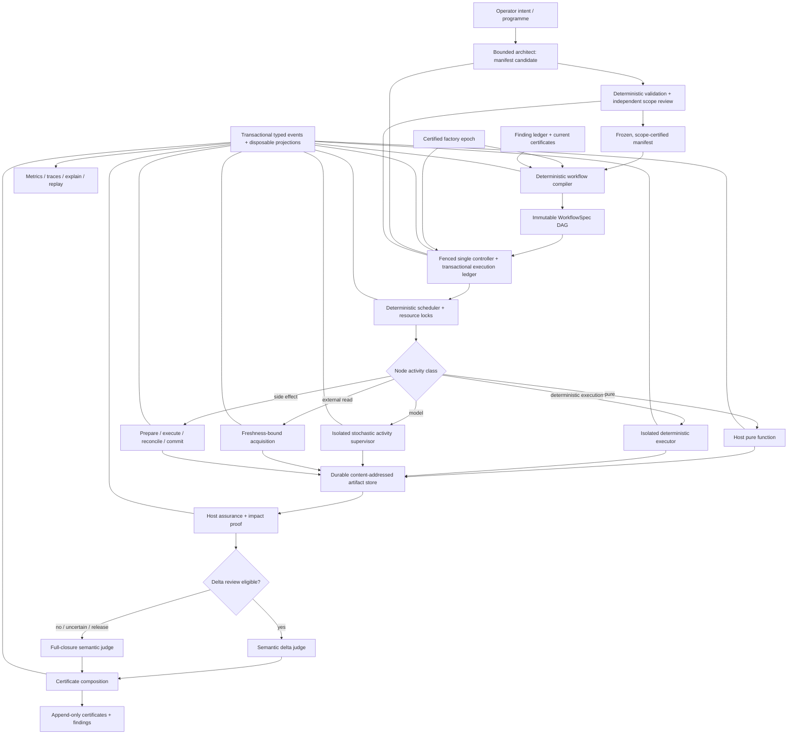
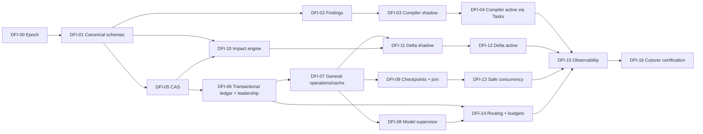

# Orchestrator v3 — complete deterministic infrastructure plan

Date: 22 July 2026  
Revision: 2 — adversarial failure review incorporated  
Status: architecture and implementation plan only; no v3 or JAA code changed  
Target host: Gigabyte, WSL/Linux  
Source baseline inspected: clean `efficiency/e2-shadow-cache` at `35efb19`  
Related decision: `ORCHESTRATOR_V3_DISPROPORTIONATE_SPEED_RETURNS_2026-07-22.md`

Revision 2 predicts failure modes across the complete control plane and changes the design where
the first draft relied on an unsafe assumption. “Rectified” in this document means corrected in
the target architecture and protected by a named gate; it does not claim that production code has
already been changed.

## Verdict

V3 should become a **single-authority deterministic workflow engine that invokes models as bounded
stochastic activities**, rather than an LLM planner that happens to be surrounded by deterministic
gates.

The complete target has five properties:

1. A scope-certified, versioned manifest compiles deterministically into a finite typed execution
   DAG; requirement changes create explicit amendments, never in-place mutation.
2. Every DAG node has an exact identity, durable state, bounded authority and content-addressed
   inputs/outputs.
3. Pure and deterministic nodes are safely reusable; completed model calls are recoverable without
   being misrepresented as deterministic truth; side effects use explicit idempotency/reconciliation.
4. Assurance is compositional: exact host evidence and prior certificates permit incremental
   semantic review, while release certification still reviews the complete release closure.
5. Every transition, reuse, invalidation, model call, finding, merge and certificate remains
   replayable and explainable from durable evidence under one fenced controller generation.

This is not a rewrite. V3 already possesses a strong spine: total task state, append-only events,
component manifests, exact operation identities for tests, pass-only reuse, host assurance,
dependency-bound certificates, isolated worktrees and fail-closed execution. The work is to unify
those mechanisms and move normal scheduling authority from the model into deterministic code.

### Revision 2 corrections

The adversarial review changed twelve material parts of the first draft:

1. Defined determinism over a committed event prefix instead of promising repeatable parallel
   completion order.
2. Added exclusive controller leadership and generation fencing before any active optimisation.
3. Replaced JSONL as the final authority with a local transactional SQLite execution ledger;
   JSONL remains historical/shadow compatibility evidence.
4. Added intent capture, bounded manifest architecture, independent scope certification and
   immutable workflow amendments.
5. Made the controller the sole ledger writer; workers publish fenced completion envelopes.
6. Replaced mutable CAS sidecars with content-addressed blob manifests and generation-safe GC.
7. Required immutable materialised inputs, domain-separated hashes and WSL path-alias controls.
8. Changed illegal state transitions from silent no-ops to loud typed refusals.
9. Added hermeticity/flakiness quarantine before deterministic pass reuse.
10. Added deterministic full-review sharding and coverage accounting for repositories larger than
    one model context.
11. Replaced unsafe snapshot rollback with generation-bound backup/restore and forward recovery.
12. Added a machine-traceable failure register: sixty-one predicted breakages, each assigned to an
    implementation slice and gate.

### Source facts driving the revision

These corrections are grounded in the inspected `35efb19` design, not generic preference:

- `control/daemon.py` performs boot checks and orphan reclaim but owns no exclusive daemon/leader
  lease, so the architecture must prevent two reconstructed controllers from claiming concurrently.
- `core/state_machine.py` deliberately returns the unchanged state for an illegal pair; the new
  operation engine needs a distinct loud refusal contract while preserving replay totality.
- `infra/event_store.py` lock-serialises sequence allocation and `fsync`s each append, but
  `replay()` tolerates/skips malformed records and cannot atomically couple several state,
  idempotency, budget and projection changes.
- `dispatch/repository.py` already documents crash windows between related durable events. Its
  recovery semantics are useful during migration, but extending that shape into the final
  multi-entity operation ledger would multiply such windows.
- `infra/atomic_io.py` uses POSIX `flock`, making WSL/Linux a valid target but strengthening the
  requirement to refuse Windows/network/synchronised state mounts rather than assuming equivalent
  locking/durability.

## Scope

This plan covers the entire deterministic factory control plane:

- factory epochs and configuration identity;
- canonical hashing and schema/version policy;
- manifests and deterministic workflow compilation;
- execution-DAG and node state machines;
- event envelopes, projections, snapshots and replay;
- content-addressed artifacts;
- operation identity, caching, deduplication and invalidation;
- worktree ownership, merging and safe concurrency;
- failure classification, retry, checkpoints and finding lifecycle;
- model invocation supervision and exact-result recovery;
- deterministic impact analysis;
- host assurance and incremental/full semantic certification;
- external evidence and side-effect contracts;
- model routing, budgets and escalation policy;
- observability, explanation, audit export and scorecards;
- migration, shadow comparison, activation, rollback and final certification.

It does not choose JAA product behaviour, remove semantic judgement, make LLM output deterministic,
or grant new external authority.

## Definition of “deterministic”

The boundary must be stated precisely.

### Deterministic

Given the same declared effective inputs, implementation version **and durable event prefix**, host
code produces the same:

- workflow graph;
- node identity and dependency set;
- eligibility and scheduling decision at that event prefix;
- authority and budget decision;
- cache/replay decision;
- impact-expansion decision;
- state transition;
- gate evaluation over the same captured artifacts; and
- receipt/certificate content, except separately recorded observational time.

Parallel completion order is not promised to be repeatable. What is promised is that every
decision is a pure function of the committed event prefix, and that deterministic joins use a
declared canonical order rather than whichever worker finishes first.

### Stochastic but deterministically governed

Model generation remains probabilistic. Deterministic infrastructure controls:

- whether a model may be called;
- which role/model/effort/tools it receives;
- the exact context package and its hash;
- the workspace and authority boundary;
- token, tool and wall-time ceilings;
- how the result is captured, validated, retried or escalated;
- whether an exact completed result is being recovered after a crash; and
- which deterministic and independent gates must accept its artifacts.

### Not claimed

- A model response is not repeatable merely because its request hash matches.
- A model result receipt is not executed evidence.
- “Exactly once” cannot be promised across a provider/network ambiguity unless the provider offers
  a binding idempotency contract. V3 can guarantee exactly-once **durable consumption** of a
  captured response, not necessarily exactly-once remote billing.
- Static impact analysis cannot prove completeness for unrestricted Python reflection or generated
  code. Uncertainty must expand the review scope or fail closed.

## Current foundation: retain, extend or retire

| Current mechanism | Current source | Decision |
|---|---|---|
| Total task state machine | `core/state_machine.py` | Retain; add a separate total operation-node state machine |
| Append-only locked event transport | `infra/event_store.py` | Retain only for historical import, shadow evidence and rollback compatibility. It cannot be the final execution authority because state transition, idempotency, lease and projection updates need one transaction |
| Durable task projection and dependency scheduling | `dispatch/repository.py` | Retain during Wave A; adapt compiled workflows into tasks. Do not extend it into the final ledger or let it remain co-authoritative after cutover |
| Incremental model planner loop | `agents/task_manager.py`, `control/project_loop.py` | Keep as exceptional fallback; remove from the normal manifest-complete path |
| Executable slice position | `control/programme.py` | Retain; make it an input to the workflow compiler |
| Component manifests and closure hashing | `validation/assurance.py` | Retain and version; extend with workflow/risk/impact declarations without breaking schema 1.0 projects |
| Exact deterministic test identity | `validation/deterministic_cache.py` | Promote into the canonical general operation identity; preserve the certified E2/E3 adapter during migration |
| Pass-only test reuse | `validation/deterministic_assurance.py` | Retain; reimplement through the general operation executor only after equivalence is proven |
| Host assurance receipt | `validation/host_assurance.py` | Retain; become one certificate input rather than a special validate-task payload only |
| Scoped dependency certificates | `control/scoped_completion.py` | Retain; split its responsibilities into smaller certificate/position modules over time |
| External evidence bundles | `validation/external_evidence.py` | Retain; conform to the common operation/artifact envelope while preserving freshness rules |
| Isolated agent runner | `dispatch/runner.py`, `dispatch/isolation.py` | Retain; invoke through typed activity nodes |
| Worktree checkpoints and settle fence | `infra/worktree.py`, `dispatch/dispatcher.py` | Retain; replace failure-reason special cases with declared activity checkpoint policy |
| Failure taxonomy and fingerprints | `infra/triage.py`, `dispatch/failure_fingerprint.py` | Retain; replace free-text routing where possible with typed termination reasons |
| Eval-receipt model tiering | `validation/model_tier.py` | Retain and generalise to deterministic role/risk routes |
| Efficiency scorecard | `dispatch/metrics.py` | Retain; project new node-level telemetry into it |

### Existing entropy to remove carefully

The relevant deterministic spine is already approximately 7,000 production lines across eighteen
modules. Canonical JSON and SHA-256 logic is repeated across assurance, deterministic cache,
external evidence, host assurance, context, worktrees, runner, dispatcher and completion modules.
Deterministic events are spread across task, assurance, host-assurance, shadow-cache and external-
evidence logs, each with its own payload convention.

The target therefore requires:

- one canonical serialisation/hashing implementation;
- one event-envelope contract, though multiple append-only streams may remain;
- one general operation identity and receipt family;
- one artifact store;
- one workflow compiler;
- one finding ledger; and
- one certificate-composition path.

Migration must not refactor every certified module at once. New code consumes the common primitives;
old E1–E6 code is adapted only after shadow equivalence, then duplicate implementations are retired.

## Non-negotiable invariants

These are the architecture laws. Each must have an executable check before activation.

### Identity and truth

1. Canonical identity never depends on dictionary insertion order, locale, current directory,
   uncontrolled environment values or wall-clock time.
2. An operation key includes every effective input and excludes irrelevant observational fields.
3. Unknown identity dimensions force fresh execution or refusal; they never produce a hit.
4. A receipt validates its own content hash and all referenced artifact hashes before use.
5. A cache hit can only return the class of evidence the original operation was authorised to
   produce. Model output never becomes deterministic gate evidence.
6. Missing telemetry is represented as missing, never zero.

### Scheduling and concurrency

7. The controller, not a model, decides the current programme slice and legal next node.
8. Exactly one fenced controller generation may claim or settle work for a factory. A second daemon
   must fail before replay, recovery or dispatch can mutate authority.
9. The same node identity cannot execute concurrently twice within one factory.
10. A claimed node carries controller and attempt fencing tokens; a stale worker cannot settle,
    append authoritative completion or publish a merge after either token is replaced.
11. Parallel writes require mechanically disjoint declared and observed ownership, a common
    certified base and a canonical join order.
12. No worker directly merges or certifies its own output.
13. STOP, efficiency pause, epoch validity, storage health and isolation readiness are checked
    before every new
    claim, not only at daemon boot.
14. Scheduling is deterministic over the committed event prefix; worker completion timing cannot
    select merge order, severity, retry policy or the next programme slice.

### Recovery and side effects

15. A crash can lose uncommitted computation, but cannot manufacture completion or forget a
    durably captured completed node.
16. Retrying unchanged deterministic failure inputs is forbidden.
17. Completed model responses are durably captured before downstream parsing/integration; recovery
    can consume that exact captured response once without a second model call.
18. An ambiguous provider timeout is recorded as `remote_outcome_unknown`; it is not silently
    treated as “not called”.
19. Consequential side effects use prepare → execute → reconcile → commit and a stable idempotency
    key. Absence of a remote receipt is not success.
20. Partial worktree artifacts remain untrusted and unmerged until ordinary gates pass.
21. Bytes used by an operation are immutable CAS inputs materialised after identity calculation;
    hashing a mutable path and executing it later is forbidden.
22. Disk-full, read-only filesystem, database-integrity and CAS-integrity faults close admission
    before they can be misreported as task failure.

### Assurance

23. Deterministic gates execute before semantic review whenever their prerequisites are available.
24. A semantic delta certificate requires a current trusted base certificate and a mechanically
    complete affected closure; uncertainty escalates to full review.
25. Every release candidate receives full-closure semantic review against the exact release
    revision regardless of incremental certificates.
26. Dependency/evidence changes invalidate only certificates whose effective closure changes;
    compatibility must be proved, not assumed.
27. Every material open finding blocks the relevant component/release. Non-blocking findings remain
    durable backlog entries and cannot disappear through rewording.
28. A skipped, unavailable or malformed assurance rung fails; it never self-passes.
29. Delta certificates cannot compose across overlapping or order-sensitive changes without a new
    full review of the combined closure.
30. Test, judge, prompt, model alias and policy revisions are certificate inputs; drift cannot be
    hidden behind a stable friendly name.

### Audit and entropy

31. Every accepted state transition has one typed event with actor, cause, prior state, next state
    and
    effective input identity.
32. Every illegal transition attempt is refused loudly and durably audited; a silent no-op is not a
    successful command.
33. Projections and snapshots are disposable; replay from the authoritative stream reconstructs
    the same state and verifies its anchor.
34. Every schema has one owner, one version registry and explicit upcast/compatibility rules.
    Unknown versions fail closed.
35. Derived launch profiles, event schemas and gate lists are generated from canonical policy;
    they are not copied into multiple hand-maintained files.
36. No new active factory law ships without a named machine check.
37. Legacy and new paths cannot both claim authority for the same workflow node.
38. Requirements, manifests and workflows are immutable after activation. Changes create a signed
    amendment with a new identity and deterministic invalidation plan.
39. Runtime telemetry is never an authority input unless its schema and completeness are part of
    the relevant operation contract.
40. Backup/restore, database integrity, CAS reachability and replay are certification gates, not
    operational suggestions.

### Capacity and coverage

41. Resource acquisition is atomic and all-or-none in canonical order; a node never waits while
    holding only part of its declared lock set.
42. Deterministic scheduling includes sequence-based fairness/project quotas, so a constant stream
    of high-priority arrivals cannot starve already-admitted work indefinitely.
43. “Full semantic review” means complete, machine-accounted closure coverage. If one context
    cannot hold it, deterministic shards plus shared-boundary overlap and final integration review
    replace truncation; uncovered files/criteria make certification impossible.

## Target architecture



## Canonical data model

### 1. Factory epoch

One production epoch pins the factory environment without unnecessarily invalidating unrelated
operation caches.

Required fields:

```json
{
  "schema_version": 1,
  "epoch_id": "sha256-...",
  "orchestrator_commit": "...",
  "source_tree_clean": true,
  "isolation_receipt_id": "...",
  "host_runtime_id": "...",
  "policy_registry_hash": "sha256-...",
  "agent_registry_hash": "sha256-...",
  "prompt_registry_hash": "sha256-...",
  "schema_registry_hash": "sha256-...",
  "created_by": "operator-command",
  "created_at": "observational timestamp"
}
```

`epoch_id` excludes `created_at`. The complete epoch is recorded on every attempt for provenance,
but an operation key includes only the epoch dimensions that can affect that operation. For
example, a judge-model policy change must not invalidate a pytest receipt if the test executor,
runtime, environment policy and product closure are unchanged. If the effective subset cannot be
proved, the safe fallback includes the complete epoch identity and forces a miss.

Epoch rules:

- creation refuses a dirty orchestrator tree or stale isolation receipt;
- exactly one epoch is active for new product admission, selected by an atomic active-epoch pointer;
- runtime stream heads, scorecard watermarks and live counters are baseline observations, not epoch
  identity; including them would make an otherwise unchanged epoch stale on every event;
- changing an identity-bearing policy closes the epoch;
- in-flight attempts remain pinned to the epoch that admitted them and must drain or be reconciled;
  they never silently inherit a replacement epoch;
- old receipts remain readable but require compatibility validation before reuse;
- an emergency factory fix creates a new epoch and records why the old one closed;
- JAA production and v3 development never share a writable epoch;
- secret values never enter epoch or operation identities: a registered secret version/authority
  handle may be an effective input, while secret bytes remain outside ordinary logs and artifacts.

### 2. Workflow specification

The compiler emits an immutable `WorkflowSpec`:

```json
{
  "schema_version": 1,
  "workflow_id": "sha256-...",
  "workflow_revision": 1,
  "parent_workflow_id": null,
  "intent_receipt_id": "sha256-...",
  "scope_certificate_id": "sha256-...",
  "project": "job-application-automation",
  "programme_id": "autonomous-job-application-system",
  "component_id": "JAA-01",
  "purpose": "build|repair|integration|release",
  "base_product_revision": "...",
  "manifest_hash": "sha256-...",
  "programme_slice_hash": "sha256-...",
  "finding_set_hash": "sha256-...",
  "nodes": [],
  "edges": [],
  "resource_sets": []
}
```

The ID derives from the complete unsigned specification. Node order is canonical. The compiler
rejects cycles, duplicate node IDs, unresolved dependencies, undeclared ownership, contradictory
acceptance, missing negative controls, unsupported activity kinds, unbounded expansion and a scope
certificate that does not bind the exact manifest. An operator requirement change produces a new
workflow revision and invalidation proof; active specifications are never edited in place.

### 3. Node specification

Each node declares:

- stable node ID derived from workflow and logical purpose;
- activity kind: `pure`, `deterministic_execution`, `model`, `external_read`, `side_effect`,
  `human_receipt`;
- operation implementation/version;
- exact input artifact and certificate references;
- declared output artifact types;
- read and write resource sets;
- capability and authority ceiling;
- timeout, token, tool, attempt and cost policy;
- cache/recovery policy;
- prerequisites and success predicate;
- required downstream gates; and
- compensation/reconciliation rule where applicable.

Every loop-like activity declares a finite `max_iterations` and a deterministic continuation
predicate. Models may propose nodes or amendments but cannot self-spawn an unbounded graph.

Node IDs do not contain random UUIDs or timestamps. Attempts do.

### 4. Operation identity

The general operation key is computed from an operation-specific effective-input projection:

```json
{
  "schema_version": 1,
  "activity_kind": "deterministic_execution",
  "operation_type": "scoped-test",
  "implementation_digest": "sha256-...",
  "input_artifacts": ["sha256-..."],
  "input_certificates": ["sha256-..."],
  "product_closure_hash": "sha256-...",
  "runtime_digest": "sha256-...",
  "environment_policy_digest": "sha256-...",
  "effective_configuration_digest": "sha256-...",
  "command_digest": "sha256-...",
  "timeout_policy": 300
}
```

The current E2 identity becomes the first adapter to this schema. Raw secret-bearing arguments are
not persisted; canonical digests and safe readable references are.

Every digest is domain-separated (`v3:<schema>:<object-kind>\0<canonical-bytes>`), and source,
configuration, runtime and tool inputs are captured as immutable CAS artifacts before execution.
Paths are labels only: identity binds resolved project-relative path, file type, byte digest and
symlink policy. WSL/Windows case aliases, Unicode-normalisation variants and path traversal refuse
instead of collapsing into an accidental match.

Critical separation:

- `operation_key`: stable effective inputs; determines deterministic reuse eligibility;
- `node_id`: logical position in one workflow;
- `attempt_id`: unique execution attempt;
- `invocation_id`: exact provider/tool request;
- `receipt_id`: content address of one captured outcome.

Conflating these identities would either destroy reuse or permit false equivalence.

Model invocations also carry an `independence_domain`. Crash recovery may consume a captured
response only for the same logical invocation/idempotency key. Two activities that are required to
be independent receive different domains even if every prompt byte matches; stochastic outputs are
never cross-workflow cached as deterministic results.

### 5. Result receipt

Every activity returns a common envelope with activity-specific evidence:

```json
{
  "schema_version": 1,
  "receipt_id": "sha256-...",
  "operation_key": "sha256-...",
  "node_id": "sha256-...",
  "attempt_id": "...",
  "activity_kind": "...",
  "status": "passed|failed|unknown|cancelled",
  "output_artifacts": ["sha256-..."],
  "evidence_artifacts": ["sha256-..."],
  "runtime_receipt": "...",
  "policy_digest": "sha256-...",
  "token_usage": null,
  "tool_usage": null,
  "termination_reason": "typed-value",
  "observed_at": "timestamp"
}
```

`receipt_id` binds the observational time but operation reuse does not. A receipt cannot be used
without revalidating all referenced artifacts and the operation-specific reuse policy.

Receipt validation also checks producer implementation/schema compatibility, complete effective
input coverage, environment hermeticity class and revocation status. A valid hash proves bytes, not
that an operation was correctly classified as deterministic.

### 6. Transactional execution ledger and typed event envelope

The existing JSONL `EventStore` remains the immutable historical/import source and may receive
shadow observations during migration. The final execution authority is a local SQLite ledger on
Gigabyte's Linux filesystem, opened with foreign keys enabled, WAL mode, an explicit supported
SQLite version and a ratified durability setting. It is never placed on SMB, NFS, OneDrive or a
Windows-mounted repository path. If the factory later requires multi-host controllers, migrate the
same contracts to PostgreSQL; do not stretch SQLite into a distributed lease service.

The authoritative append transaction atomically performs:

1. controller-generation and attempt-fence validation;
2. expected current-state/version comparison;
3. idempotency/operation uniqueness enforcement;
4. stream sequence and previous-hash assignment;
5. typed event insertion;
6. current projection update;
7. lease, budget and outbox/inbox update where applicable; and
8. commit before success is returned.

The envelope stored in the event table is:

```json
{
  "event_schema_version": 1,
  "event_id": "sha256-...",
  "ledger_seq": 1042,
  "transaction_id": "sha256-...",
  "stream_id": "execution:<workflow-id>",
  "stream_seq": 17,
  "event_type": "node_completed",
  "entity_id": "<node-id>",
  "prior_state": "running",
  "next_state": "succeeded",
  "payload_artifact": "sha256-...",
  "actor": "controller|worker:<attempt-id>|operator",
  "causation_id": "...",
  "correlation_id": "<workflow-id>",
  "previous_event_hash": "sha256-...",
  "observed_at": "timestamp"
}
```

Rules:

- engine-critical execution streams fail closed on malformed, missing-sequence or hash-chain
  corruption; they do not silently skip the record;
- foreign/legacy records remain readable through an explicit adapter and cannot mutate new
  projections;
- stream sequence, prior hash, transition validation and projection update are one database
  transaction; callers cannot pre-read authority and append later;
- `ledger_seq` provides total committed order across streams; events within one transaction are
  inserted in canonical order and share `transaction_id`;
- unique constraints cover `(stream_id, stream_seq)`, `event_id`, active node lease and idempotency
  keys; constraint failure is a typed refusal, not a retryable success;
- new engine-critical streams use strict replay/validation; legacy permissive replay remains
  available only through the historical adapter and cannot power new projections;
- event payloads reference CAS artifacts instead of embedding large prompts, diffs or diagnostics;
- snapshots bind stream sequence and event hash; a bad snapshot is discarded and replayed;
- projection schema migrations are explicit, reversible until cutover and rebuildable from events;
- wall-clock time is observational and never decides causal order; lease policy uses controller
  generation, host boot identity and monotonic elapsed time while a controller is alive;
- before authoritative use, backup/restore, abrupt-process-kill, WAL recovery, disk-full,
  read-only-filesystem and integrity-check drills must pass on the actual Gigabyte filesystem.

Separate logical streams may remain for workflows, operations, assurance and directives. The
transactional ledger, envelope, schema registry and validation path are singular. Metrics and
traces are projections and cannot mutate execution truth.

### 7. Artifact store

The CAS stores immutable blobs and immutable artifact manifests, each at a path derived from its
own SHA-256 and written atomically:

```text
state/cas/blobs/sha256/ab/abcdef...
state/cas/manifests/sha256/cd/cdef01...
```

The content-addressed manifest binds:

- digest and byte length;
- media/schema type;
- producer operation/receipt;
- confidentiality class;
- credential scan result;
- compression/encoding;
- creation observation; and
- retention/pin status.

An `artifact_id` is the manifest digest; the manifest references the blob digest. There is no
mutable sidecar keyed only by blob digest, because identical bytes can legitimately have distinct
producer/confidentiality metadata. An authoritative event references the verified manifest ID.

CAS rules:

- bytes are written to a same-filesystem temporary file, flushed and `fsync`ed, atomically renamed,
  parent-directory `fsync`ed and then verified before the ledger may reference them;
- bytes are verified on read;
- existing digest with different bytes is a fatal invariant violation;
- model prompts/responses, diagnostics and source bundles receive confidentiality labels;
- secrets are quarantined rather than entering ordinary artifacts;
- release certificates, current workflows and unresolved findings pin reachable artifacts;
- garbage collection is mark-and-sweep from a transactionally pinned root generation, dry-run
  first; it cannot race a newly committed reference;
- orphan bytes created before a failed ledger transaction are harmless and recoverable by a later
  grace-period sweep;
- low-space thresholds stop new model/tool admission before writes begin, while emergency reserve
  remains available for settlement, reconciliation and audit export;
- GC never decides truth or deletes event/certificate records.

### 8. Finding record

A semantic or deterministic rejection becomes structured data:

```json
{
  "finding_id": "sha256-...",
  "project": "...",
  "component_id": "...",
  "source_revision": "...",
  "source_receipt": "...",
  "criterion_id": "...",
  "boundary": "persistence|replay|authority|interface|quality|evidence|other",
  "severity": "blocker|major|minor",
  "summary": "...",
  "evidence_artifacts": [],
  "affected_resources": [],
  "regression_coverage": "existing:<test-id>|required|not-applicable",
  "status": "open|assigned|resolved_pending_certification|closed|superseded",
  "resolution_revision": null
}
```

Natural-language wording is not the identity by itself. Identity includes component, reviewed
revision, criterion/boundary and evidence digest. Duplicate findings consolidate; distinct causal
mechanisms remain distinct.

Closure rules:

- only a current accepting certificate can close `resolved_pending_certification`;
- changing source after resolution invalidates the pending closure when affected;
- supersession requires an explicit relationship to the replacement finding;
- minors may enter the improvement backlog under the ratified quality policy, but remain visible;
- blockers and majors relevant to the component prevent certification.

### 9. Certificate algebra

Add three explicit certificate forms:

1. `full_component`: complete deterministic and semantic review of a component closure;
2. `delta_component`: review of a proved-complete affected closure, bound to one current full or
   composed base certificate;
3. `release`: complete deterministic integration and full semantic review of the exact release.

Composition is valid only when:

```text
current certificate
  = trusted base certificate
  + exact source delta
  + complete impact proof
  + current host-assurance receipt
  + accepted semantic delta verdict
  + closed relevant finding set
```

The composed certificate records the full current file-hash map and dependency certificate IDs;
it does not force a verifier to replay an unbounded chain merely to know current closure. The chain
remains available for audit.

Composition is refused when two deltas overlap, touch a shared interface, were derived from
different bases, invalidate one another's assumptions or exceed a configured chain-depth/change-
surface threshold. The recovery is a full review of the combined current closure, not an attempt
to guess a safe order. Certificate and finding projections support explicit revocation and
reopening when later evidence invalidates an ancestor.

## Execution node state machine

Use a separate total state machine rather than stretching task statuses:

```text
PLANNED -> READY -> LEASED -> RUNNING
RUNNING -> SUCCEEDED | FAILED | OUTCOME_UNKNOWN | CANCELLED
FAILED -> READY                only when retry policy and changed/effectively retryable input permit
OUTCOME_UNKNOWN -> RECONCILING
RECONCILING -> SUCCEEDED | FAILED | NEEDS_OPERATOR
SUCCEEDED -> INVALIDATED       when an effective dependency changes
PLANNED/READY/LEASED -> CANCELLED  when workflow is superseded or STOP closes admission
```

Every state/event pair has a defined result, but an illegal pair returns a typed
`transition_refused` outcome and emits a non-authoritative audit record; it must never look like a
successful no-op. Authoritative state changes and their events commit together.

### Claims and fencing

- The scheduler appends `node_leased` with a monotonically increasing fencing token.
- A worker must include controller generation and attempt token in every heartbeat, checkpoint,
  result and merge proposal.
- Settlement rejects stale tokens even if the worker later returns success, and every mutable sink
  independently verifies the fence rather than trusting the scheduler alone.
- Lease expiry does not itself prove the worker stopped; mutable integration waits for isolation
  termination/reconciliation.
- An exact node key has one active lease. Concurrent duplicates wait on or reference it.

### Controller leadership and time

- A non-blocking host process lock prevents two ordinary daemons from starting on Gigabyte.
- The ledger also owns a monotonically increasing controller generation; this is the durable fence
  if a previous process or orphaned worker survives.
- Startup first proves supported local filesystem/database configuration, acquires leadership,
  validates epoch/STOP/isolation/storage, then reconciles old attempts. It does not reclaim first.
- A live controller measures durations with a monotonic clock. Persisted wall time is diagnostic;
  expiry after restart is decided from controller generation, host boot identity and explicit
  reconciliation, not from a possibly rewound wall clock.
- Leadership loss closes admission immediately. In-flight workers may preserve evidence but cannot
  settle under the old generation.

### Writer topology and completion inbox

The controller is the only authoritative database writer. Workers never update state, leases,
budgets or certificates directly. They atomically publish an attempt-specific completion or
heartbeat envelope to a certified local inbox/CAS location and notify the controller. The
controller verifies controller generation, attempt token, operation identity, artifact hashes,
authority and current state before committing one settlement transaction. After takeover, an old
worker envelope can be retained as untrusted recovery evidence, but only a typed reconciliation
under the new generation may adopt it. Inbox capacity is reserved before admission and completion
envelopes are never dropped. This avoids SQLite writer contention and makes fencing enforceable at
one boundary without trusting worker code. Authoritative transactions stay short; no model,
subprocess, filesystem scan or network call executes while a database transaction is open.

### Retry policy

Retry is a deterministic function of:

- typed termination reason;
- activity kind;
- whether remote outcome is known;
- operation/input identity change;
- previous attempt count and policy;
- provider/runtime health receipt;
- checkpoint validity; and
- budget state.

Every retry records a causal fingerprint and a changed-input or explicitly transient-health proof.
The workflow has both per-node and global retry ceilings. Repeated causal failure at the ceiling
becomes one redesign/refusal event, not another planner/model loop.

Free-text substring triage remains a compatibility adapter only. New execution paths emit typed
termination reasons at source.

## Workflow compilation

### Bootstrap and scope freeze

Deterministic compilation cannot turn an underspecified human goal into a complete product plan.
Before the execution DAG exists:

1. the operator intent/programme is captured immutably;
2. one bounded architect activity may produce a `ManifestCandidate`;
3. deterministic validation checks schema, ownership, acceptance, negative controls, dependencies,
   authority, finite bounds and supported activity kinds;
4. an independent scope reviewer checks that the candidate faithfully covers the operator intent
   and does not silently narrow quality or deliverables; and
5. an accepted scope certificate freezes the exact manifest hash.

Only the frozen manifest reaches the compiler. This preserves semantic planning where it is
genuinely necessary without repurchasing an LLM planner decision before every task.

Bootstrap is not an unlogged prelude. It is a fixed built-in intake workflow governed by the same
epoch, isolation, budget, artifact and receipt contracts (through the legacy task adapter during
Wave A and the execution ledger after cutover).

### Amendments

New operator direction, newly discovered scope or an architectural redesign produces a typed
`WorkflowAmendmentProposal`. Deterministic validation and scope review create a new manifest and
workflow revision, then calculate which completed nodes remain compatible. No model or operator
message mutates an active DAG in place. Superseded nodes stop receiving new claims; in-flight work
is drained, cancelled or retained only as untrusted evidence under explicit policy.

### Compiler inputs

The compiler consumes only versioned data:

- active factory epoch;
- current programme position;
- current slice and assurance component;
- current product revision and inventory;
- current dependency/evidence certificates;
- open findings for the component;
- existing independent coverage receipts;
- deterministic policy registry; and
- explicit operator steering records, if any.

It does not read chat memory, personal corpus, model prose or ambient repository instructions.

### Normal new-component graph

For a complete manifest/slice, compile:

1. `capture-base` — pin product HEAD, inventory and current upstream receipts.
2. `build` — isolated model activity with production write ownership only.
3. `author-tests` — independent isolated model activity with test/fixture ownership only.
4. `join-candidate` — deterministic rebase/merge of both deltas against the same base.
5. `host-assurance` — exact tests, negative controls, authenticity, ownership and closure.
6. `impact-proof` — exact changed/affected closure and uncertainty classification.
7. `semantic-review` — full review for first certificate; delta only when eligible.
8. `compose-certificate` — close findings and issue current component receipt.
9. `advance-position` — recompute programme position from certificates; never accept a model claim.

Builder and test-author may execute concurrently when the manifest proves disjoint ownership.

### Repair graph

For a rejected revision:

1. Freeze the complete open finding set from that review.
2. Group compatible findings for the same component into one repair batch.
3. If every finding is already exercised by independent failing coverage, compile only a builder
   repair activity; do not spend a tester call merely to restate existing tests.
4. If any finding requires new regression coverage, compile an independent test-author activity in
   parallel from the same base.
5. Join, run host assurance, prove impact and review once.
6. A new independent causal finding opens a new batch; duplicate wording does not.

### Planner fallback

The LLM task manager is invoked only when the compiler returns a typed refusal such as:

- `manifest_incomplete`;
- `ownership_ambiguous`;
- `finding_conflict`;
- `dependency_unknown`;
- `repeated_causal_failure_requires_redesign`; or
- `operator_steering_requires_spec_change`.

The planner returns a strict `PlanProposal`, never runnable tasks. Deterministic validation either:

- converts it into a valid manifest/graph amendment;
- requests one bounded correction; or
- refuses and escalates.

The planner cannot select a later slice, broaden authority, remove gates or mark work complete.
Fallback frequency is itself an activation metric: if more than the ratified small fraction of
manifest-complete historical cases requires fallback, Wave A does not activate because the
compiler/manifest contract is not yet expressive enough.

### Instruction/data boundary

Only registered, hash-bound system policy, operator intent and certified project instruction
artifacts are instructions. Source files, tests, issue text, diagnostics, model output, external
evidence and tool output are untrusted data even when they contain imperative language. Context
packages label this boundary explicitly; no data artifact can broaden tools, authority, budget,
write scope or assurance policy. The deterministic controller enforces those limits independently
of model compliance.

## Operation execution and reuse policy

| Activity class | Fresh execution | Reuse/recovery | Trust produced |
|---|---|---|---|
| Pure host function | In-process, no side effect | Reuse exact valid result | Deterministic data |
| Deterministic execution | Isolated command/tool | Pass-only exact reuse; failures remain diagnostic evidence | Executed gate evidence |
| Model activity | Isolated provider invocation | Deduplicate only the same logical invocation/idempotency key; recover its exact durably completed response after crash; never collapse required independent calls or replay a failed response as a new attempt | Untrusted proposal/artifact |
| External read | Registered acquisition | Reuse exact bundle only within freshness/provenance contract | Captured evidence, not universal truth |
| Side effect | Registered capability | Never ordinary-cache; reconcile by idempotency key and authoritative receipt | Consequential outcome evidence |
| Human receipt | Explicit operator action | Reuse only while exact artifact/policy hash remains current | Bounded approval/steering |

### Model activity durability

The model supervisor must journal this order:

1. `invocation_prepared` — exact request/context/model-version-or-provider-fingerprint/tool/policy
   hashes and provider idempotency key where supported;
2. `invocation_started` — provider process identity, controller generation and fencing token;
3. stream events/usage where available;
4. complete response marker plus response bytes written atomically to a fenced completion spool and
   CAS; partial streams never receive the complete marker;
5. `invocation_captured` — response artifact and provider usage;
6. strict AgentResult/proposal parsing;
7. artifact/worktree validation;
8. `node_completed` or typed failure.

If the controller crashes after step 5, replay consumes the captured response without another
provider call. If it crashes between steps 2 and 5 and provider outcome cannot be established, the
node becomes `OUTCOME_UNKNOWN`; policy determines reconciliation or a clearly measured second call.

A friendly model alias is never sufficient identity: the provider-reported model revision or a
versioned behaviour policy is captured, and alias drift closes the applicable route/evaluation
receipt. Tool calls emitted during a model activity are separate typed child activities with their
own authority, receipts and side-effect policy; they cannot hide consequential work inside prose.

No model call remains alive merely because a shell or interactive session disappears. The factory
supervisor owns process lifetime, captures termination and settles every invocation.

## Workspaces, ownership and concurrency

### Resource model

Resources are canonical project-relative sets:

- `read_files`;
- `write_files`;
- `write_patterns`;
- `database/evidence resources` where relevant;
- `project_branch`;
- `external capability`; and
- `global factory resources` such as registry or epoch.

The scheduler permits parallel execution only when:

- write sets are disjoint;
- neither write set overlaps the other's read-sensitive set where stale reads are prohibited;
- both nodes share the same certified base revision;
- neither requires the project-global or factory-global exclusive resource; and
- the manifest/compiled graph declares the join.

Unknown glob overlap is treated as conflict.

Declared ownership is admission evidence, not final proof. After execution, the controller derives
the actual changed paths, symlinks, generated outputs, migrations and dependency files and compares
them with the declaration. Each lane receives an isolated dependency/cache/temp namespace unless a
shared resource is explicitly read-only and identity-bound. Undeclared writes invalidate the lane.

### Builder/test-author independence

- Builder receives production ownership and acceptance contract, not test-author output.
- Test-author receives test ownership and acceptance contract, not builder output.
- Both start from the same base.
- The deterministic join validates each delta against ownership before rebasing.
- A conflict or undeclared file invalidates the candidate; the controller never chooses one side.
- Path-disjoint deltas can still conflict semantically. Host assurance and all integration tests
  execute only on the joined candidate, never inferred from the two separately passing lanes.
- Join order is canonical by node ID and base revision; completion timing cannot decide it.
- Neither lane can issue a certificate.

### Checkpoints

Checkpoint policy becomes declared per activity rather than a growing termination-reason allowlist:

- worktree delta artifact;
- base revision;
- ownership set;
- activity/input identity;
- last captured diagnostic;
- trust state `untrusted_unmerged`;
- refresh/rebase policy; and
- explicit revival requirement.

Every resumed checkpoint is inspected against current HEAD and operation identity. Clean, foreign,
conflicting or unverifiable checkpoints are refused, never silently converted into fresh work.

## Deterministic impact engine

The impact engine is assurance code, not the Graphify semantic graph. Graphify remains valuable for
human/codebase analysis, but inferred edges cannot certify completeness.

### Impact inputs

- exact Git diff and current file hashes;
- manifest ownership, inputs, interfaces, shared and environment patterns;
- deterministic Python AST import/call/name-use graph;
- explicitly declared cross-language/generated/runtime edges;
- public API/interface fingerprints;
- migration/schema/config/lockfile classifications;
- test-to-component declarations and prior certificate closure; and
- changed dependency/evidence certificate IDs.

Every derived dependency graph binds the exact source inventory, parser version and language
configuration. A stale graph, parse error, deleted/renamed file, generated source, unresolved
import or unsupported language records uncertainty and forces expansion/full review; the engine
never uses a last-known-good graph as if it described current source.

### Outputs

```json
{
  "impact_proof_id": "sha256-...",
  "base_certificate_id": "sha256-...",
  "changed_files": [],
  "affected_files": [],
  "affected_interfaces": [],
  "affected_acceptance": [],
  "required_tests": [],
  "unchanged_file_hashes": {},
  "dependency_edges": [],
  "uncertainty_reasons": [],
  "delta_review_eligible": true
}
```

### Automatic full-review triggers

- no trusted full/composed base certificate;
- manifest or programme contract change;
- public interface/API change;
- database schema, migration or persistence-format change;
- authentication, authority, secret handling or irreversible side-effect change;
- runtime/dependency/lockfile change affecting execution;
- generated code, dynamic import, reflection or monkey-patching affecting the closure;
- undeclared file or unknown language edge;
- changed shared file with unbounded fan-out;
- incomplete/missing test mapping;
- judge requests expansion; or
- release/integration policy requires full review.

False positives cost review tokens; false negatives can certify defective work. Therefore every
classifier defaults to expansion and is promoted to narrower behaviour only after mutation and
historical-recall evidence.

Delta eligibility is a deterministic fact backed by the proof artifact, never a model preference.

## Assurance pipeline

### Host assurance order

1. Epoch, isolation and product-base validity.
2. Manifest/programme/component validity.
3. Current dependency and external-evidence receipts.
4. Ownership and inventory classification.
5. Exact tests through general pass-only operation reuse.
6. Required negative controls.
7. Authenticity and secret checks.
8. Candidate closure stability.
9. Impact proof.
10. Host-assurance receipt.

Any failure prevents semantic spend unless the semantic activity is explicitly diagnostic and
budgeted as such.

Test selection is itself evidence: required-test mapping, test implementation digest, collection
inventory and skipped/xfailed counts are bound to host assurance. A flaky test cannot enter the
pass-only cache until a ratified stability policy has been met; inconsistent outcomes quarantine
that operation key and force diagnosis.

### Semantic review modes

`full`:

- complete receipt-bound semantic production closure;
- zero tools when safely bundleable, otherwise bounded read-only tools;
- all acceptance criteria, trust/persistence/replay/authority/failure boundaries;
- all findings in structured verdicts;
- if the closure exceeds one reviewed context budget, deterministic shards assign every file,
  criterion and risk boundary to at least one review; shared interfaces appear in overlapping
  shards, and a final integration review consumes their receipts plus interface/data-flow evidence;
- a coverage ledger proves there is no omitted source/criterion before verdict composition.

`delta`:

- exact diff;
- complete affected closure from impact proof;
- affected interfaces/acceptance criteria;
- prior base certificate summary containing only deterministic facts and hashes;
- current host-assurance receipt;
- unresolved findings;
- zero access outside the package unless it returns `scope_expansion_required`.

`release`:

- always full closure and full integration evidence;
- exact distributable artifact hashes;
- no unresolved material findings;
- replay/restart/isolation/failure drills;
- independent final verdict against the exact release revision.

Sharding changes packaging, not the standard: one failed/missing shard or uncovered closure item
blocks the aggregate. Review partitions are identity-bound and reused only when their exact closure,
criteria, judge policy and dependencies remain current.

Judges receive evidence packages without builder reasoning or prior verdict rhetoric unless a
specific finding must be retested. Judge prompt, model revision, effort, tool policy and evaluator
rubric are certificate inputs. A delta chain is rebased through full review after the first
overlap/order-sensitive change or a small configured depth/change-surface ceiling, whichever
arrives first.

### Shadow gate for delta review

Before active use, run full and delta reviews on the same frozen revisions. Promotion requires:

- 100% recall of all known material findings in the pinned replay corpus;
- no false certificate on injected dependency/interface/schema/dynamic-edge controls;
- deterministic escalation on every uncertainty fixture;
- equal verdict on clean certified fixtures;
- complete token, latency and finding telemetry; and
- rollback to full mode without changing product source or certificates.

## Budgets and model routing

Budgets are node policies, not only post-hoc pauses:

- maximum provider calls;
- maximum uncached/cached/total tokens where provider telemetry permits;
- maximum tool calls;
- maximum wall time;
- maximum retry attempts by typed reason;
- maximum cumulative workflow spend; and
- reserved budget for independent assurance.

The scheduler refuses a node whose budget cannot cover its required assurance reserve. A task that
exceeds a hard post-call token cap remains measured and rejected; the system never edits telemetry
to fit the cap.

Pre-call token estimates are advisory and conservative. A hard cap may prevent starting or stop a
model activity, but it cannot convert partial output into success, skip required assurance or
consume the separately reserved settlement/reconciliation capacity. Budget reservation and release
are transactional, so concurrent nodes cannot each spend the same remaining allowance.

Model routing extends the existing eval-receipt design:

- route by deterministic role + risk class + change class;
- no cheap route without a current passing evaluation receipt;
- high-risk persistence/replay/authority/schema work starts on the frontier route;
- bounded work may start cheaper and escalate on typed failure/uncertainty;
- judge and builder independence is preserved;
- every route change closes or versions the applicable policy, but does not invalidate unrelated
  deterministic operation receipts.

Quality is checked by outcome parity, not by assuming a cheaper model is equivalent. Escalation has
one bounded path per causal failure; alternating providers/models cannot become an unbounded retry
loop.

## Observability and audit surfaces

### Required projections

- workflow status and current blocking node;
- node timeline and dependency graph;
- fresh/reused/invalidated/unknown operations;
- provider/model/role/token/tool/wall/cost metrics;
- deterministic versus stochastic time;
- cache eligibility, hit reason and miss reason;
- findings opened/closed/reopened per revision;
- certificates and transitive dependencies;
- resource locks and concurrency utilisation;
- checkpoint/resume/reconciliation outcomes;
- operator interventions; and
- tokens/time per accepted component and release.

### Operator commands

The target CLI must support read-only explanations:

```text
factory epoch show
factory workflow show <workflow-id>
factory node explain <node-id>
factory receipt verify <receipt-id>
factory certificate verify <certificate-id>
factory findings list --project ... --open
factory replay verify --stream ...
factory cache explain <operation-key>
factory impact explain <impact-proof-id>
factory scorecard --project ... --epoch ...
```

Every explanation cites event/receipt/artifact IDs. “The model said” is never the terminal reason.

### Tracing

Export OpenTelemetry-compatible spans as a projection, not the source of truth. Trace hierarchy:

```text
factory epoch
  -> workflow
     -> node
        -> attempt
           -> provider/tool/subprocess
```

Trace export failure cannot stop execution or erase durable events; it is observable as a telemetry
degradation.

Telemetry packages use bounded-cardinality labels and artifact references rather than embedding
prompts, source bundles, secrets or model responses. Export queues have bounded disk/memory use;
overflow drops only the derived export, records a degradation counter and never blocks or mutates
the authoritative ledger. Metrics are reconciled against ledger totals before efficiency claims.

## Safe migration architecture

The migration avoids a new “big-bang v3 inside v3”.

### Compatibility strategy

1. Keep the existing `TaskRepository`, task state machine, `EventStore`, dispatcher, runner and E1–E6
   paths authoritative initially.
2. Introduce new schemas and projections without changing execution.
3. Compile workflows in shadow and compare them with actual planner output.
4. Activate deterministic compilation by generating ordinary existing `Task` records; the old
   dispatcher still executes them.
5. Build the CAS and transactional SQLite execution ledger beside the legacy path. Mirror legacy
   task outcomes into it as explicitly non-authoritative observations; never dual-write authority.
6. Rehearse backup/restore, leader fencing, crash recovery and legacy-import equivalence on
   Gigabyte's actual filesystem.
7. At a STOP-protected cutover, atomically select one authority profile and write a cutover receipt.
8. Move one activity class at a time to the new engine only through a new authority epoch.
9. Retire a legacy path only after exact replay/equivalence and rollback drills.

This delivers planner savings before the general execution substrate is complete and avoids
rewriting the most battle-tested spine first.

### Event migration

- Historical logs remain immutable.
- A migration index records source file hash, byte length, last valid sequence, imported event IDs,
  adapter version and every skipped/refused legacy record. Silent tolerant skipping is forbidden
  in migration evidence.
- Legacy events project into compatibility records; they are never rewritten as if originally
  emitted under the new schema.
- New authoritative operation events begin at an explicit cutover transaction and controller
  generation.
- Dual observation is allowed; dual authority is forbidden.
- Rollback before cutover discards new projections/CAS references only after preserving audit
  evidence.
- Rollback after any new-ledger authority event is forward recovery into a new epoch unless a
  rehearsed reverse adapter proves every post-cutover event compatible. Restoring an old snapshot
  while ignoring newer side effects is forbidden.

## Adversarial failure-mode register

This register predicts how the design can fail before implementation begins. `P0` blocks the
relevant activation; `P1` blocks final factory certification; `P2` is an operational/efficiency
defect that must remain visible but need not block an earlier shadow slice. “Correction” names the
design response; the implementation slice must prove it with the listed gate.

| ID | Pri | Predicted breakage | Consequence | Correction and required gate |
|---|---|---|---|---|
| FM-01 | P0 | Two daemons replay the same state and both claim work | Duplicate model spend and conflicting settlement | Temporary Wave-A host lock, then host lock + ledger controller generation + stale-leader drill; DFI-00, DFI-06 |
| FM-02 | P0 | Worker completion timing changes merge or scheduling choice | Runs are not defensibly deterministic | Decisions consume committed event prefixes; canonical join order; shuffled-completion property test; DFI-03, DFI-09 |
| FM-03 | P0 | Live log heads are included in epoch identity | Epoch becomes stale after every event | Keep runtime watermarks in baseline receipts, not epoch identity; DFI-00 mutation test |
| FM-04 | P0 | Epoch changes while work is running | Attempts inherit incompatible policy or become stranded | Pin attempt epoch; drain/reconcile old generation; rollover drill; DFI-00, DFI-06 |
| FM-05 | P0 | Secret bytes enter hashes/logs | Credential leakage and unstable identities | Bind registered secret-version handle only; quarantine scan; DFI-01, DFI-05 |
| FM-06 | P0 | Wall clock moves backwards/forwards | False lease expiry or freshness result | Monotonic live durations + boot/controller generation + restart reconciliation; clock-skew drill; DFI-06 |
| FM-07 | P0 | Python/runtime/locale serialises values differently | False cache miss/hit and unverifiable receipts | Closed canonical types and cross-runtime golden vectors; DFI-01 |
| FM-08 | P0 | Same bytes are hashed for different object classes | Cross-type identity confusion | Domain-separated hashes with schema/object prefix; mutation vectors; DFI-01 |
| FM-09 | P0 | WSL case, Unicode, symlink or path aliases collapse | Wrong file enters identity or ownership proof | Resolve project-relative byte identities under explicit symlink/case policy; path corpus; DFI-01, DFI-09 |
| FM-10 | P0 | File is changed after hashing but before execution | Receipt certifies bytes that were not executed | Materialise immutable CAS inputs, then execute from them; TOCTOU drill; DFI-05, DFI-07 |
| FM-11 | P0 | Manifest is structurally valid but omits user intent | Fast factory builds the wrong product | Bounded architect + independent scope certificate binding intent and manifest; DFI-03 |
| FM-12 | P0 | New requirements mutate an active DAG | Evidence and completed nodes lose meaning | Immutable workflow revisions + amendment/invalidation proof; mid-run steering drill; DFI-03, DFI-04 |
| FM-13 | P0 | Set/dict/traversal order changes compiled DAG | Different node identities on the same input | Canonical sorts and permutation property tests; DFI-03 |
| FM-14 | P0 | Planner/model creates recursive or unlimited work | Token/time runaway | Finite graph and bounded loop schemas; self-spawn refusal; DFI-03 |
| FM-15 | P1 | Typed planner fallback quietly becomes the normal path | Original token bleed returns | Fallback-rate activation ceiling and reason scorecard; DFI-03, DFI-04, DFI-15 |
| FM-16 | P0 | JSONL cannot atomically settle state, lease, idempotency and projection | Split truth after crash | SQLite authoritative transaction; JSONL compatibility only; transaction crash matrix; DFI-06 |
| FM-17 | P0 | Permissive replay skips a corrupt authoritative record | Fabricated clean state | Strict authoritative replay and explicit legacy skip ledger; corruption drill; DFI-06 |
| FM-18 | P0 | Event commits but projection/budget/lease update does not | Replay/live views disagree | Event and projection mutation in one transaction; forced-kill tests at every statement; DFI-06 |
| FM-19 | P1 | Snapshot is stale, corrupt or from another schema | Fast startup returns wrong state | Hash/sequence/schema anchor; discard and full replay; DFI-06 |
| FM-20 | P0 | New code cannot replay old event/schema versions | Upgrade bricks the factory | Version registry, pure upcasters, golden historical corpus and forward-read refusal; DFI-01, DFI-06 |
| FM-21 | P0 | Disk full/read-only/WAL failure occurs during settlement | Completion or evidence is lost/misreported | Admission health gate + settlement reserve + actual-host fault drills; DFI-05, DFI-06 |
| FM-22 | P0 | CAS metadata commits without durable bytes, or vice versa | Dangling/fabricated artifact | fsync→rename→verify bytes before ledger reference; orphan sweep; DFI-05 |
| FM-23 | P0 | GC races a newly referenced artifact | Live evidence is deleted | Transactionally pinned root generation + grace period + concurrent-GC drill; DFI-05 |
| FM-24 | P1 | Prompt/response/source artifacts leak credentials | Audit system becomes a secret store | Confidentiality classes, quarantine and redacted telemetry; DFI-05, DFI-15 |
| FM-25 | P0 | Operation identity omits an effective input | Unsafe false cache hit | Identity field mutation suite + hermeticity declaration + fail-closed unknowns; DFI-07 |
| FM-26 | P2 | Identity binds irrelevant global policy | Safe cache exists but never hits | Operation-specific effective-input projection proven by compatibility tests; DFI-07 |
| FM-27 | P0 | Network/time/random/global state command is labelled deterministic | Stale pass is reused as evidence | Hermeticity classes, sandbox policy and stability probes; non-hermetic work is fresh-only; DFI-07 |
| FM-28 | P0 | A flaky pass enters pass-only cache | Intermittent defect becomes durable evidence | Stability threshold/quarantine and repeated contradictory-outcome drill; DFI-07 |
| FM-29 | P0 | Duplicate suppression is process-local only | Concurrent exact work still executes twice | Ledger unique active-operation constraint + cross-process race test; DFI-06, DFI-07 |
| FM-30 | P0 | Provider timed out after accepting request | Retry double-bills or creates conflicting side effects | `OUTCOME_UNKNOWN`, provider idempotency/reconciliation, measured retry; DFI-08 |
| FM-31 | P0 | Partial streamed model response looks complete | Invalid work is parsed or recovered | Fenced completion marker and exact byte count/end-state; truncated-stream drill; DFI-08 |
| FM-32 | P0 | Provider changes model behind a stable alias | Eval receipt and cache assumptions silently expire | Capture provider revision/versioned behaviour policy; alias-drift refusal; DFI-08, DFI-14 |
| FM-33 | P1 | Controller dies after provider response but before local capture | Some repurchase remains unavoidable | Durable supervisor/spool where possible; otherwise honest unknown outcome, never zero-cost claim; DFI-08 |
| FM-34 | P0 | Expired worker returns after replacement | Old work settles or merges | Controller + attempt fences checked at every mutable sink; stale-settle drill; DFI-06, DFI-09 |
| FM-35 | P0 | Long healthy task loses lease | Duplicate execution or killed useful work | Heartbeats + monotonic elapsed policy + typed extension ceiling; long-run drill; DFI-06 |
| FM-36 | P0 | Retry/escalation alternates indefinitely | Token runaway without new evidence | Causal fingerprint + per-node/workflow ceilings + redesign terminal state; DFI-06, DFI-08, DFI-14 |
| FM-37 | P0 | Agent writes outside declared files/patterns | Parallel lanes corrupt ownership assumptions | Compare actual delta, generated files and symlinks to declaration; DFI-09, DFI-13 |
| FM-38 | P0 | Path-disjoint builder/tester changes conflict semantically | Joined product fails despite both lanes passing | Canonical join followed by full joined-candidate assurance; DFI-09, DFI-13 |
| FM-39 | P0 | Parallel agents share caches, temp files or mutable environment | Nondeterministic contamination | Per-attempt namespaces; explicit read-only shared resources; contamination drill; DFI-09, DFI-13 |
| FM-40 | P0 | Reflection, dynamic import, generated code or schema change evades impact | Delta judge misses material defect | Uncertainty forces full review; adversarial impact fixtures; DFI-10, DFI-11 |
| FM-41 | P0 | Dependency graph describes an older source inventory | False delta eligibility | Bind graph to inventory/parser/config; stale graph refuses; DFI-10 |
| FM-42 | P0 | Two individually valid deltas invalidate each other | Unsound certificate composition | Refuse overlap/order sensitivity; full combined-closure review; DFI-11, DFI-12 |
| FM-43 | P0 | Long delta chains accumulate hidden drift | Current certificate no longer reflects global behaviour | Small chain/change-surface ceiling and periodic full rebase; DFI-12 |
| FM-44 | P0 | Judge sees builder rhetoric or prior verdict and anchors | Review independence is weakened | Receipt-only evidence package and version-bound judge policy; blinded parity tests; DFI-11 |
| FM-45 | P0 | Tests are skipped, weakened, renamed or selection misses them | Host assurance passes less evidence | Bind collection inventory, test digests, skips/xfails and mapping; mutation tests; DFI-10, DFI-11 |
| FM-46 | P0 | Concurrent budget reservations overspend or exhaust assurance | Completion cannot be independently checked | Transactional reservation + separate assurance/settlement reserve; DFI-14 |
| FM-47 | P1 | Telemetry exporter blocks, leaks data or reports partial totals | Production slows or efficiency claim is false | Bounded redacted projection; ledger reconciliation; exporter-failure drill; DFI-15 |
| FM-48 | P0 | Legacy tasks and new operations are both authoritative | Duplicate work and irreconcilable truth | Atomic authority profile + boot refusal on dual mode; DFI-04, DFI-16 |
| FM-49 | P0 | Rollback restores old state but ignores post-cutover effects | Lost evidence or repeated consequential action | Forward recovery by default; reverse adapter only after event-completeness proof; DFI-16 |
| FM-50 | P1 | JAA history does not cover a new workflow shape | Shadow parity gives false confidence | Synthetic/property/mutation corpus plus a second canary before JAA; DFI-03, DFI-16 |
| FM-51 | P0 | External side effect has no reliable idempotency/reconciliation | Duplicate irreversible action | Capability-specific prepare/execute/reconcile/commit; otherwise require human receipt; DFI-08, DFI-16 |
| FM-52 | P0 | STOP prevents new cycles but old workers still settle | Work continues after operator stop | STOP closes admission immediately; policy explicitly drains/cancels and fences settlement/merge; DFI-06, DFI-16 |
| FM-53 | P0 | Backup exists but cannot restore ledger + CAS coherently | Disaster recovery is fictional | Generation-bound backup manifest and clean-host restore/replay drill; DFI-16 |
| FM-54 | P0 | SQLite/CAS are placed on `/mnt/c`, network or synced storage | Locking/durability assumptions fail | Boot filesystem allowlist and real Gigabyte path probe; DFI-00, DFI-06 |
| FM-55 | P0 | Workers write SQLite authority directly | Lock contention, unordered settlement and distributed fencing bugs | Controller-only writer + atomic completion inbox + takeover reconciliation; DFI-06 |
| FM-56 | P0 | Finding deduplication merges distinct defects or task success closes one | A material defect disappears from certification state | Causal finding identity, occurrence lineage and certificate-only closure/reopening drills; DFI-02 |
| FM-57 | P1 | Deterministic priority order starves an older project/node | Factory appears active while admitted work never progresses | Sequence-based fairness/project quotas and starvation scorecard; DFI-06, DFI-15 |
| FM-58 | P0 | Nodes acquire resource locks incrementally in different orders | Deterministic deadlock | Atomic all-or-none lock reservation in canonical order; contention/deadlock property tests; DFI-13 |
| FM-59 | P0 | Full semantic closure exceeds one model context | Truncation, silent omissions or enormous repeated prompts | Deterministic coverage shards, shared-interface overlap, coverage ledger and integration verdict; DFI-11, DFI-12 |
| FM-60 | P0 | Source/issue/diagnostic text is interpreted as factory instruction | Agent gains scope or bypasses a gate | Hash-bound instruction registry, labelled untrusted data and controller-enforced authority; DFI-03, DFI-08, DFI-11 |
| FM-61 | P0 | Model deduplication collapses two required independent reviews | Apparent redundancy saving destroys evaluator independence | Invocation-scoped recovery plus explicit independence domains; cross-domain dedup refusal; DFI-08, DFI-11 |

No P0 correction may be deferred past activation of the subsystem it protects. If a correction
cannot be implemented without unacceptable complexity, that subsystem remains shadow-only or the
older certified path remains authoritative.

## Residual risks that cannot honestly be designed away

| Residual risk | Why it remains | Required containment |
|---|---|---|
| Provider accepted a request but no response was captured | Most providers do not expose a complete exactly-once transaction with local state | Preserve `OUTCOME_UNKNOWN`; reconcile by provider idempotency/status when available, otherwise make any second call explicit and measured |
| A semantic reviewer misses a real defect | Model judgement is probabilistic and tests/specifications can also be incomplete | Independent roles, deterministic gates, negative controls, blinded parity, coverage ledger and full release review; never claim proof of semantic correctness |
| Scope reviewer misses part of operator intent | Natural-language intent is not mechanically complete | Immutable intent receipt, omission fixtures, explicit scope certificate and amendment path; uncertainty/refusal is preferable to silent narrowing |
| Dynamic runtime behaviour defeats static impact proof | Reflection, generated code and external systems are not fully statically knowable | Mark uncertainty and force full review/fresh execution; never infer delta safety from absence of an edge |
| Hardware/filesystem loses already acknowledged durable bytes | Local durability primitives reduce but cannot eliminate device/firmware failure | Generation-bound backups, restore drills, integrity checks and no false claim of zero data-loss probability |
| Provider/model behaviour changes without a useful immutable revision | External model infrastructure can drift | Versioned route policy, recurring eval receipts and immediate frontier/full-review fallback when identity or parity is uncertain |

These are controlled failure states, not waived requirements. The factory must report which one it
encountered instead of manufacturing deterministic certainty.

## Implementation programme

Each slice is an independently reviewable commit on a dedicated Gigabyte branch/worktree. Focused
tests run per slice; the full v3 suite runs at the end of each wave and before every activation.
This preserves final coverage without paying the complete 3,600-test cost after every tiny edit.

Each slice manifest must enumerate the `FM-*` records it mitigates and the exact positive,
negative, crash/replay and actual-host test IDs that prove each correction. Promotion tooling fails
if a P0 assigned to that slice has no passing test receipt, or if a test is deleted/renamed without
an explicit replacement mapping. The table above is therefore a traceability contract, not prose
to be checked off manually.

### DFI-00 — Baseline and production epoch

**Build**

- Pin clean source `35efb19` or its explicitly reconciled successor.
- Pin the complete executable factory closure: tracked source, import roots, generated policy,
  runtime/dependency receipt and any importable untracked/ignored path; undeclared executable bytes
  refuse rather than hiding behind a clean Git commit.
- Pin a reproducible cut of current task/assurance/cache streams: file hash, byte length, last valid
  sequence/event identifier where available, plus the scorecard export. A live log growing after
  capture makes the cut stale; it does not retroactively alter the baseline.
- Add a read-only epoch builder/validator and epoch status command.
- Add Gigabyte host/filesystem probes: WSL Linux path, local filesystem, SQLite capability,
  available/reserved disk and supported runtime versions.
- Add a temporary exclusive legacy-daemon host lock so Wave A cannot run two authoritative
  `TaskRepository` controllers; DFI-06 later replaces it with host lock + ledger generation.
- Keep STOP armed; create no production epoch automatically.

**Acceptance**

- Dirty source, stale isolation, unknown policy/schema and mismatched host refuse epoch creation.
- Untracked/ignored importable code, mutable `PYTHONPATH` influence or dependency/runtime drift
  refuses the executable closure.
- Same effective epoch inputs produce the same `epoch_id` despite different observation time.
- Appending runtime events changes the baseline watermark but not the immutable factory epoch.
- Epoch status reports every bound identity and why it is current/stale.
- Epoch rollover pins/drains old attempts and refuses silent inheritance.
- A second legacy daemon refuses before replay/reclaim/dispatch.
- Existing launch path remains unchanged.

**Negative controls**

- One-byte policy, registry, source or isolation-receipt change invalidates the appropriate epoch.
- An unrelated timestamp change does not.
- A `/mnt/c`, network/synchronised state directory or insufficient settlement reserve refuses.

### DFI-01 — Canonical serialisation, hashing and schema registry

**Build**

- Add one inward-layer canonical JSON/hash implementation.
- Add domain-separated object hashes, closed schema/version registry, pure upcasters and strict
  primitive/path validators.
- Define factory epoch, workflow, node, receipt, event, artifact, finding and impact schemas.
- Adapt new code only; do not refactor every E1–E6 caller yet.

**Acceptance**

- Canonical vectors are identical across Mac and Gigabyte Python versions supported by v3.
- NaN/Infinity, booleans-as-integers, duplicate/unknown fields and unsupported versions fail.
- Golden hashes and round trips pass repeatedly.
- Historical schema fixtures replay through explicit upcasters; unknown future versions refuse.
- WSL path/case/Unicode/symlink vectors cannot alias accidentally.

**Negative controls**

- Key order, locale and cwd cannot change identity.
- Missing identity-bearing field cannot silently default.
- The same canonical payload under two object/schema domains cannot share an identity.

### DFI-02 — Structured finding ledger

**Build**

- Add finding schema, append-only store, projection and lifecycle.
- Convert judge verdicts and deterministic gate failures through adapters.
- Before DFI-05, preserve the original diagnostic through an explicit `legacy_evidence_ref` binding
  source path/cut/digest; never pretend a placeholder is a CAS artifact. DFI-05 may import the exact
  verified bytes into CAS.

**Acceptance**

- The three known JAA-01 findings remain three distinct durable records.
- Reworded duplicates consolidate without losing occurrences.
- Distinct causes with similar prose remain distinct, and later invalidating evidence reopens a
  previously closed finding with lineage.
- A resolution cannot close until a current certificate binds its revision.
- Open material findings are queryable after restart.

**Negative controls**

- Same prose against a different boundary/revision does not collide.
- A task success alone cannot close a finding.

### DFI-03 — Workflow compiler in shadow mode

**Build**

- Add immutable intent receipt, bounded `ManifestCandidate`, deterministic manifest validator and
  independent scope-certificate contract.
- Compile current programme position, scope-certified manifest and finding set into immutable,
  finite workflow DAGs.
- Add typed amendment/version/invalidation planning without mutating active DAGs.
- Add instruction-registry/context-package schema separating trusted policy from untrusted project
  data.
- Emit no runnable tasks in shadow.
- Compare compiled nodes with planner-produced implement/test/validate work.
- Record `match`, `planner_extra`, `compiler_extra`, `ambiguous` and refusal reasons.

**Acceptance**

- Every JAA-00/JAA-01 normal and repair episode in the replay set produces a valid acyclic graph or
  a precise fail-closed refusal.
- Synthetic novel workflow shapes and mid-run requirement changes produce valid bounded revisions
  or precise refusal.
- Compiler never selects a later slice or removes a required test/judge.
- Existing planner/dispatcher behaviour remains authoritative.
- Given a scope-certified manifest, compilation consumes zero model tokens. Bootstrap architect and
  scope-review calls are separately measured and occur once per manifest revision, not per task.

**Negative controls**

- Missing ownership, dependency cycle, conflicting findings and absent negative controls refuse.
- Random ordering cannot change workflow/node IDs.
- An incomplete-but-schema-valid manifest cannot receive a scope certificate in the adversarial
  omission corpus; recursive/unbounded node proposals refuse.
- Imperative text inside source/diagnostics cannot alter compiled authority, budgets or gates.

### DFI-04 — Deterministic normal scheduling through existing tasks

**Build**

- Activate compiled workflow-to-`Task` adapter for complete, unambiguous contracts.
- Retain LLM planner only for typed compiler refusals/redesign.
- Batch all open same-revision findings into one repair workflow.
- Skip new tester call only when every finding binds current independent regression coverage.

**Acceptance**

- Manifest-complete routine slices invoke zero task-manager calls.
- Builder/tester/judge responsibility remains independent.
- Current `TaskRepository`, worktrees, runner and all E1–E6 gates remain unchanged.
- Replay benchmark shows no missing required work versus planner baseline.
- Planner fallback frequency and causes remain below the ratified activation ceiling.

**Negative controls**

- A coverage gap forces independent test-author work.
- Planner fallback cannot broaden the deterministic slice or authority.
- Dual authority profile, stale scope certificate or in-place workflow edit refuses before task
  creation.

**Activation**

- Shadow comparison must first show complete required-node recall on the pinned JAA replay set.
- Rollback is a STOP/drain-protected profile switch back to planner scheduling with existing task
  IDs reconciled; no state migration or duplicate task creation.

### DFI-05 — Content-addressed artifact store

**Build**

- Same-filesystem temp/fsync/rename/directory-fsync CAS blobs and content-addressed manifests.
- Confidentiality/credential quarantine.
- Transactional root-generation pinning, grace-period reachability and dry-run GC.
- Low-space admission threshold and settlement/reconciliation reserve.
- Store source bundles, diffs, diagnostics, model responses and impact proofs by hash.

**Acceptance**

- Concurrent same-byte writes converge to one artifact.
- Corruption is detected before read/use.
- Credential fixtures quarantine.
- Mark-and-sweep retains every event/certificate/finding root and removes only unreachable test
  fixtures in the GC drill.
- Crash at each write stage leaves either a verified artifact or an unreferenced recoverable
  orphan; no ledger reference points to missing bytes.
- Concurrent GC cannot delete an artifact referenced by a committing transaction.

**Negative controls**

- Metadata cannot point to mismatched bytes.
- Symlink/path traversal and digest collision simulation fail closed.
- Disk-full and read-only faults close new admission without losing settlement evidence.

### DFI-06 — Transactional execution ledger, leadership and operation repository

**Build**

- Add a SQLite execution ledger on the certified local WSL filesystem; foreign keys, WAL,
  durability policy, integrity checks and supported-version guard are explicit.
- One transaction validates controller/attempt fences and expected state, enforces idempotency,
  assigns stream sequence/hash, appends the event and updates projection/lease/budget/outbox state.
- Make the controller the sole ledger writer; workers publish fenced atomic completion/heartbeat
  envelopes to a capacity-reserved local inbox/CAS and cannot mutate authority directly.
- Add exclusive host leadership plus monotonically increasing ledger controller generation.
- Preserve the current JSONL `EventStore` solely as historical import/shadow/rollback evidence;
  record every legacy skip/refusal explicitly.
- Operation/node total state machine returns loud typed refusals for illegal transitions.
- Deterministic scheduler policy includes sequence-based fairness/project quotas and bounded
  starvation evidence.
- Snapshot anchor binds stream sequence and event hash.
- Mirror current task execution into non-authoritative operation observations without dual-writing
  authority.

**Acceptance**

- Replay reconstructs identical workflows/nodes/attempts after forced termination.
- A second daemon refuses before mutation; takeover increments generation and reconciles rather
  than blindly reclaiming.
- Parallel worker completions are accepted by one writer in committed ledger order; random arrival
  order cannot alter canonical joins or deterministic eligibility.
- A continuous high-priority arrival fixture cannot starve an already-admitted eligible node past
  the declared bound.
- Stale worker token cannot settle.
- Bad snapshot falls back to verified replay.
- Corrupt engine-critical event halts that stream with an exact diagnosis.
- Backup/restore, WAL recovery, disk-full, read-only, abrupt-kill and clock-skew drills pass on
  Gigabyte.

**Negative controls**

- Duplicate sequence/event/idempotency key, broken prior hash, illegal transition and unknown
  schema refuse transactionally.
- Legacy foreign records cannot mutate new operation state.
- A crash between any two settlement statements leaves either the complete old state or complete
  new state, never a split projection/event/budget/lease result.
- A direct worker database write is impossible through module/API boundaries and architecture
  tests; stale completion envelopes remain evidence-only until reconciled.

### DFI-07 — General operation identity and pass-only executor

**Build**

- General operation identity and receipt validator.
- Hermeticity classes plus pure-node, deterministic-execution and fresh-only adapters.
- Materialise source/config/runtime/tool inputs from CAS after identity calculation.
- Migrate E2/E3 scoped-test identity through an equivalence adapter.
- Ledger uniqueness suppresses concurrent exact duplicates across processes.
- Flaky/contradictory outcomes quarantine the operation key from pass-only reuse.

**Acceptance**

- Existing 101/101 shadow equivalence evidence is reproducible through the adapter.
- Every current E2 invalidation dimension still forces a miss.
- Exact passing tests reuse; failures never pass from cache.
- Irrelevant model policy change does not invalidate deterministic tests when compatibility is
  mechanically proved.

**Negative controls**

- Omitted runtime/policy/config/input dimension is caught by identity mutation tests.
- Tampered receipt poisons only its exact cache key/store policy and forces fresh execution.
- Network/time/random/global-state fixtures cannot be misclassified as reusable deterministic work;
  a hash-then-mutate TOCTOU fixture refuses or executes the captured bytes.

### DFI-08 — Durable model activity supervisor

**Build**

- Typed invocation request identity and provider process ownership.
- Provider-version/behaviour-policy and idempotency identity where supported.
- Logical invocation and independence-domain identity; no stochastic cross-workflow cache.
- Fenced completion spool and atomic CAS capture before parsing; partial streams stay partial.
- Recovery of captured complete responses.
- `OUTCOME_UNKNOWN` and reconciliation path for ambiguous remote outcomes.
- Replace shell-lifetime supervision with factory-owned lifecycle.
- Represent model-emitted tool calls as separately governed child activities.
- Build exact hash-bound context packages with trusted-instruction/untrusted-data labels.

**Acceptance**

- Crash after response capture causes zero second provider calls and exactly one durable
  consumption.
- Crash before capture never fabricates “not called” or success.
- Invalid response remains an untrusted artifact with measured usage.
- Existing isolation/tool/token/time bounds remain.
- Friendly model alias drift invalidates the applicable route/eval receipt before new admission.

**Negative controls**

- A response for different request/model/prompt/tool policy cannot be consumed.
- A previously rejected response cannot masquerade as a fresh retry.
- Two otherwise identical independent-review invocations cannot deduplicate, while restart recovery
  of the same invocation consumes exactly one captured response.
- Truncated stream, orphan provider process, old controller generation and hidden side-effecting tool
  call cannot settle success.
- Prompt-injection fixtures in source, issue and tool output cannot broaden the registered activity
  contract even if the model attempts to comply.

### DFI-09 — Generic checkpoint and deterministic candidate join

**Build**

- Checkpoint receipts independent of hard-coded termination-reason lists.
- Builder/test-author common-base worktrees and ownership receipts.
- Per-attempt dependency/cache/temp namespaces.
- Actual changed/generated/symlink path verification against declared ownership.
- Canonically ordered deterministic join/rebase, conflict refusal and candidate closure receipt.

**Acceptance**

- Current timeout, tool-budget, authored-test and post-build checkpoints map without evidence loss.
- Valid checkpoints refresh against current product HEAD and remain untrusted/unmerged.
- Disjoint builder/test deltas join reproducibly.
- Merge occurs only after actual ownership checks and joined-candidate host/integration assurance.

**Negative controls**

- Stale base, foreign branch, undeclared file, overlapping edits and conflict all refuse.
- Clean/spoofed checkpoint cannot claim work exists.
- Semantically conflicting path-disjoint deltas fail joined assurance; shared mutable cache/temp
  contamination is detected by the isolation fixture.

### DFI-10 — Deterministic impact engine

**Build**

- Exact diff, file ownership and source-inventory/parser-bound AST dependency graph.
- Public-interface, schema/migration/config/lockfile classifiers.
- Test/acceptance mapping and complete impact-proof artifact.
- Explicit uncertainty and automatic full-review decision.

**Acceptance**

- Known JAA persistence/replay changes expand to all declared affected files/interfaces.
- Unchanged hashes and dependency paths are reproducible.
- Impact decisions consume zero model tokens.
- Graphify/inferred semantic edges are excluded from certification decisions.
- Rename/delete, parse-failure and stale-graph cases record uncertainty rather than reusing an old
  graph.

**Negative controls**

- Dynamic import, reflection, migration, shared-file fan-out, undeclared path and unknown language
  force full review.
- Hiding an affected dependency fails a mutation fixture.

### DFI-11 — Semantic delta certification in shadow

**Build**

- Delta review package, judge contract and structured verdict.
- Blind receipt-bound judge package excluding builder rationale/prior verdict rhetoric.
- Explicit judge independence domains separate required reviews from crash recovery identity.
- Deterministic full-review partitioner, closure/criterion coverage ledger, shared-interface overlap
  and aggregate integration verdict for closures that exceed one context budget.
- Full-versus-delta shadow runner.
- Base + delta certificate composition validator.
- Scope-expansion response that schedules full review without treating it as failure.

**Acceptance**

- Delta review reproduces every known material finding in the pinned corpus.
- Clean fixtures agree with full review.
- All host receipts, unchanged hashes and current findings bind the delta certificate.
- No active certificate is issued from shadow mode.
- Every source file, acceptance criterion and risk boundary is covered; missing/truncated/failed
  shard blocks aggregate certification.
- Judge/model/prompt/tool-policy drift creates a new comparison cohort rather than silently joining
  old parity evidence.

**Negative controls**

- Stale base, changed interface, incomplete impact, unknown edge, changed host receipt and hidden
  finding prevent composition or force full review.
- Delete one shard assignment or shared-interface overlap; coverage/integration composition refuses.
- Untrusted source/verdict prose cannot alter judge criteria, tool policy or review scope except via
  the typed `scope_expansion_required` output.
- Identical bytes in two required independent judge requests do not produce a cache/dedup hit.

### DFI-12 — Active incremental certificates and terminal full review

**Build**

- Activate delta review only for eligible revisions.
- Preserve full review for first component certificate, forced expansions, integration policy and
  every release.
- Current-certificate projection compacts the chain while retaining audit lineage.
- Force full rebase on overlap, order sensitivity or configured chain-depth/change-surface ceiling;
  support explicit certificate revocation/finding reopening.

**Acceptance**

- Active and rollback profiles produce the same material verdict on the activation corpus.
- Release path cannot select delta-only mode.
- Dependency closure invalidation propagates exactly to affected certificates.
- Measured judge token reduction meets the ratified threshold without finding loss.

**Negative controls**

- A forged base/delta chain, missing full ancestor or open material finding blocks certification.
- Two individually valid but interacting deltas cannot compose without full combined review.

### DFI-13 — Resource-lock concurrency

**Build**

- Deterministic resource overlap and atomic all-or-none lock manager using canonical resource order.
- Enable builder/test-author parallel lanes for proven disjoint ownership.
- Preserve project/global exclusivity for unknown or broad writes.
- Validate observed write sets and isolated mutable environments before deterministic join.

**Acceptance**

- Eligible lanes start from the same base and overlap in wall time.
- Final candidate and certificates are identical to serial execution.
- Stale lease/fencing and STOP drills pass under concurrency.
- Ineligible work remains serial.

**Negative controls**

- Glob ambiguity, shared write, stale read-sensitive input and product-head drift prevent parallel
  admission.
- Incremental partial-lock acquisition is impossible; random contention schedules cannot deadlock.
- Randomised completion order cannot change join order, next-node decision or certificate content.

### DFI-14 — Deterministic model routing and budget reservation

**Build**

- Extend eval-receipt model tiering to role/risk/change classes.
- Transactional node/workflow budget reservation plus independent assurance and settlement reserve.
- Deterministic escalation and provider-health handling.

**Acceptance**

- No route lacks a current pinned eval receipt.
- Persistence/replay/authority/schema classes begin on frontier route.
- Lower route failure escalates without weakening gates or repeating unchanged deterministic work.
- Provider outage pauses affected stochastic nodes while host nodes continue.
- One causal failure cannot bounce indefinitely between models/providers.

**Negative controls**

- Missing usage is not charged as zero success.
- Budget exhaustion cannot consume the reserved final assurance budget or mark completion.
- Concurrent reservation race and token-estimate underrun cannot overspend or convert partial output
  into acceptance.

### DFI-15 — Observability, replay audit and operator explanation

**Build**

- Node/workflow/certificate/finding projections and CLI.
- OpenTelemetry export adapter.
- Bounded-cardinality, confidentiality-aware export queues and ledger reconciliation.
- Historical/current/epoch scorecards.
- Replay verifier, cache miss explainer and certificate lineage export.

**Acceptance**

- Every JAA attempt can be traced to node, operation, attempt, provider/tool and certificate.
- Fresh/reused/invalidated/unknown work totals reconcile with event records.
- An operator can answer “why did this run, why did it cost tokens, why did it fail, what will run
  next?” without reading raw JSONL.
- Trace exporter failure leaves durable operation intact and raises a visible telemetry warning.

**Negative controls**

- Missing event/usage/artifact/certificate linkage fails audit completeness.
- Export backpressure, exporter outage and secret-bearing fixture cannot block authority or leak raw
  sensitive artifacts.

### DFI-16 — Cutover, entropy retirement and factory certification

**Build**

- Activate the operation engine as authority for one canary project, then JAA.
- Perform STOP-protected atomic authority cutover under a new epoch/controller generation.
- Retire planner-normal path, duplicate cache/canonical logic and special-case checkpoint policy only
  after equivalence.
- Preserve explicit legacy rollback until final acceptance.
- Add generation-bound ledger+CAS backups and restore/replay on a clean disposable host path.
- Issue a factory infrastructure certificate bound to source, epoch, replay corpus and drills.

**Acceptance**

- Full v3 suite passes on Gigabyte.
- Pinned replay corpus reconstructs with no unexplained verdict/state divergence.
- Crash at every node boundary resumes without false completion or unnecessary repeated model call.
- STOP, isolation loss, token cap, provider outage, stale receipt, cache tamper, merge conflict,
  checkpoint conflict, event corruption, dual-daemon, disk-full, clock-skew and stale-worker drills
  fail safely.
- A non-JAA synthetic canary and one complete controlled JAA component workflow pass through the
  new path.
- Clean-host restore reconstructs ledger, CAS, findings and certificates with zero dangling roots
  and no repeated side effect.
- Token/throughput comparison is reported against both historical and frozen E1–E6 baselines.
- V3 source is clean and no old/new dual authority remains.

**Negative controls**

- Disable/remove one required subsystem at boot; dispatch refuses.
- Attempt to re-enable the legacy normal planner alongside the active compiler; boot refuses.
- Put authoritative state on an unsupported mount or restore a mismatched ledger/CAS generation;
  boot refuses.

## Dependency and activation map



## Implementation waves

### Wave A — immediate safe return

Slices: DFI-00 to DFI-04.

Outcome: freeze the factory and remove routine task-manager calls while retaining the existing
dispatcher, worktrees, host assurance, judge and certificates. This is the safest first production
gain.

Activation gate: compiler shadow has complete required-node recall and no forbidden-node emission
on the pinned replay corpus.

### Wave B — durable execution substrate

Slices: DFI-05 to DFI-09.

Outcome: CAS, strict events, durable node state, general pass-only reuse, model response recovery
and generic checkpoints. The new SQLite ledger is shadow-only until its actual-host durability and
leadership gates pass; existing task execution remains authoritative rollback.

Activation gate: crash/replay/fencing/tamper/storage/restore equivalence with no duplicate
consequential settle and no split event/projection state.

### Wave C — incremental assurance

Slices: DFI-10 to DFI-12.

Outcome: deterministic impact proof and semantic delta certification with terminal full review.

Activation gate: 100% material-finding recall on the pinned shadow corpus and every uncertainty
negative control escalates, with forced full rebases covering interacting deltas.

### Wave D — throughput and economic routing

Slices: DFI-13 to DFI-14.

Outcome: safe independent concurrency and benchmark-receipted model routing/budget reservation.

Activation gate: result/certificate parity with serial/frontier baseline and no escaped material
defect across randomised completion order and shared-environment contamination drills.

### Wave E — cutover and entropy removal

Slices: DFI-15 to DFI-16.

Outcome: operation-engine authority, complete explanation/audit surfaces and retirement of duplicate
legacy machinery.

Activation gate: full factory certification and one complete controlled JAA component.

## Test strategy

### Per-slice test layers

1. Pure unit/property tests for canonical identities and state transitions.
2. Model-based state-machine tests comparing arbitrary command sequences with a small reference
   model; illegal commands must refuse loudly.
3. Contract tests against existing v3 adapters.
4. Negative/tamper/invalidation controls.
5. Replay, transaction-boundary and process-kill tests with randomised worker completion order.
6. Focused integration tests on disposable repositories and isolated state directories.
7. Real Gigabyte filesystem/database/isolation/runtime drills when execution behaviour changes.
8. Backup to a separate path, clean restore and full replay/integrity comparison.
9. Full v3 suite at wave promotion and final activation.

### Required replay corpus

Include at minimum:

- accepted routine build/test/judge workflow;
- JAA-00 semantic rejection and repairs;
- JAA-01 three-finding rejection;
- deterministic cache miss/hit/policy invalidation;
- provider timeout after partial delta;
- tool-budget checkpoint;
- post-build assurance failure and resume;
- authored-test failure and retained evidence;
- stale checkpoint rebase and conflict;
- malformed result;
- isolation refusal;
- STOP during multiple in-flight nodes;
- task/result/event corruption fixtures;
- external evidence fresh, reused, expired and tampered cases;
- two-daemon claim race and controller takeover with a surviving stale worker;
- epoch rollover with running deterministic and model activities;
- in-place requirement change converted to an amendment;
- JSONL corrupt/torn/foreign records imported with explicit refusal accounting;
- SQLite transaction kills, WAL recovery, disk-full, read-only and unsupported mount;
- CAS write/event-reference/GC race at every durability boundary;
- hash-then-mutate TOCTOU and non-hermetic/flaky deterministic candidates;
- path-disjoint but semantically conflicting parallel deltas;
- overlapping/order-sensitive delta certificate composition; and
- generation-bound backup/restore with orphan and missing-artifact fixtures.

### Mutation targets

Inject faults that remove or alter:

- one identity field;
- one dependency edge;
- one ownership path;
- one negative control;
- one event hash/sequence;
- one fencing token;
- one artifact byte;
- one base certificate;
- one open finding;
- one usage field;
- one full-review escalation rule;
- one STOP/isolation check;
- one controller-generation/attempt fence;
- one transaction statement or uniqueness constraint;
- one scope-certificate/manifest binding;
- one completion marker;
- one graph-inventory/parser binding;
- one budget reservation or assurance reserve; and
- one backup generation/CAS root.

The suite must prove each mutation is detected at the intended boundary.

## Rollback design

Every wave has a checked rollback:

- Wave A: return scheduling authority to the existing planner; compiled records remain observation.
- Wave B before authority cutover: use existing TaskRepository/dispatcher/E2–E6 paths; SQLite
  observations/CAS remain inert evidence. After any authoritative new-ledger event, use forward
  recovery into a new epoch unless the rehearsed reverse adapter proves completeness.
- Wave C: force semantic review mode `full`; no product source change.
- Wave D: restore one-writer serial execution and frontier model routes.
- Wave E: never restore a pre-cutover snapshot over newer evidence. Restore a generation-matched
  ledger+CAS backup and replay, or run the proven reverse adapter while preserving every
  post-cutover event and external-effect receipt.

Rollback configuration is committed and validated. Unknown mode values fail before a claim.

## Efficiency targets

Targets are measured against the frozen E1–E6 baseline, not the chaotic historical build alone:

| Metric | Activation target |
|---|---:|
| Task-manager calls on manifest-complete routine work | 0 |
| Repeated exact completed model calls after controller crash | 0 |
| Same-revision duplicate semantic reviews | 0 |
| Material-finding recall in delta shadow corpus | 100% |
| Release candidates receiving full semantic review | 100% |
| Deterministic exact repeat reuse when identity is unchanged | 100% eligible hits |
| Cross-process duplicate claims/settlements | 0 |
| Planner fallback on scope-certified routine workflows | below ratified activation ceiling |
| Unexplained cache/verdict divergence | 0 |
| Token reduction per accepted component after full programme | 35–55% target range |
| Eligible builder/test-author wall-time improvement | 20–40% target range |
| Missing usage represented as zero | 0 occurrences |
| Unlinked node transitions/receipts/artifacts | 0 |
| Backup/restore replay divergence or dangling CAS roots | 0 |

Token and speed targets cannot override a failed quality/safety gate.

## Size and entropy budget

The deterministic infrastructure must not become another oversized product.

- Reuse the existing task state machine, JSONL EventStore, isolation, worktree, assurance and E1–E6
  code during shadow/migration. Do not enlarge JSONL/TaskRepository into the final transactional
  authority.
- Prefer small new modules with one responsibility over adding more branches to the existing
  913-line repository, 677-line dispatcher and 1,002-line scoped-completion module.
- New production code should plausibly remain in the low thousands of lines, not tens of thousands.
  If the implementation projection exceeds roughly 8,000 new production lines before retirement,
  stop for architecture review [planning threshold, not a quality target].
- Every new schema/module must identify the legacy implementation it extends or eventually retires.
- No duplicate canonical hash, event envelope, operation identity, artifact store, finding store or
  certificate composer is permitted.
- Generated schemas/docs may have multiple surfaces, but one source owns them.

## Proposed module ownership

Names are provisional; layer placement is not.

```text
core/
  execution_models.py       immutable enums/dataclasses only
  execution_state.py        total node state machine

infra/
  canonical.py              one canonical JSON/hash implementation
  artifact_store.py         CAS and metadata
  execution_ledger.py       SQLite transactions, typed events and projections
  legacy_event_adapter.py   strict-accounted import from historical JSONL
  factory_leader.py         host lock, controller generation and takeover

validation/
  execution_identity.py     operation identity and receipt validation
  findings.py               finding schema/store/lifecycle
  impact.py                 deterministic dependency/impact proof
  certificate_algebra.py    full/delta/release composition
  delta_assurance.py        delta package and eligibility

dispatch/
  operation_repository.py   node/event projection, leases, fencing
  operation_executor.py     pure/deterministic/model/external activity adapters
  resource_locks.py         deterministic overlap and admission
  activity_supervisor.py    durable provider/subprocess lifecycle

control/
  factory_epoch.py          epoch create/validate/close
  scope_freeze.py           intent, scope certificate and amendment contract
  workflow_compiler.py      manifest/finding -> immutable DAG
  workflow_adapter.py       migration adapter to existing Task records
  execution_loop.py         operation-engine control loop after cutover

edge/
  execution_cli.py          explain/verify/scorecard surfaces
```

The existing inward-only layer law must approve every import. No new top-level package is needed.

## What must not happen

- Do not rewrite `TaskRepository` or `EventStore` before the compiler shadow path delivers evidence;
  build the final transactional ledger beside them and cut authority only once.
- Do not run JAA and modify the active factory epoch simultaneously.
- Do not represent Graphify's inferred graph as certification evidence.
- Do not cache failed model outputs as new attempts.
- Do not treat a provider timeout as proof that no remote work occurred.
- Do not permit model-written workflow nodes to bypass manifest validation.
- Do not claim deterministic planning for an underspecified goal; scope-review and freeze the
  manifest first.
- Do not activate delta review from token savings alone.
- Do not parallelise agents without resource/ownership proof.
- Do not retain both legacy and new scheduling authority after cutover.
- Do not run authoritative SQLite/CAS state on `/mnt/c`, a network share or synchronised storage.
- Do not use wall-clock expiry as proof that a worker is dead, or a path hash as proof of executed
  bytes.
- Do not restore an old snapshot over newer authoritative events or external-effect receipts.
- Do not run the full repository suite after every small edit; run focused gates per slice and the
  complete suite at every wave promotion and activation.
- Do not relax tests, negative controls, semantic judgement, isolation or release review to meet an
  efficiency target.

## First implementation window

When implementation is authorised, begin only with DFI-00 through DFI-03:

1. Preserve the Gigabyte baseline and create the epoch contract.
2. Add canonical schemas/hashes for new infrastructure.
3. Add the finding ledger and import the known JAA findings.
4. Add intent/manifest/scope-certificate/amendment contracts and run the workflow compiler in shadow
   against historical plus synthetic JAA-independent episodes.

Do not activate compiled scheduling, alter JAA, migrate event authority, enable delta review or
change model routes in that first window. The evidence from DFI-03 decides whether DFI-04 is safe.

## Done bar for the entire deterministic infrastructure

The programme is complete only when:

- normal manifest-complete production uses no LLM planner;
- one fenced controller and one transactional ledger own execution authority;
- every active workflow is bound to an immutable intent, scope certificate, manifest and epoch;
- every workflow/node/attempt/receipt/artifact/finding/certificate is replayable and explainable;
- exact deterministic work is reused under complete identities;
- captured completed model results survive controller failure without repurchase;
- side effects and ambiguous outcomes reconcile without fabricated completion;
- independent build/test lanes run concurrently only under proved disjoint ownership;
- semantic delta certification has passed full-review parity and adversarial completeness controls;
- every release still receives full deterministic and semantic certification;
- all old/new dual-authority and duplicate deterministic implementations are retired or explicitly
  compatibility-only;
- a generation-bound ledger+CAS backup restores and replays on a clean path with no dangling roots,
  repeated side effects or unexplained state difference;
- the complete v3 suite, isolation drills, replay corpus, mutation controls and one controlled JAA
  component pass on Gigabyte; and
- measured token/throughput results are published honestly against both baselines.

At that point v3's career claim becomes defensible in its strongest form: not merely that it builds
software autonomously, but that its production economics, recovery and assurance are themselves
engineered, measured and reproducible.
