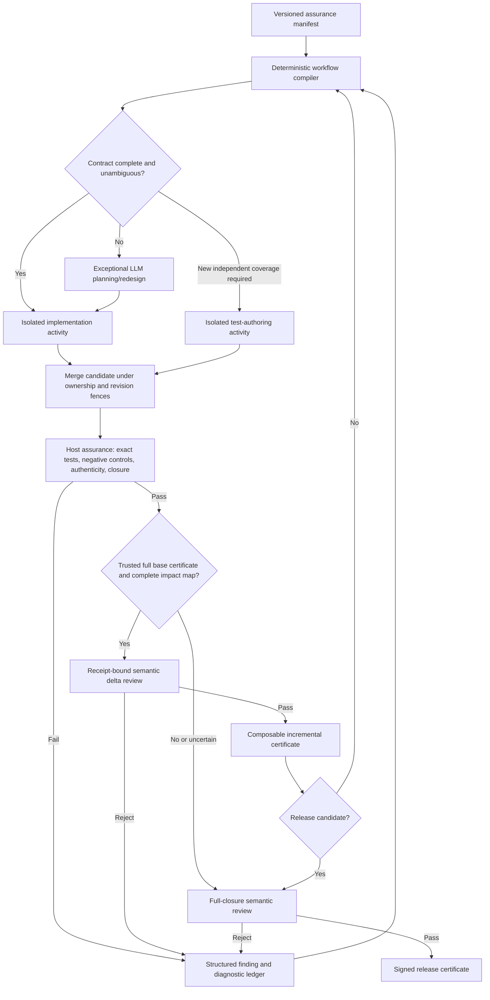

# Orchestrator v3 — disproportionate speed returns without assurance loss

Date: 22 July 2026  
Scope: `orchestrator-v3` as a software factory, with JAA as the measured production workload  
Decision type: analysis and proposed architecture; no factory or JAA code changed  

## Verdict

The largest safe gain is not another prompt reduction. It is to turn v3 from an LLM-directed
sequence of roles into a **deterministically compiled, incrementally certified execution graph**.

Six changes dominate the return:

1. Freeze one certified factory revision for the duration of a product production epoch.
2. Compile ordinary work directly from the assurance manifest; invoke an LLM planner only for
   genuine ambiguity or redesign.
3. Replace repeated full-source semantic review with receipt-bound semantic delta certification,
   while retaining a full-closure review at release and fail-closed escalation rules.
4. Persist and reuse every completed execution-graph node, including completed model calls, rather
   than caching only deterministic tests and external evidence.
5. Route roles through an evidence-gated model cascade instead of assigning the strongest model to
   every role.
6. Run independent implementation and test-authoring concurrently when their ownership is
   mechanically disjoint, then certify the merged result.

These are additive to E1–E6, not replacements for them. They retain the event log, isolation,
signed receipts, exact tests, negative controls, authenticity checks, independent semantic review,
revision fences and operator STOP. No recommendation below removes a terminal quality gate.

Against the already improved E1–E6 factory, the combined mature target is **35–55% fewer model
tokens and 1.8–2.8 times normal throughput** [estimate, confidence 0.72]. Against the historical
JAA/v3 co-development period, where factory defects repeatedly invalidated and restarted product
work, the saving could be **60–80% of tokens and 3–5 times throughput** [estimate, confidence 0.60].
These ranges are deliberately non-additive. They must be accepted only after replay benchmarks,
not treated as promised savings.

## Evidence boundary

This report is grounded in:

- the checked-out v3 source and its current E1–E6 certification records;
- the append-only v3 task log and its scorecard projection;
- the JAA efficiency/runtime audit and JAA handoff;
- the pinned local ECC checkout and its GIGA analysis;
- primary documentation or papers for the compared public systems.

The local v3 tree contains separately owned dirty isolation changes. It was read, not modified.
The production factory remained stopped. Historical scorecard categories are not all mutually
exclusive, and older events have less role-level telemetry than newer events; totals are therefore
used only where the scorecard defines them exactly.

## What the measurements actually say

### Whole observed JAA workload

The current append-only scorecard reports:

| Measure | Observed value |
|---|---:|
| Model attempts | 115 |
| Accepted attempts | 42 |
| Unique accepted task IDs | 41 |
| Rejected attempts | 73 |
| Total provider-reported tokens | 43,248,058 |
| Tokens per unique accepted task | 1,054,831 |
| Tokens attached to rejected work | 19,684,671 |
| Tokens attached to failed assurance | 16,495,512 |
| Tool calls | 336 |
| Recorded model wall time | 37,454 seconds |

`failed_work_tokens` and `failed_assurance_tokens` must not be added: assurance failures are a
subset of rejected work in the scorecard fold. The decisive fact is still that 73 of 115 attempts
were rejected and the observed rate exceeded one million tokens per accepted task [verified,
confidence 1.00].

### E1–E6 are valuable but not sufficient

The existing controls have proved real gains:

- Context containment reduced explicit builder/tester task envelopes to roughly 285 and 350
  estimated tokens. The two calls nevertheless consumed 61,055 and 49,262 provider-reported total
  tokens respectively—110,317 combined. This exposes substantial provider/harness/reasoning
  overhead outside the explicit task prompt [verified, confidence 1.00].
- Exact deterministic JAA work has demonstrated 15.4-times faster reuse, and one JAA-00 preflight
  fell from 116.75 seconds fresh to 4.21 seconds reused [verified, confidence 1.00].
- Host assurance can reject failed deterministic work before any semantic model call [verified,
  confidence 1.00].
- Complete-source zero-tool judging reduced the nearest preserved JAA comparison from 202,282 to
  48,805 tokens, a measured 75.9% reduction, although model and revision differed [verified
  measurement; causal attribution confidence 0.55].
- The JAA-01 deterministic host layer completed in approximately six seconds on exact cache hits,
  while semantic review could still consume 52k–70k tokens or hit a 1,200-second watchdog
  [verified, confidence 0.98].

But the same records also show the remaining structural problem:

- A complete four-role small project used 310,977 tokens and 213 seconds.
- The scorecard contains 141 shadow executions. Of 101 exact reuse candidates, all 101 matched,
  but shadow mode deliberately re-executed them. Only two active reuse hits appear in the present
  historical log.
- Recent successful JAA semantic judges commonly used about 48k–70k tokens per revision.
- During JAA production, v3 itself repeatedly changed to repair timeout recovery, checkpoint
  retention, post-build assurance, runtime selection, stale-checkpoint rebasing, diagnostic
  preservation and semantic transport. Those changes were legitimate factory repairs, but every
  control-plane change could invalidate operation identities and receipts.

The remaining dominant costs are therefore:

1. expensive roles invoked when a deterministic controller already knows the next action;
2. unchanged source repeatedly supplied to semantic review;
3. completed sub-work lost or invalidated at role/process boundaries;
4. the strongest model used indiscriminately;
5. independent work serialised even when it is mechanically conflict-free; and
6. product production and factory development occurring in the same certification epoch.

## Comparison with public orchestrators and adjacent systems

No single public system should replace v3. The useful move is to import specific execution
economics while preserving v3's stronger assurance boundary.

| System | Economically useful design | What v3 should adopt | What v3 should not copy |
|---|---|---|---|
| LangGraph | Checkpoints at graph supersteps and retained successful parallel writes; persisted task results avoid recomputation after resume. [Persistence](https://docs.langchain.com/oss/python/langgraph/persistence), [Functional API](https://docs.langchain.com/oss/python/langgraph/functional-api) | Durable node-level results and resume from the first invalid node | Treating a checkpoint alone as a correctness certificate |
| Temporal | Event-sourced durable workflows separate deterministic workflow decisions from retryable, idempotent activities. [Documentation](https://docs.temporal.io/), [architecture](https://github.com/temporalio/temporal/blob/main/docs/architecture/README.md) | Make model calls and external actions explicit activities with idempotency keys | Re-platforming v3 wholesale before its own execution contract is settled |
| Dagger / Bazel | Content-addressed operations are reused when all effective inputs match; side effects use different cache policies. [Dagger](https://github.com/dagger/dagger), [Dagger cache control](https://dagger.io/blog/cache-control-for-modules/), [Bazel remote caching](https://bazel.build/remote/caching) | Generalise v3's exact operation identity to every pure workflow node | Caching model claims as if they were deterministic truth |
| Agentless | A fixed localisation → repair → validation pipeline avoids open-ended autonomous tool loops. The paper reports competitive SWE-bench performance at low average cost. [Paper](https://arxiv.org/abs/2407.01489), [repository](https://github.com/OpenAutoCoder/Agentless) | An agentless fast path for manifest-bounded implementation and repair | Using its benchmark claims as proof that JAA's persistence and authority risks need less review |
| Aider | Dependency-ranked repository maps fit structural context into a small token budget; stable prefixes benefit from prompt caching. [Repo map](https://aider.chat/docs/repomap.html), [prompt caching](https://aider.chat/docs/usage/caching.html) | A receipt-bound dependency/interface map and stable role prefix | Replacing exact closure hashes with a lossy map |
| OpenHands | Immutable event streams, isolated runtimes, explicit budgets and context condensation. Its documentation reports up to two-times per-turn cost reduction from condensation on its evaluated workloads. [Architecture](https://docs.openhands.dev/sdk/arch/sdk), [runtime](https://docs.openhands.dev/openhands/usage/architecture/runtime), [condenser](https://docs.openhands.dev/sdk/guides/context-condenser) | Per-node budgets and retained execution events | Long conversational sessions as v3's default; v3's calls are deliberately ephemeral and should remain contamination-resistant |
| OpenAI Agents SDK | Built-in tracing spans and handoff input filters let a workflow retain observability while reducing forwarded history. [Tracing](https://openai.github.io/openai-agents-python/tracing/), [handoffs](https://openai.github.io/openai-agents-python/handoffs/), [models](https://openai.github.io/openai-agents-python/models/) | Explicit filtered role contracts and measured model routing | Free-form agent handoffs that bypass v3's controller contracts |
| AutoGen | GraphFlow expresses sequential, parallel, conditional and looping control while OpenTelemetry exposes runs. [GraphFlow](https://microsoft.github.io/autogen/dev/user-guide/agentchat-user-guide/graph-flow.html), [tracing](https://microsoft.github.io/autogen/stable/user-guide/agentchat-user-guide/tracing.html) | Structured concurrency and standard trace export | Conversation as the source of orchestration truth |
| SWE-agent | Full trajectories retain thoughts/actions/observations, configuration and logs for reproducibility. [Trajectories](https://github.com/SWE-agent/SWE-agent/blob/main/docs/usage/trajectories.md) | Replayable role-level evidence | Unbounded exploratory trajectories for already scoped work |
| MetaGPT / ChatDev | SOP-like role decomposition makes responsibilities explicit. [MetaGPT](https://arxiv.org/abs/2308.00352), [ChatDev](https://arxiv.org/abs/2307.07924) | Compile known SOPs into controller code | Adding more agents or more inter-agent conversation; both increase handoff tax |

### ECC's actual contribution

ECC here means the pinned `affaan-m/ECC` / Everything Claude Code corpus. It is not a superior
runtime engine to transplant. Its useful contribution is governance:

- capability surfaces should be loaded only when needed because every connector and instruction
  carries a context, runtime, privacy and supply-chain tax;
- evaluation should pin input, revision, model, configuration and grader;
- quality, cost, latency and variance should be measured together;
- missing or unavailable evidence must not be counted as a pass; and
- promotion should bind hashes and traces.

Those principles strengthen the activation gates below. Importing ECC wholesale would add surface
area and entropy without fixing v3's principal waste [inference, confidence 0.93].

## The six disproportionate changes

### 1. Freeze a certified production epoch

**Change.** Separate factory development from product production. A production epoch pins:

- orchestrator commit;
- assurance-manifest schema;
- runtime and dependency identity;
- isolation policy receipt;
- role/model/effort profile;
- prompt and judge contract hashes; and
- cache and evidence schemas.

JAA runs only on that epoch. Factory changes accumulate on another branch and enter production in
a scheduled promotion window after their own replay and regression certification.

**Why the return is disproportionate.** v3's cache keys correctly invalidate on policy, runtime,
code and configuration changes. During JAA development, continual v3 repair therefore converted
correct invalidation into chronic cache churn and repeatedly changed the execution semantics under
the product. Freezing makes the already certified E2/E3 cache useful rather than weakening its key.

**Assurance effect.** Positive. Evidence becomes easier to reproduce because a product receipt
refers to one immutable factory. Emergency P0 factory fixes remain possible, but explicitly close
the epoch and trigger targeted recertification.

**Estimated return.** On a stable factory, less than 5%. During a co-development period resembling
the historical JAA run, 15–35% fewer tokens and materially fewer interrupted repairs [estimate,
confidence 0.58].

**Implementation risk.** Very low. This is primarily an operational and release-governance change.

### 2. Compile manifests into workflows; make planning exceptional

**Change.** The assurance manifest already declares slice order, ownership, inputs, interfaces,
exact tests, evidence and negative controls. Compile that contract into a typed execution graph:

```text
slice ready
  -> implementation activity
  -> independent test-authoring activity (when new coverage is required)
  -> host assurance
  -> semantic certification
  -> signed component receipt
```

For a judge rejection, convert structured findings deterministically into one repair batch. Invoke
the LLM task manager only when:

- the manifest is incomplete or contradictory;
- ownership/dependency analysis is uncertain;
- two repair findings conflict;
- the same causal fingerprint recurs after a materially different repair; or
- a component redesign is required.

**Why the return is disproportionate.** The controller often already knows both the component and
the exact failed gate. Asking a general model to restate the next implement/test/validate sequence
adds a full model transition, can fragment one repair into several calls and can create avoidable
replanning loops. Agentless demonstrates the wider principle: bounded software repair does not
require an open-ended autonomous planner.

**Assurance effect.** Neutral to positive. Responsibility separation remains. The workflow becomes
more reproducible because scheduling is derived from versioned data rather than another model
opinion. A durable finding ledger must record finding ID, source revision, affected boundary,
severity, evidence, required regression coverage and resolution revision.

**Estimated return.** 5–15% fewer tokens and 10–25% less wall time on ordinary slices; 15–30% in
replanning-heavy repairs [estimate, confidence 0.68].

**Implementation risk.** Low to medium. The fail-closed escape is to invoke the existing planner
when the compiler cannot prove a valid graph.

### 3. Incremental semantic certificates, with full release review retained

**Change.** For a component previously certified at revision `R0`, review a change at `R1` using:

- the exact diff;
- all changed functions/classes/schemas;
- the mechanically computed affected caller/callee/import/interface closure;
- prior component certificate ID and unchanged-file hashes;
- current deterministic command receipts and negative controls;
- acceptance criteria affected by the change;
- unresolved finding ledger entries; and
- explicit uncertainty flags.

The controller still hashes and revision-fences the complete component closure. It supplies the
judge only the semantic delta package, not every unchanged byte. A delta certificate composes with
the prior full certificate but does not replace it. A full-closure semantic review remains required
for the release candidate.

Escalate automatically to full review when any of these is true:

- no trusted base certificate exists;
- manifest, public interface, schema, migration, authentication, authority or external side-effect
  boundaries changed;
- dynamic imports, reflection or generated code make impact analysis incomplete;
- changed code is outside declared ownership;
- deterministic coverage or dependency mapping is incomplete;
- the delta judge requests expansion; or
- a periodic/adversarial audit sample selects the revision.

**Why the return is disproportionate.** Current JAA judges often consume 48k–70k tokens to re-read
large production closures after comparatively small repairs. Host assurance has already proved the
tests, hashes and closure. The semantic model should spend its budget on what changed and what the
change can affect.

**Assurance effect.** Neutral only if completeness is mechanically established and full release
review remains. A source summary alone is unacceptable; the package must bind exact hashes and
expand fail-closed on uncertainty.

**Estimated return.** 50–80% fewer judge tokens and 40–75% lower judge latency on eligible repairs;
10–30% fewer total factory tokens depending on the judge share of the workload [estimate,
confidence 0.75].

**Implementation risk.** Medium. This must run in shadow mode beside full review until it has 100%
recall of all material findings in the replay/adversarial corpus.

### 4. Generalise content-addressed reuse to every execution-graph node

**Change.** E2/E3 currently give deterministic commands a strong operation identity. Extend the
same execution model to:

- manifest compilation;
- dependency/impact map construction;
- context-package construction;
- localisation;
- model invocation requests and completed outputs;
- test-authoring deltas;
- judge delta packages and verdicts; and
- receipt/certificate composition.

Each node records exact effective inputs, implementation version, output hash, status and
provenance. Pure nodes may be reused. Deterministic failed nodes may be reused only as known failed
evidence where appropriate; they never become passing receipts. Model outputs are not treated as
deterministic truth, but a completed output for an exact invocation ID is durably retained so a
controller crash or supervisor loss does not pay for the same call again. External side effects
remain non-cacheable or require explicit idempotency keys.

**Why the return is disproportionate.** v3's event sourcing resumes tasks, but the JAA run exposed
many seams where a model had already produced a useful delta or test set and the enclosing process
failed to return cleanly. The subsequent checkpoint repairs were correct but special-case driven.
A durable operation graph makes completed sub-work the default unit of recovery.

**Assurance effect.** Positive. Every reused result has a more precise lineage. The controller can
show exactly which nodes were fresh, reused, invalidated or abandoned.

**Estimated return.** 5–15% fewer tokens on healthy runs and 20–60% in timeout/restart/failure-heavy
episodes [estimate, confidence 0.66].

**Implementation risk.** Medium. Model-call identity must not imply semantic equivalence, and
side-effecting activities need explicit replay policy.

### 5. Evidence-gated role/model cascade

**Change.** The outage profile currently pins planner, builder, tester and judge to
`gpt-5.6-sol`, medium effort. Replace the universal assignment with deterministic routing classes:

| Work class | Initial route | Escalation |
|---|---|---|
| Manifest compilation and scheduling | host code; no model | task manager only on compiler uncertainty |
| Small bounded repair with exact failing evidence | fast/low-cost coding model, low or medium effort | Sol on failed post-build gate, low confidence or repeated causal fingerprint |
| Independent test authoring | fast coding model | Sol when boundary/persistence coverage is involved or authored tests fail ambiguously |
| Routine delta semantic review | efficient reasoning model | Sol/full review on high-risk boundary, uncertainty or disagreement |
| Schema, persistence, replay, authority, secrets or irreversible side effects | Sol-class model from the start | second independent review when policy requires |

Routing must use controller-visible facts—diff size, component risk tags, changed interfaces,
failure fingerprint and previous evidence—not a model's self-assessment.

**Why the return is disproportionate.** The strongest model is currently charged even for a
zero-tool JSON planner and routine tester work. Public agent SDKs increasingly recommend smaller,
lower-effort defaults for low-latency work, escalating when quality demands it. V3 can do this more
safely because every candidate still faces deterministic gates and independent review.

**Assurance effect.** Neutral only after a pinned replay evaluation proves equal material-defect
escape rates. A weaker first attempt is acceptable only when failure is cheap, visible and
automatically escalated; a weaker certificate is not.

**Estimated return.** 5–20% fewer tokens, 20–50% lower model wall time and a potentially larger
subscription/cost saving, depending on available model accounting [estimate, confidence 0.60].

**Implementation risk.** Medium. Activate role by role, beginning with exceptional planning and
routine test authoring, not high-risk semantic judgement.

### 6. Parallel independent build and test lanes under mechanical ownership

**Change.** For an eligible new component or repair, branch two isolated worktrees from the same
certified base:

- the builder may modify only declared production paths;
- the tester may modify only declared test/fixture paths;
- both receive the same acceptance contract but not each other's output;
- each returns a confined delta and trace;
- the controller rebases/merges both against the current epoch revision;
- conflicts, ownership violations or base drift fail closed; and
- host assurance and semantic review occur only on the combined candidate.

Existing one-writer-per-project behaviour remains the default when ownership is not provably
disjoint.

**Why the return is disproportionate.** Independent test authorship is valuable, but independence
does not require serial execution. The current worktree architecture already supplies much of the
isolation substrate.

**Assurance effect.** Neutral to positive. Tests remain independently authored. The exact common
base and both deltas become explicit evidence. No parallel lane can certify or merge itself.

**Estimated return.** 20–40% wall-time reduction on eligible feature slices, with approximately
zero token saving [estimate, confidence 0.73].

**Implementation risk.** Low to medium if restricted to mechanically disjoint ownership. Do not
enable speculative parallel agents that may edit the same component.

## Target architecture



Every box is a durable node with an input identity, output hash, timing, token/tool telemetry and
status. The append-only event log remains the source of operational truth; certificates are
projections over it, not substitutes for it.

## Why the estimates are not additive

Several changes remove the same tokens:

- freezing the factory increases cache validity, so some of its gain appears again under node
  reuse;
- deterministic workflow compilation removes planner calls that model routing would otherwise
  make cheaper;
- delta review reduces the judge workload that model routing would otherwise optimise; and
- parallelism shortens elapsed time but usually does not reduce tokens.

The proper experimental baselines are therefore:

1. **Historical baseline:** the complete recorded JAA scorecard.
2. **Current baseline:** frozen E1–E6, active caches, same JAA slice and same model profile.
3. **Candidate:** one change at a time on a replay corpus, then the combined profile.

For each baseline, report median and p90:

- provider tokens per accepted component;
- uncached input, cached input, output and reasoning tokens;
- model calls and tool calls per accepted component;
- wall time per accepted component;
- deterministic executions avoided;
- attempts rejected before model invocation;
- material findings per judge call;
- repair revisions per certificate;
- resumed nodes versus repeated nodes; and
- operator interventions.

## Non-negotiable no-regression gates

The phrase “without sacrificing quality” cannot be established by architecture rhetoric. Promotion
requires measured parity or improvement:

1. **No gate deletion.** Exact tests, negative controls, authenticity, evidence freshness,
   isolation, revision fences and independent semantic review remain mandatory where they are
   mandatory now.
2. **Finding recall.** Delta review must reproduce 100% of known material P0/P1 findings and 100%
   of all material findings in the pinned replay corpus before activation. Any miss forces design
   repair, not a lower target.
3. **Adversarial incompleteness controls.** Hidden dependency, dynamic import, schema drift,
   migration, symlink, stale certificate, changed runtime and changed policy drills must force full
   review or fail closed.
4. **Pass consistency.** Candidate role/model routes must match or improve the incumbent's `pass^k`
   and material escaped-defect rate on pinned tasks. `pass@k` alone is insufficient for autonomous
   production because repeated reliability matters.
5. **Terminal full review.** Every release receives full-closure semantic review against the exact
   release revision, regardless of incremental certificates.
6. **Audit completeness.** Every fresh, reused, invalidated, escalated, failed and abandoned node is
   represented in durable telemetry. Missing usage remains missing—not zero and not a pass.
7. **No cache trust expansion.** Model output reuse prevents duplicate billing after an exact
   completed call; it does not convert the output into executed or certified evidence.
8. **Rollback.** Every optimisation has a checked legacy/full mode and can be disabled without
   changing product source.

## Safest implementation sequence after migration

### Phase 0 — preserve the baseline

1. Settle the separately owned dirty isolation work and record the clean Gigabyte v3 commit.
2. Export the current JAA scorecard and pin its task-log hash.
3. Freeze a production epoch with the active E1–E6 settings.
4. Build a replay set from accepted, rejected, timed-out, tool-capped, stale-checkpoint and semantic
   rejection episodes. Do not spend live JAA tokens to discover basic regressions.

### Phase 1 — remove model calls the controller does not need

1. Add the structured finding ledger without changing scheduling.
2. Build a shadow manifest-to-workflow compiler.
3. Compare its steps with the existing task manager on the replay set.
4. Activate only for complete, unambiguous contracts; retain planner fallback.

This is the safest first code change because it does not alter tests, judging or merge gates.

### Phase 2 — make semantic assurance incremental

1. Build the exact impact/dependency package and certificate-composition schema.
2. Run delta and full judges side-by-side in shadow mode.
3. Inject completeness failures and known JAA findings.
4. Activate only after material-finding parity; retain automatic full-review escalation.

This is the largest direct token opportunity and therefore deserves the strongest activation gate.

### Phase 3 — durable operation graph

1. Represent the existing compiled workflow as durable nodes without changing execution.
2. Persist completed model-call outputs and context packages under exact invocation identities.
3. Prove crash-after-provider-return resumes without a second provider call.
4. Generalise reuse node by node; keep side effects non-reusable by default.

### Phase 4 — route and parallelise

1. Benchmark model routes per role and risk class using ECC-style pinned evaluation records.
2. Activate a cascade for the lowest-risk role first.
3. Add two-lane builder/tester execution only for disjoint ownership.
4. Measure the combined profile against both historical and current baselines.

### Phase 5 — only then resume sustained JAA production

Run JAA on the frozen epoch. Factory improvements wait for the next promotion window unless a P0
factory defect makes continued production unsafe. Report tokens and elapsed time per accepted JAA
slice, not only aggregate progress.

## Changes that look fast but are rejected

- Removing the independent tester or semantic judge.
- Raising tool, timeout or retry ceilings as the default response to a stalled role.
- Running more free-form agents in parallel.
- Trusting model-written summaries instead of exact source/receipt hashes.
- Reusing failed or stale receipts.
- Keeping long conversational model sessions merely to preserve cache; this risks context drift and
  contamination, and the existing Codex calls already suppress ambient context.
- Loading ECC, personal memory, plugins or broad repository rules into production roles.
- Treating a lower subscription charge as proof of lower token use or equal quality.
- Continuing to modify v3 and JAA simultaneously while expecting deterministic cache hit rates to
  rise.

## Ranked decision

| Rank | Change | Return | Safety | Recommended decision |
|---:|---|---|---|---|
| 1 | Freeze certified production epoch | Very high during current co-development | Very high | Do immediately |
| 2 | Manifest-compiled workflow / exceptional planner | High | High with fail-closed fallback | Implement first |
| 3 | Incremental semantic certificate | Highest direct token reduction | Medium until shadow parity | Implement second, activate cautiously |
| 4 | Durable content-addressed operation graph | High in recovery-heavy operation | High if model outputs remain untrusted | Implement third |
| 5 | Evidence-gated model cascade | Medium to high | Medium; benchmark-dependent | Implement role by role |
| 6 | Disjoint builder/tester parallelism | High wall-time return, little token return | High under ownership proof | Implement after workflow compiler |

## Final conclusion

V3 is not slow because assurance is inherently incompatible with speed. It is slow because its
assurance is repeatedly wrapped in expensive, general-purpose model turns and repeatedly applied
to unchanged work while the factory itself keeps moving.

The right design is **host-deterministic by default, model-semantic only where necessary,
incrementally certified during development, and fully certified at release**. That preserves what
makes v3 defensible while changing the unit of paid reasoning from “another role in another cycle”
to “the smallest uncertified semantic delta.”
